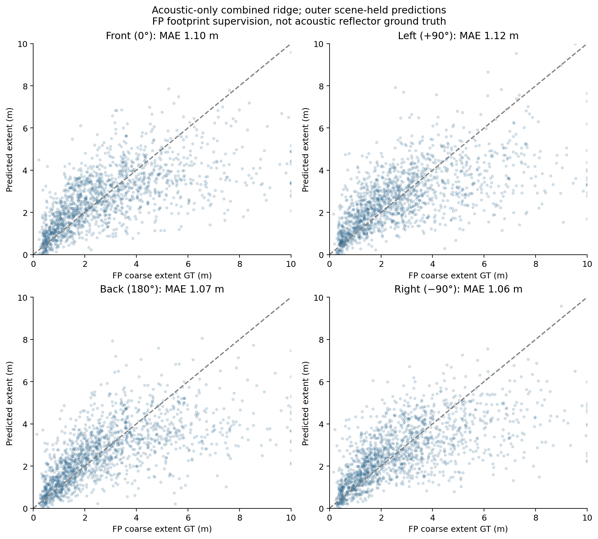
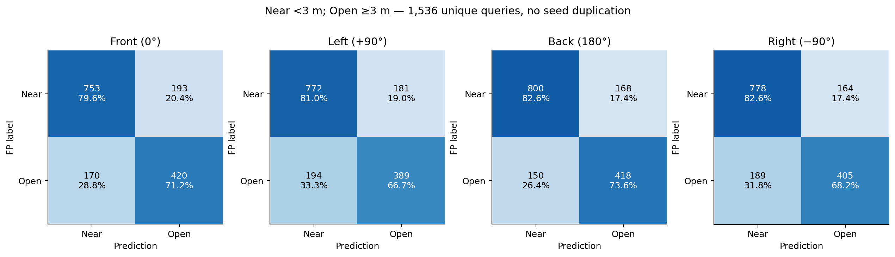
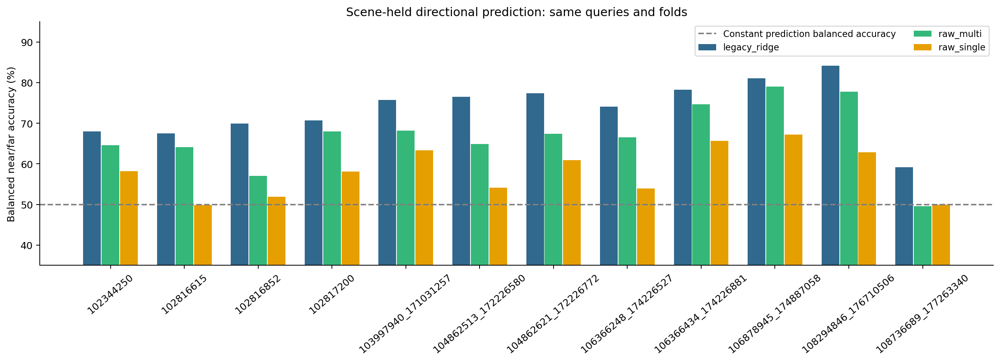
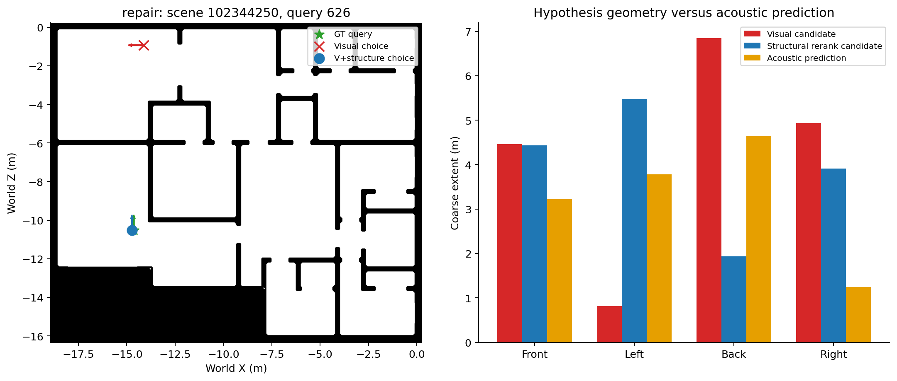
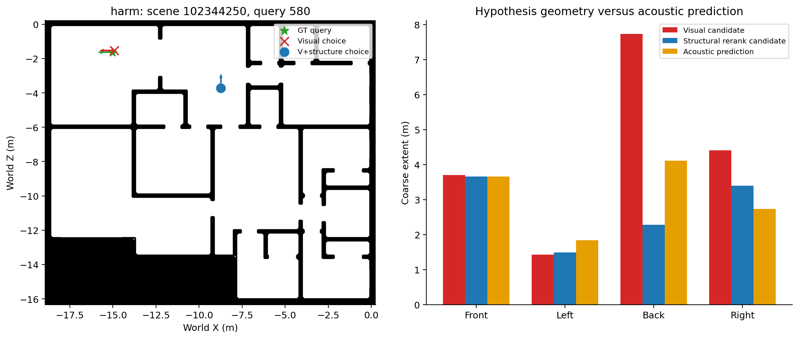
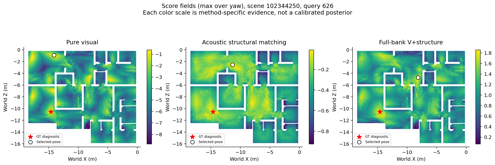
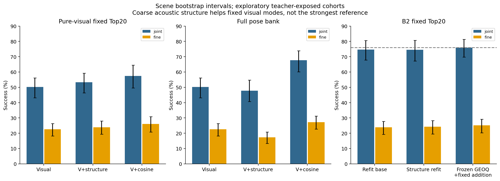

# Directional Acoustic Structural Evidence — Track A

## 결론과 증거 수준

6-channel RIR의 방향별 구조 단서는 순수 visual 후보 사이의 판별에 유용했다. 후보 좌표를 그대로 유지하고 visual score와 구조 일치 점수를 0.85/0.15로 결합하면 New12 joint가 50.20%→53.32%(+3.125%p, paired scene bootstrap 95% CI [2.018,4.297])로 개선됐다. 고정 방법의 Transfer11 결과도 49.08%→52.34%(+3.267%p, CI [2.202,4.332])였다. 그러나 기존 cosine fusion과 B2+GEOQ를 능가하지 못했다. 전체 공간에서 구조 점수로 pose를 다시 선택하면 정밀도가 떨어졌다. 따라서 기여는 **시각 후보의 위치를 유지한 모호성 해소**이며 기존 강한 시스템의 대체 성공이 아니다.

증거 수준은 **Exploratory**다. New12의 3개 outer fold는 8개 fit scene/4개 held scene으로 분리되지만, 모든 장면은 과거 연구와 visual teacher에 노출되었다. Transfer11도 새 독립 Test가 아니다. 2개 seed를 scene 내 평균한 뒤 12개 scene(transfer는11개)을 20,000회 bootstrap했다. 결정론적 ridge의 seed 복제는 독립 증거가 아니다. 다중 비교 보정은 하지 않았다. Test 관측·라벨·결과는 사용하지 않았다.

## 기존 Stage A 감사 및 물리적 조건

[AUDIT](AUDIT.md)와 `prior_replay.json`은 기존 24개 probe checkpoint의 96개 held prediction을 오차0으로 재현한다. 기존 manifest 3,723개 항목을 검증했다. 예전 raw_ridge는 raw waveform이 아니라 E/C/N 552차원이었다. Frozen embedding은128차원, combined ridge는680차원, 작은 MLP는680→64→4이며60epoch였다. 기존 MLP와 probe를 다시 학습하지 않았다.

실제 raw RIR을 query별로 추적해6채널·48kHz·수평반경5cm·중앙source·channel roll 및 metadata를 확인했다. 여러 yaw query는 동일 base RIR의 회전을 재사용하므로1536query가1536독립 rendering을 뜻하지 않는다. 공유 시간 원점을 보존한84차원 descriptor를 만들었다. Direct path 부근 peak는 별도 통계로 기록하며, peak를 특정 벽 반사로 간주하지 않는다. CNN token 순서를 방위각으로 해석하지 않았다.

목표는 각 body 방향 ±20°의5개 FP ray 중앙값, 최대10m이다. Front/Left/Back/Right는 logical raster [0,27,18,9]다. XZ forward=(cos yaw,sin yaw), body-left는 world yaw−90°이며 up×forward로 확인한다. Metric 목표는 log1p 거리; near<3m, ordinal 경계2m/5m를 고정했다. 2D blocked footprint는 감독 신호이며 3D 반사면 정답이 아니다. Query target은 연속 pose/1cm raycast, candidate geometry는10cm DESDF/20cm pose grid/36yaw여서 불일치가 남는다.

## 방향별 예측

아래 MAE/median/P90은 meter이며 scene별 통계를 평균했다. 특히 median/P90은 pooled quantile이 아니다. 거리 출력은 metric 계산에0–10m로 clip한다. BA는 balanced accuracy이며 기존77.07% ordinary accuracy와 다르다.

### Prediction baselines

| Model / arm | MAE m | Median m | P90 m | BA % | AUROC | Rank rho | Ordering % |
|---|---|---|---|---|---|---|---|
| cyclic_ecn/matched | 1.083 | 0.713 | 2.598 | 72.967 | 0.832 | 0.565 | 78.047 |
| legacy_embedding_ridge/matched | 1.073 | 0.724 | 2.532 | 74.413 | 0.834 | 0.565 | 78.144 |
| legacy_mlp/matched | 1.436 | 0.979 | 3.381 | 67.107 | 0.755 | 0.416 | 70.811 |
| legacy_raw_ridge/matched | 1.146 | 0.771 | 2.743 | 71.628 | 0.811 | 0.526 | 76.124 |
| legacy_ridge/matched | 1.088 | 0.728 | 2.580 | 73.529 | 0.825 | 0.519 | 75.794 |
| raw_isotropic/matched | 1.391 | 1.123 | 2.971 | 57.622 | 0.683 | 0.004 | 50.052 |
| raw_multi/matched | 1.178 | 0.821 | 2.703 | 66.820 | 0.772 | 0.386 | 68.855 |
| raw_multi/prior | 1.565 | 1.268 | 3.400 | 50.000 | 0.500 | -0.023 | 48.757 |
| raw_single/matched | 1.380 | 1.109 | 2.998 | 58.011 | 0.682 | -0.016 | 49.053 |

### cyclic_ecn / directions

| Model / arm | MAE m | Median m | P90 m | BA % | AUROC |
|---|---|---|---|---|---|
| Front | 1.122 | 0.752 | 2.719 | 72.396 | 0.838 |
| Left | 1.091 | 0.712 | 2.627 | 72.648 | 0.824 |
| Back | 1.095 | 0.726 | 2.605 | 72.178 | 0.830 |
| Right | 1.022 | 0.662 | 2.422 | 74.645 | 0.837 |

### legacy_embedding_ridge / directions

| Model / arm | MAE m | Median m | P90 m | BA % | AUROC |
|---|---|---|---|---|---|
| Front | 1.115 | 0.763 | 2.642 | 74.201 | 0.832 |
| Left | 1.111 | 0.753 | 2.599 | 73.144 | 0.826 |
| Back | 1.033 | 0.677 | 2.435 | 75.657 | 0.845 |
| Right | 1.032 | 0.689 | 2.442 | 74.648 | 0.832 |

### legacy_mlp / directions

| Model / arm | MAE m | Median m | P90 m | BA % | AUROC |
|---|---|---|---|---|---|
| Front | 1.502 | 1.037 | 3.435 | 67.378 | 0.759 |
| Left | 1.402 | 0.962 | 3.288 | 68.048 | 0.763 |
| Back | 1.380 | 0.938 | 3.231 | 67.705 | 0.765 |
| Right | 1.458 | 1.002 | 3.339 | 65.297 | 0.732 |

### legacy_raw_ridge / directions

| Model / arm | MAE m | Median m | P90 m | BA % | AUROC |
|---|---|---|---|---|---|
| Front | 1.176 | 0.817 | 2.827 | 72.619 | 0.820 |
| Left | 1.164 | 0.771 | 2.753 | 69.758 | 0.799 |
| Back | 1.136 | 0.745 | 2.686 | 72.019 | 0.821 |
| Right | 1.109 | 0.747 | 2.624 | 72.115 | 0.805 |

### legacy_ridge / directions

| Model / arm | MAE m | Median m | P90 m | BA % | AUROC |
|---|---|---|---|---|---|
| Front | 1.101 | 0.755 | 2.593 | 73.145 | 0.833 |
| Left | 1.118 | 0.766 | 2.627 | 71.503 | 0.811 |
| Back | 1.071 | 0.703 | 2.588 | 76.237 | 0.842 |
| Right | 1.063 | 0.723 | 2.473 | 73.231 | 0.815 |

### raw_isotropic / directions

| Model / arm | MAE m | Median m | P90 m | BA % | AUROC |
|---|---|---|---|---|---|
| Front | 1.405 | 1.126 | 3.021 | 56.839 | 0.697 |
| Left | 1.413 | 1.136 | 2.975 | 58.133 | 0.678 |
| Back | 1.377 | 1.100 | 2.908 | 58.569 | 0.686 |
| Right | 1.371 | 1.113 | 2.903 | 56.949 | 0.669 |

### raw_multi / directions

| Model / arm | MAE m | Median m | P90 m | BA % | AUROC |
|---|---|---|---|---|---|
| Front | 1.194 | 0.834 | 2.734 | 66.693 | 0.775 |
| Left | 1.198 | 0.848 | 2.757 | 66.833 | 0.765 |
| Back | 1.170 | 0.802 | 2.609 | 67.305 | 0.778 |
| Right | 1.152 | 0.796 | 2.679 | 66.447 | 0.769 |

### raw_single / directions

| Model / arm | MAE m | Median m | P90 m | BA % | AUROC |
|---|---|---|---|---|---|
| Front | 1.398 | 1.131 | 3.003 | 57.580 | 0.691 |
| Left | 1.396 | 1.112 | 2.958 | 59.051 | 0.683 |
| Back | 1.360 | 1.081 | 2.923 | 58.768 | 0.691 |
| Right | 1.368 | 1.117 | 2.886 | 56.645 | 0.665 |

## 반증 대조와 불확실성

Raw multi와 같은84차원/동일 ridge/동일4출력의 canonical channel-sort 대조는 절대 channel identity를 제거한다. Permutation 불변성을 raw에서 검사했다. Multi−symmetric BA +8.300%p [5.646,10.849], ordering +20.773%p [17.855,23.553]이다. 이는 단순 room prior만으로 모든 결과를 설명하기 어렵게 하지만 physical DoA를 입증하지 않는다. Cyclic probe는6회 회전 증강과36방향 supervision을 사용하여4출력 probe와 감독량이 다르다.

### Raw controls

| Model / arm | MAE m | Median m | P90 m | BA % | AUROC | Rank rho | Ordering % |
|---|---|---|---|---|---|---|---|
| cyclic_ecn/donor1 | 1.821 | 1.527 | 3.761 | 48.958 | 0.477 | -0.155 | 42.453 |
| cyclic_ecn/donor17 | 1.797 | 1.502 | 3.726 | 49.960 | 0.496 | -0.001 | 50.521 |
| cyclic_ecn/donor31 | 1.830 | 1.540 | 3.759 | 48.350 | 0.473 | -0.015 | 49.097 |
| cyclic_ecn/isotropic_prediction | 1.408 | 1.069 | 3.078 | 57.750 | 0.687 | 0.000 | 50.000 |
| cyclic_ecn/matched | 1.083 | 0.713 | 2.598 | 72.967 | 0.832 | 0.565 | 78.047 |
| cyclic_ecn/prior | 1.565 | 1.268 | 3.400 | 50.000 | 0.500 | -0.023 | 48.757 |
| cyclic_ecn/rolled | 1.073 | 0.728 | 2.491 | 72.399 | 0.817 | 0.563 | 77.302 |
| raw_multi/donor1 | 1.677 | 1.323 | 3.592 | 51.100 | 0.517 | -0.120 | 44.144 |
| raw_multi/donor17 | 1.718 | 1.435 | 3.572 | 50.084 | 0.497 | 0.017 | 51.169 |
| raw_multi/donor31 | 1.756 | 1.498 | 3.538 | 48.041 | 0.468 | -0.036 | 48.195 |
| raw_multi/isotropic_prediction | 1.372 | 1.084 | 2.965 | 58.986 | 0.688 | 0.000 | 50.000 |
| raw_multi/matched | 1.178 | 0.821 | 2.703 | 66.820 | 0.772 | 0.386 | 68.855 |
| raw_multi/permuted | 1.376 | 1.040 | 3.036 | 59.969 | 0.674 | 0.074 | 53.362 |
| raw_multi/prior | 1.565 | 1.268 | 3.400 | 50.000 | 0.500 | -0.023 | 48.757 |
| raw_multi/rolled | 1.121 | 0.777 | 2.540 | 66.692 | 0.776 | 0.420 | 70.133 |

### Feature isolation

| Model / arm | MAE m | Median m | P90 m | BA % | AUROC | Rank rho | Ordering % |
|---|---|---|---|---|---|---|---|
| C_early | 1.245 | 0.846 | 2.935 | 68.591 | 0.777 | 0.533 | 76.501 |
| C_full_window | 1.228 | 0.828 | 2.972 | 69.488 | 0.782 | 0.532 | 76.441 |
| E_energy | 1.551 | 1.258 | 3.363 | 50.000 | 0.561 | 0.126 | 55.899 |
| N_envelope | 1.407 | 1.081 | 3.144 | 58.205 | 0.672 | 0.137 | 56.471 |

E/N은 각각48차원, coherence early/full은 각각228차원이다. Early는50ms미만, full은2–128ms로 late-only 대조가 아니다. E의 약한 성능은 정규화/표준편차floor/regularizer에 의존할 수 있어 energy 정보 부재로 해석하지 않는다. Complex channel 관계의 유용성은 특정 반사 경로 식별과 다르다.

불확실성은 fit scene의 inner-OOF residual로 학습했다. Held fixed90 interval의 방향별 coverage는91.28/91.47/90.95/91.93%, log halfwidth는0.6255/0.6488/0.6127/0.6158이다. Learned error scale은 calibrated posterior가 아니다. Fit uncertainty 출력은 regressor에 대해 in-sample이므로 GEOQ 결합 feature에서는 제외했다.

Repeat diagnostic은 기존4개 acoustic-training scene의8개Observed pose와32개FP pose를 재사용한다. Observed의 반복간 평균 거리 차이는0.418m, near-label agreement82.81%; FP는0.386m/87.50%다. 실제 센서 반복성이나 새로운 scene 일반화 증거가 아니다.

## 순수 Visual 후보와 B2 후보 판별

Pure visual fullbank 점수만으로 NMS(1m/30°) Top20을 구성했다. B2 Top20과 별도 평가한다. 쌍 선택은 fit-only visual gap 하위1/3, 후보 간 거리≥1m, FP log-geometry 차이≥0.15이며 GT는 이후 good/bad label에만 사용했다. High ambiguity는 fit-only top1–top2 visual gap 하위1/3이다. Candidate 내 z-score fusion과 fullbank z-score fusion은 다른 실험이다.

### pure_visual

| Model / arm | Joint % | R@0.1m % | Ambiguous pair % | Ranking AUC | Success rank | High ambiguity % | Repair % | Harm % |
|---|---|---|---|---|---|---|---|---|
| cosine | 47.005 | 20.964 | 84.403 | 0.890 | 2.556 | 43.087 | 17.708 | 20.898 |
| cyclic_ecn_geometry | 16.081 | 5.664 | 71.440 | 0.734 | 5.513 | 14.958 | 5.599 | 39.714 |
| cyclic_ecn_visual_geometry | 53.190 | 24.154 | 68.963 | 0.855 | 3.003 | 30.494 | 5.078 | 2.083 |
| direction_shuffled_geometry | 6.901 | 2.409 | 60.455 | 0.571 | 8.582 | 8.124 | 3.190 | 46.484 |
| donor17_geometry | 5.729 | 2.083 | 52.664 | 0.524 | 9.470 | 5.460 | 2.083 | 46.549 |
| donor1_geometry | 7.943 | 2.995 | 54.686 | 0.550 | 8.977 | 8.460 | 3.385 | 45.638 |
| donor31_geometry | 4.232 | 1.628 | 50.993 | 0.512 | 9.682 | 3.434 | 1.628 | 47.591 |
| geometry_prior | 5.273 | 2.148 | 53.775 | 0.535 | 9.227 | 4.711 | 2.083 | 47.005 |
| isotropic_geometry | 9.961 | 3.906 | 63.119 | 0.616 | 7.690 | 9.055 | 3.776 | 44.010 |
| legacy_embedding_ridge_geometry | 18.164 | 6.901 | 72.663 | 0.744 | 5.323 | 16.701 | 7.552 | 39.583 |
| legacy_embedding_ridge_visual_geometry | 54.036 | 24.414 | 69.129 | 0.857 | 2.977 | 32.578 | 6.120 | 2.279 |
| legacy_ridge_geometry | 17.643 | 6.250 | 72.852 | 0.746 | 5.313 | 14.838 | 6.576 | 39.128 |
| legacy_ridge_visual_geometry | 53.320 | 23.893 | 69.331 | 0.856 | 2.987 | 31.563 | 5.273 | 2.148 |
| ordinal_geometry | 31.315 | 13.672 | 62.650 | 0.634 | 5.049 | 24.282 | 5.924 | 24.805 |
| query_only | 50.195 | 22.526 | 50.000 | 0.500 | 3.349 | 24.260 | 0.000 | 0.000 |
| raw_multi_geometry | 13.867 | 4.948 | 68.046 | 0.687 | 6.381 | 12.633 | 5.534 | 41.862 |
| raw_multi_visual_geometry | 51.758 | 23.177 | 66.180 | 0.851 | 3.074 | 27.098 | 4.622 | 3.060 |
| visual | 50.195 | 22.526 | 56.808 | 0.836 | 3.349 | 24.260 | 0.000 | 0.000 |
| visual_cosine | 57.487 | 26.042 | 76.876 | 0.872 | 2.709 | 41.475 | 8.464 | 1.172 |
| visual_ordinal | 52.018 | 23.372 | 63.920 | 0.848 | 3.142 | 28.788 | 4.102 | 2.279 |

### B2

| Model / arm | Joint % | R@0.1m % | Ambiguous pair % | Ranking AUC | Success rank | High ambiguity % | Repair % | Harm % |
|---|---|---|---|---|---|---|---|---|
| GEOQ | 75.977 | 25.065 | 93.267 | 0.916 | 1.950 | 67.006 | 30.306 | 4.167 |
| cosine | 39.551 | 12.012 | 66.958 | 0.687 | 3.523 | 34.936 | 17.350 | 27.637 |
| cyclic_ecn_geometry | 19.857 | 2.051 | 61.839 | 0.601 | 5.680 | 17.104 | 7.845 | 37.826 |
| cyclic_ecn_visual_geometry | 52.702 | 20.573 | 59.691 | 0.664 | 3.197 | 35.552 | 5.794 | 2.930 |
| direction_shuffled_geometry | 15.495 | 1.758 | 55.269 | 0.534 | 6.655 | 13.994 | 6.641 | 40.983 |
| donor17_geometry | 10.677 | 0.749 | 51.956 | 0.508 | 7.165 | 10.717 | 4.655 | 43.815 |
| donor1_geometry | 13.086 | 1.628 | 53.096 | 0.532 | 6.712 | 10.877 | 5.176 | 41.927 |
| donor31_geometry | 9.538 | 0.944 | 49.305 | 0.496 | 7.409 | 8.586 | 3.711 | 44.010 |
| geometry_prior | 10.872 | 1.009 | 51.765 | 0.516 | 7.028 | 8.827 | 3.581 | 42.546 |
| isotropic_geometry | 16.211 | 1.953 | 58.218 | 0.564 | 6.061 | 15.782 | 6.803 | 40.430 |
| legacy_embedding_ridge_geometry | 20.573 | 2.604 | 62.919 | 0.609 | 5.511 | 19.436 | 8.431 | 37.695 |
| legacy_embedding_ridge_visual_geometry | 52.865 | 20.671 | 60.373 | 0.666 | 3.165 | 35.950 | 6.250 | 3.223 |
| legacy_ridge_geometry | 20.215 | 2.507 | 62.924 | 0.610 | 5.509 | 17.419 | 7.520 | 37.142 |
| legacy_ridge_visual_geometry | 52.995 | 20.736 | 60.459 | 0.666 | 3.152 | 36.447 | 6.185 | 3.027 |
| ordinal_geometry | 41.764 | 10.775 | 59.047 | 0.567 | 3.930 | 37.715 | 17.513 | 25.586 |
| query_only | 73.438 | 24.642 | 50.000 | 0.500 | 1.685 | 65.152 | 28.158 | 4.557 |
| raw_multi_geometry | 17.122 | 2.148 | 59.808 | 0.581 | 5.902 | 14.207 | 6.641 | 39.355 |
| raw_multi_visual_geometry | 51.042 | 20.020 | 58.695 | 0.662 | 3.254 | 32.460 | 5.469 | 4.264 |
| visual | 49.837 | 19.434 | 53.967 | 0.652 | 3.366 | 29.788 | 0.000 | 0.000 |
| visual_cosine | 59.505 | 23.730 | 62.765 | 0.677 | 2.786 | 48.274 | 11.263 | 1.595 |
| visual_ordinal | 50.326 | 19.173 | 58.611 | 0.661 | 3.266 | 31.478 | 4.069 | 3.581 |

Pair tie는0.5, Top1 tie는 첫 후보로 처리한다. Query-only constant는 pose 정보가 없고 pureV의 첫 후보를 유지한다. Success rank는 성공 후보가 있는 query에 조건부다. Repair/harm은 동일 후보 집합의 visual 대비 전체query 비율이다.

사례는 고정 GT-free pair 조건을 만족하는 첫 repair/harm을 사후 선택한 설명 그림이다. 빈도 근거는 전체 집계 표이며 harm도 제시한다.

## Full SE(2) structural matching と統合

Structural scoreはquery predicted log geometryと候補FP geometryの平均絶対残差の負値。推論にFP-RIR reference bankを必要としないが、frozen query encoderの過去contrastive学習にはFP-RIRが使われている。このbaselineをTrack B独立frameworkの達成と扱わない。Ordinal、direction-centered similarity、uncertainty weighting、geometry prior、donor、direction shuffleも評価した。GT-neighborhood score massはtemperature1の記述統計で、確率校正されていない。

### Full bank

| Model / arm | Joint % | Fine % | R@1m % | Top5 % | Top20 % | GT score mass |
|---|---|---|---|---|---|---|
| cosine | 20.768 | 4.036 | 32.292 | 54.883 | 84.375 | 0.007 |
| cosine_structure | 21.289 | 4.883 | 32.096 | 58.333 | 87.174 | 0.015 |
| direction_structure | 1.953 | 0.065 | 3.581 | 8.268 | 25.260 | 0.007 |
| donor_structure | 0.456 | 0.065 | 3.516 | 2.799 | 10.612 | 0.005 |
| geometry_prior | 0.521 | 0.000 | 4.102 | 2.474 | 10.612 | 0.005 |
| ordinal_structure | 0.781 | 0.000 | 2.214 | 3.516 | 11.914 | 0.006 |
| shuffled_structure | 1.172 | 0.065 | 10.091 | 5.404 | 17.643 | 0.005 |
| structure | 4.297 | 0.065 | 10.091 | 15.104 | 43.750 | 0.006 |
| uncertainty_structure | 4.167 | 0.065 | 10.026 | 15.039 | 43.294 | 0.009 |
| visual | 50.195 | 22.526 | 51.172 | 74.089 | 90.690 | 0.046 |
| visual_cosine | 67.708 | 27.214 | 69.401 | 92.448 | 98.698 | 0.012 |
| visual_structure | 47.786 | 17.253 | 49.219 | 76.367 | 92.578 | 0.011 |

### Full bank / high visual ambiguity

| Model / arm | Joint % | Top5 % | Top20 % |
|---|---|---|---|
| cosine | 19.205 | 53.512 | 82.758 |
| cosine_structure | 21.070 | 56.030 | 84.715 |
| direction_structure | 1.822 | 7.336 | 25.661 |
| donor_structure | 0.732 | 2.981 | 10.317 |
| geometry_prior | 1.136 | 3.287 | 9.664 |
| ordinal_structure | 0.967 | 4.415 | 12.104 |
| shuffled_structure | 1.238 | 6.816 | 18.730 |
| structure | 3.826 | 16.171 | 43.469 |
| uncertainty_structure | 3.284 | 14.970 | 41.784 |
| visual | 24.260 | 61.480 | 89.900 |
| visual_cosine | 57.790 | 92.146 | 99.421 |
| visual_structure | 31.525 | 72.418 | 93.243 |

### Full bank / preservation

| Model / arm | Conditional joint % | Repair % | Harm % | Visual preservation % |
|---|---|---|---|---|
| cosine | 24.379 | 9.180 | 38.607 | 22.832 |
| cosine_structure | 24.232 | 9.570 | 38.477 | 22.711 |
| direction_structure | 6.160 | 0.781 | 49.023 | 2.049 |
| donor_structure | 12.219 | 0.260 | 50.000 | 0.520 |
| geometry_prior | 6.097 | 0.326 | 50.000 | 0.355 |
| ordinal_structure | 6.015 | 0.391 | 49.805 | 0.655 |
| shuffled_structure | 6.588 | 0.651 | 49.674 | 0.907 |
| structure | 9.044 | 1.823 | 47.721 | 4.573 |
| uncertainty_structure | 9.099 | 1.953 | 47.982 | 4.125 |
| visual | 54.696 | 0.000 | 0.000 | 100.000 |
| visual_cosine | 68.528 | 23.633 | 6.120 | 86.445 |
| visual_structure | 50.914 | 11.003 | 13.411 | 72.099 |

### Matched-budget GEOQ integration

| Model / arm | Joint % | Fine % | Pair % |
|---|---|---|---|
| base | 74.707 | 23.828 | 92.700 |
| donor | 74.642 | 24.284 | 92.897 |
| fixed_addition | 75.977 | 25.098 | 93.284 |
| matched | 74.544 | 24.251 | 92.555 |
| nuisance | 74.707 | 23.828 | 92.606 |

E0는 기존GEOQ, E1은 V+structure, E2는 cosine+structure, E3는 기존156feature에 구조8+상대8을 추가한172feature GEOQ 재학습이다. E4는 direction-centered matching 대안이다. 별도로 donor/nuisance 동일용량 대조와 고정0.05score addition도 수행했다. 150iteration/15leaf/최소leaf100의 동일 설정이다. Matched 결합은 GEOQ 대비 joint−1.432%p CI[−2.962,−0.130]였다. 고정addition은 joint가 같고 미세한 fine 차이를 확정 개선으로 보지 않는다. 기존GEOQ를 유지한다.

추론에 사용할 수 없는 true4방향 geometry oracle도 fullbank joint51.11%, Top20 98.96%였다. 4방향 요약은 유일한 pose 식별에 불충분하며 예측 오차도 큰 추가 요인이다. Oracle은 진단용이고 추론에 넣지 않는다. Fullbank V+structure는 전체query에서 joint−2.409%p/fine−5.273%p였지만 후보 위치를 고정한 재정렬은 개선됐다. 구조 신호는 거친 mode 판별을 지원하지만 연속 pose peak를 움직이기에는 불충분하다는 해석과 일치한다.

## 固定方法のTransfer11

### Transfer

| Model / arm | Joint % | Fine % | Pair % | Ranking AUC | Repair % | Harm % |
|---|---|---|---|---|---|---|
| cosine | 43.608 | 21.094 | 84.024 | 0.881 | 16.051 | 21.520 |
| donor | 5.398 | 1.776 | 54.377 | 0.527 | 2.770 | 46.449 |
| prior | 6.747 | 1.989 | 54.850 | 0.542 | 3.267 | 45.597 |
| structure | 18.537 | 8.381 | 74.763 | 0.754 | 7.884 | 38.423 |
| visual | 49.077 | 22.443 | 58.198 | 0.826 | 0.000 | 0.000 |
| visual_cosine | 54.972 | 25.355 | 76.387 | 0.857 | 7.031 | 1.136 |
| visual_donor | 47.301 | 21.946 | 57.671 | 0.825 | 3.196 | 4.972 |
| visual_structure | 52.344 | 24.290 | 71.729 | 0.847 | 4.830 | 1.562 |

### Transfer existing baselines

| Model / arm | Joint % | Fine % |
|---|---|---|
| B2 | 70.135 | 24.645 |
| GEOQ | 74.219 | 25.852 |
| fullbank_fixed_fusion | 66.335 | 26.562 |
| support | 72.408 | 24.929 |

계수·fit scene·checkpoint hash·ambiguity threshold를 transfer score 계산 전에 고정했다. 11scene 모두 V+structure−V joint 차이는 양수였지만 기존cosine fusion/GEOQ를 넘지 못했다. 새로운 미사용scene 독립검증은 미실시다.

## 비용·재현성과 한계

아래 시간은 측정 구간이 달라 speedup 비율을 주장하지 않는다. Structure는 CPU4방식 합계, cosine은 GPU query×reference 행렬곱, visual은 CPU score 계산이다. Encoder 전처리·RIR 생성 비용은 제외한다. Full wall에는 NMS/IO가 포함된다. FP embedding과4방향geometry byte는 dtype을 포함한 표현 크기이며 raw reference RIR 총량이 아니다.

| Scene | Poses | Struct4 CPU s | Cosine GPU s | Visual CPU s | FP embedding bytes | Geometry bytes |
|---|---:|---:|---:|---:|---:|---:|
| 102344250 | 200988 | 1.264 | 0.119 | 2.229 | 102905856 | 3215808 |
| 102817200 | 181980 | 1.142 | 0.072 | 1.129 | 93173760 | 2911680 |
| 104862621_172226772 | 132192 | 0.823 | 0.054 | 0.779 | 67682304 | 2115072 |
| 106878945_174887058 | 104184 | 0.656 | 0.042 | 0.628 | 53342208 | 1666944 |
| 102816615 | 98100 | 0.605 | 0.039 | 0.582 | 50227200 | 1569600 |
| 103997940_171031257 | 542664 | 3.387 | 0.196 | 6.841 | 277843968 | 8682624 |
| 106366248_174226527 | 54792 | 0.343 | 0.020 | 0.344 | 28053504 | 876672 |
| 108294846_176710506 | 239580 | 1.517 | 0.095 | 1.459 | 122664960 | 3833280 |
| 102816852 | 71892 | 0.459 | 0.010 | 0.451 | 36808704 | 1150272 |
| 104862513_172226580 | 114840 | 0.771 | 0.045 | 0.713 | 58798080 | 1837440 |
| 106366434_174226881 | 153144 | 1.081 | 0.062 | 0.993 | 78409728 | 2450304 |
| 108736689_177263340 | 26784 | 0.198 | 0.010 | 0.216 | 13713408 | 428544 |

## 가설 판정과 다음 반증 예측

- H1: 거친 방향별 FP구조 관계를 지지한다. 정밀DoA/벽별 반사 식별은 미증명이다.
- H2: scene prior만이라는 설명은 donor/channel/동일용량 비방향 대조로 약해진다. Dataset 고유 shortcut 전반을 배제할 수는 없다.
- H3: 고정pureV 후보 재정렬에 한정해 지지한다. Fullbank metric localization 개선으로 일반화하지 않는다.
- H4: cosine/GEOQ를 넘는 추가 정보의 실용 가치는 미확인이다. Matched 재학습은 부정 결과다.
- H5: metric 불확실성·먼 거리 과소추정·fine 저하는 지지 증거다. Ordinal로만 대체하면 된다고 말할 수 없다.
- H6: 현 조건에서 방향 정보를 전혀 관측할 수 없다는 강한 주장은 대조 결과와 모순된다. 물리적 방향 분해능·실측 강건성은 미해결이다.

전이 가설: 거친 acoustic 구조는 시각이 제안한 떨어진 mode 사이 선택에 유용하고, mode 내부 정밀 위치를 움직이면 harm이 증가한다. 새로운 미사용scene/실측RIR에서 visual 좌표 고정과 자유 재최적화를 사전등록하여 비교하면 반증 가능하다. 이번 결과를 미실시 실험의 결론으로 대체하지 않는다.

새 checkpoint73개를 생성했다(prediction24, uncertainty6, integration24, symmetric6, feature12, transfer1). 가중치·waveform·raw 예측은 로컬에 보존한다. 기존 연구·strong baseline·Track B는 변경하지 않는다. 실행 코드·hash와 재현 절차는 최종provenance/재현 문서로 추적한다. 최종 완료는 model replay·산출물manifest·요건감사·Docs/index 검증과 동기화 후 판정한다.
### Ordinal and ordinary openness accuracy

| Model / arm | Ordinal % | Ordinary openness % |
|---|---|---|
| cyclic_ecn/donor1 | 40.902 | 55.957 |
| cyclic_ecn/donor17 | 41.878 | 56.999 |
| cyclic_ecn/donor31 | 41.325 | 55.534 |
| cyclic_ecn/isotropic_prediction | 53.906 | 67.985 |
| cyclic_ecn/matched | 66.423 | 77.767 |
| cyclic_ecn/prior | 42.188 | 61.995 |
| cyclic_ecn/rolled | 65.690 | 77.848 |
| legacy_embedding_ridge/donor | 42.464 | 55.208 |
| legacy_embedding_ridge/matched | 66.032 | 77.669 |
| legacy_embedding_ridge/prior | 42.188 | 61.995 |
| legacy_embedding_ridge/rolled | 66.227 | 77.458 |
| legacy_mlp/donor | 40.454 | 55.794 |
| legacy_mlp/matched | 58.114 | 71.159 |
| legacy_mlp/prior | 42.188 | 61.995 |
| legacy_mlp/rolled | 57.528 | 69.621 |
| legacy_raw_ridge/donor | 41.374 | 56.266 |
| legacy_raw_ridge/matched | 63.932 | 75.570 |
| legacy_raw_ridge/prior | 42.188 | 61.995 |
| legacy_raw_ridge/rolled | 63.639 | 74.658 |
| legacy_ridge/donor | 41.602 | 55.257 |
| legacy_ridge/matched | 65.413 | 77.067 |
| legacy_ridge/prior | 42.188 | 61.995 |
| legacy_ridge/rolled | 65.544 | 76.058 |
| raw_isotropic/donor1 | 49.105 | 63.639 |
| raw_isotropic/donor17 | 44.238 | 60.221 |
| raw_isotropic/donor31 | 42.611 | 60.384 |
| raw_isotropic/isotropic_prediction | 52.930 | 67.855 |
| raw_isotropic/matched | 52.604 | 67.513 |
| raw_isotropic/prior | 42.188 | 61.995 |
| raw_multi/donor1 | 45.622 | 58.822 |
| raw_multi/donor17 | 42.936 | 57.943 |
| raw_multi/donor31 | 41.748 | 56.152 |
| raw_multi/isotropic_prediction | 53.060 | 68.604 |
| raw_multi/matched | 61.279 | 73.307 |
| raw_multi/permuted | 54.525 | 67.822 |
| raw_multi/prior | 42.188 | 61.995 |
| raw_multi/rolled | 63.542 | 74.154 |
| raw_single/donor1 | 49.447 | 64.372 |
| raw_single/donor17 | 43.766 | 60.010 |
| raw_single/donor31 | 43.490 | 59.912 |
| raw_single/isotropic_prediction | 52.995 | 68.278 |
| raw_single/matched | 52.718 | 67.920 |
| raw_single/prior | 42.188 | 61.995 |

### Candidate conditional metrics and margins

| Model / arm | R@1m % | Conditional joint % | Preservation % | Success-failure margin |
|---|---|---|---|---|
| B2/GEOQ | 77.311 | 76.557 | 90.752 | 0.625 |
| B2/cosine | 44.727 | 39.839 | 43.812 | 0.672 |
| B2/cyclic_ecn_geometry | 23.958 | 19.988 | 23.234 | 0.049 |
| B2/cyclic_ecn_visual_geometry | 53.841 | 53.074 | 93.509 | 0.559 |
| B2/direction_shuffled_geometry | 23.405 | 15.613 | 16.976 | 0.021 |
| B2/donor17_geometry | 15.365 | 10.752 | 11.836 | 0.008 |
| B2/donor1_geometry | 18.457 | 13.180 | 15.117 | 0.019 |
| B2/donor31_geometry | 14.323 | 9.609 | 11.432 | 0.002 |
| B2/geometry_prior | 15.169 | 10.950 | 14.388 | 0.011 |
| B2/isotropic_geometry | 22.201 | 16.323 | 18.208 | 0.031 |
| B2/legacy_embedding_ridge_geometry | 25.130 | 20.712 | 23.173 | 0.052 |
| B2/legacy_embedding_ridge_visual_geometry | 54.069 | 53.234 | 92.778 | 0.562 |
| B2/legacy_ridge_geometry | 25.553 | 20.369 | 24.977 | 0.053 |
| B2/legacy_ridge_visual_geometry | 54.232 | 53.376 | 93.380 | 0.564 |
| B2/ordinal_geometry | 45.475 | 42.056 | 47.792 | 0.047 |
| B2/query_only | 74.935 | 73.989 | 89.797 | 0.000 |
| B2/raw_multi_geometry | 22.917 | 17.239 | 20.434 | 0.040 |
| B2/raw_multi_visual_geometry | 52.572 | 51.406 | 90.971 | 0.547 |
| B2/visual | 51.237 | 50.195 | 100.000 | 0.592 |
| B2/visual_cosine | 61.003 | 59.947 | 96.360 | 0.604 |
| B2/visual_ordinal | 51.628 | 50.686 | 92.667 | 0.543 |
| pure_visual/cosine | 51.237 | 51.682 | 58.416 | 1.526 |
| pure_visual/cyclic_ecn_geometry | 19.987 | 17.764 | 21.172 | 0.125 |
| pure_visual/cyclic_ecn_visual_geometry | 54.102 | 57.994 | 96.002 | 1.503 |
| pure_visual/direction_shuffled_geometry | 12.174 | 7.721 | 8.016 | 0.046 |
| pure_visual/donor17_geometry | 8.919 | 6.490 | 7.733 | 0.018 |
| pure_visual/donor1_geometry | 12.174 | 8.807 | 8.955 | 0.031 |
| pure_visual/donor31_geometry | 7.943 | 4.686 | 5.614 | 0.010 |
| pure_visual/geometry_prior | 9.115 | 5.734 | 6.142 | 0.022 |
| pure_visual/isotropic_geometry | 16.211 | 11.056 | 12.598 | 0.064 |
| pure_visual/legacy_embedding_ridge_geometry | 21.875 | 20.130 | 21.821 | 0.130 |
| pure_visual/legacy_embedding_ridge_visual_geometry | 54.883 | 58.879 | 95.363 | 1.509 |
| pure_visual/legacy_ridge_geometry | 22.005 | 19.545 | 22.119 | 0.133 |
| pure_visual/legacy_ridge_visual_geometry | 54.232 | 58.156 | 95.724 | 1.510 |
| pure_visual/ordinal_geometry | 33.789 | 34.148 | 50.891 | 0.102 |
| pure_visual/query_only | 51.172 | 54.696 | 100.000 | 0.000 |
| pure_visual/raw_multi_geometry | 20.052 | 15.379 | 16.786 | 0.101 |
| pure_visual/raw_multi_visual_geometry | 52.865 | 56.485 | 94.223 | 1.480 |
| pure_visual/visual | 51.172 | 54.696 | 100.000 | 1.624 |
| pure_visual/visual_cosine | 58.594 | 62.627 | 97.686 | 1.609 |
| pure_visual/visual_ordinal | 52.930 | 56.670 | 95.594 | 1.459 |

Signal audit: 1,536 query rows reuse 1,201 base RIRs. All 9,216 channel early peaks occur at sample 7. This is centered-source direct timing, not directional wall evidence.

## 측정한 전처리 구간

Raw descriptor/ECN audit wall: 66.586s (1536query). PureV candidate preparation: 8.515s (12scene; cosine controls, IO, NMS included). Renderer generation and complete encoder/GEOQ end-to-end latency were not measured; no speedup claim.
