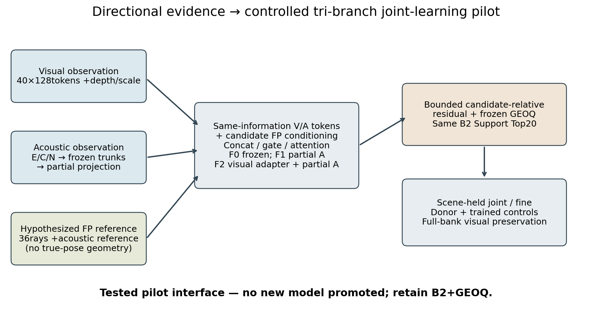

# IJCAI contribution assessment — one-page decision

**Current claim strength: a reproducible feasibility/negative pilot, not a validated new localization architecture.**

**Established within this reused cohort.** Acoustic-only ridge predicts coarse body-frame footprint extent; rotation, isotropic and donor controls support directional dependence. B2+GEOQ already discriminates ambiguous candidates strongly. The complete66fit frozen/partial-unfreeze pilot, inner-scene optimization followup and exact forward replays expose a reproducible gap between representation probing and downstream contribution. Full-bank visual preservation identifies a regression missed by depthMAE.

**Causal hypothesis still open.** Learned acoustic structure may be mostly redundant given GEOQ, or correspondence to candidate FP may be too weak under reference mismatch. The experiment does not distinguish all such mechanisms. Broad acoustic CNN/RGB encoder joint optimization remains untested. Replacing the strong-baseline residual interface might change learnability, but no current evidence warrants a large architecture search.

**Negative result.** Gating/attention does not establish benefit over equally informed concat and strong GEOQ while retaining fine localization. Actual partial acoustic training overfits; audio-conditioned visual adaptation does not beat self/donor controls. A tiny joint improvement with fine degradation is not an acceptable success claim. No proposed new model should replace the current reference.

**Required for a research contribution.** Show conditional residual information with a simple, falsifiable cue-to-hypothesis correspondence objective; preserve fine and visual-only success; then compare genuine multimodal joint training with equally informed controls. Demonstrate scene-held, teacher-unseen generalization on a newly reserved non-Test protocol. The existing exploratory pool cannot become pristine by renaming it. Only after that should full-bank runtime/coverage and larger encoder unfreezing be promoted as a method result.

**Publication stance.** This pilot is useful supporting evidence and a design constraint. Standalone novelty/SOTA claims would be premature. The accompanying figure depicts the tested interface, not a successful new method.

