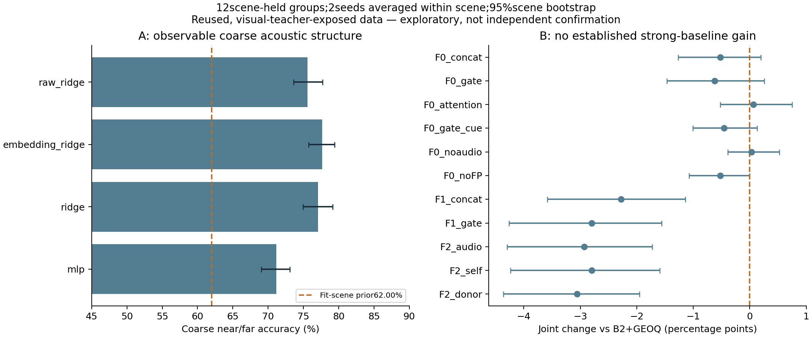

# Results — directional evidence and tri-branch pilot

**Decision: preserve B2+GEOQ. No new method passes joint improvement plus fine/visual preservation.** Acoustic-only coarse direction is observable, but additional localization value beyond the strong reference is not established.

This cohort is12NewTrain scenes×128queries=1,536 unique queries,3outer scene folds,2seeds. Seeds are averaged within scene. CIs are20,000 paired scene bootstrap draws, unadjusted for exploratory comparisons/reuse. Visual teacher exposure remains. Historical11-scene/6,072query scores are a different cohort and are not mixed into this table.

|Reference|R@1m %|Joint1m/30° %|Fine R@0.1m %|
|---|---:|---:|---:|
|visual|51.172|50.195|22.526|
|acoustic|32.292|20.768|4.036|
|fixed_fusion|69.401|67.708|27.214|
|B2|73.307|72.103|24.740|
|support|74.935|73.438|24.642|
|GEOQ|77.311|75.977|25.065|
|E0_GEOQ|77.799|76.367|25.065|

|New model|Joint %|Δjoint vs GEOQ pp [95%CI]|Fine %|Δfine pp [95%CI]|
|---|---:|---|---:|---|
|F0_concat|75.456|-0.521 [-1.270, 0.195]|23.633|-1.432 [-2.214, -0.781]|
|F0_gate|75.358|-0.618 [-1.465, 0.260]|23.079|-1.986 [-3.027, -1.107]|
|F0_attention|76.042|0.065 [-0.521, 0.749]|23.861|-1.204 [-1.888, -0.618]|
|F0_gate_cue|75.521|-0.456 [-1.009, 0.130]|23.763|-1.302 [-2.018, -0.684]|
|F0_noaudio|76.009|0.033 [-0.391, 0.521]|24.935|-0.130 [-0.326, 0.065]|
|F0_noFP|75.456|-0.521 [-1.074, 0.000]|23.991|-1.074 [-1.725, -0.521]|
|F1_concat|73.698|-2.279 [-3.581, -1.139]|21.419|-3.646 [-4.948, -2.474]|
|F1_gate|73.177|-2.799 [-4.264, -1.562]|21.126|-3.939 [-5.111, -2.897]|
|F2_audio|73.047|-2.930 [-4.297, -1.725]|20.540|-4.525 [-6.152, -3.092]|
|F2_self|73.177|-2.799 [-4.232, -1.595]|21.159|-3.906 [-5.111, -2.865]|
|F2_donor|72.917|-3.060 [-4.362, -1.953]|20.866|-4.199 [-5.501, -3.027]|

F0 attention’s tiny positive joint difference is uncertain and accompanies a clear fine loss. Noaudio added-branch control is competitive. F1/F2 increase fitting-set joint performance to~82% while outer results fall to~73%; actual encoder updates were verified, so this is not a silently frozen training failure. F2_audio vs self/donor does not establish observation-specific visual exchange.

|Controlled contrast|Δjoint pp [CI]|Δfine pp [CI]|
|---|---|---|
|F0_gate minus F0_concat|-0.098 [-0.618, 0.423]|-0.553 [-0.977, -0.130]|
|F0_attention minus F0_concat|0.586 [-0.033, 1.172]|0.228 [-0.130, 0.618]|
|F0_gate_cue minus F0_gate|0.163 [-0.358, 0.618]|0.684 [0.260, 1.139]|
|F1_gate minus F1_concat|-0.521 [-0.846, -0.228]|-0.293 [-0.781, 0.130]|
|F1_gate minus F0_gate|-2.181 [-3.613, -0.911]|-1.953 [-2.572, -1.204]|
|F2_audio minus F1_gate|-0.130 [-0.488, 0.228]|-0.586 [-1.139, -0.098]|
|F2_audio minus F2_self|-0.130 [-0.488, 0.293]|-0.618 [-1.139, -0.098]|
|F2_audio minus F2_donor|0.130 [-0.098, 0.391]|-0.326 [-0.749, 0.033]|

## Optimization falsification and preservation

Both frozen and low-lr acoustic gates selected epochs[0, 0, 0, 3, 3, 0] in seed/fold order. Each selected the same final poses. The10x-lower learning rate and inner-only epoch selection did not reveal an acoustic-specific gain. Both vsGEOQ: joint 0.065 [-0.098, 0.260]pp; fine -0.033 [-0.130, 0.065]pp. This limits overclaiming that the fixed12epoch loss proves fundamental absence of acoustic information.

F2 depthMAE drops from~.1753m to~.1742m, but full-bank pure-visual joint changes are:

- F2_audio: joint -0.586 [-1.172, -0.065]pp; fine 0.195 [-0.293, 0.716]pp.
- F2_self: joint -0.488 [-1.139, 0.065]pp; fine 0.195 [-0.326, 0.716]pp.
- F2_donor: joint -0.586 [-1.172, -0.065]pp; fine 0.228 [-0.260, 0.716]pp.

Thus depth regression and localization preservation disagree; depth loss alone is insufficient. Full-bank visual replay is exact for the frozen baseline. Full-bank *new tri-branch* scoring and F3 were not run: no fixed-candidate method met the screen. Transfer11 was prepared but not evaluated with new models; no independent confirmation claimed.

## Extraction versus decision

Candidate oracle joint coverage Top1/5/10/20: 73.438%, 95.508%, 97.949%, 99.154%. All20 candidate pose IDs are unique. Candidate-to-anchor spatial separation median, scene-averaged, is 5.72m (not nearest-neighbor separation). Coverage is GT-diagnostic reachability, not achievable Top1. Unchanged proposals isolate decision/representation, so this study claims no extraction improvement.

`analysis.json` includes allscene values, both seeds, conditional-on-coverage success, pair accuracy, repair/harm and visual-success preservation. `diagnostics.json` contains deterministic repair/harm examples (query IDs and old/new hypotheses), full-bank visual effects and inner learning curves. GEOQ ambiguous-pair accuracy 90.220 [87.776, 92.301]%; F0attention 89.327%; F2audio 86.242%. No NLL/ECE or calibrated localization posterior is reported.

