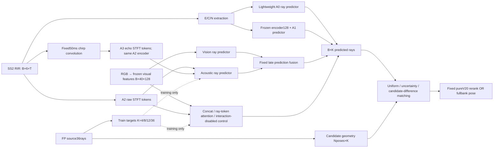

# Method at a glance — controlled ray and joint-learning study

## Phase0: actual inputs and objectives

The attached AVLoc manuscript is ICLR2027 submission8698, OpenReview id Yi9xMxlOKe. Its paper Table2 reports joint expert72.3% R@1m and71.3% at1m/30deg, on Gibson(f), not HSSD. The full model74.7% is also R@1m. These are contextual literature numbers, not our reproduced results. Main paper Sec3/p4–5 and supplementary p13 specify36omnidirectional ray tokens, vision-only11FOV tokens, ResNet50vision and4channel ResNet18audio, Laplace NLL, learned uncertainty routing and likelihood matching. We will isolate representation/joint-learning factors, not reproduce the entire robustness/router benchmark.

| Stage | Existing Track A | AVLoc paper | This controlled study |
|---|---|---|---|
| Audio | SS2 RIR h:6×T,48kHz,5cmring/central source | Binaural h;50ms logarithmic chirp20Hz–20kHz;100ms response | Same6channel h; matched-duration raw vs fixedchirp convolution |
| Features |2–128ms;256FFT/256window/64hop,500–4000Hz;E6×19×95,C2×6×2×19 plusN envelope |512FFT/64window/16hop;left/right logmag+IPDsin/cos | A0 E/C/N;A1 frozen encoder;A2 STFT tokens;A3 same encoder on chirpSTFT |
| Encoder |3feature branches→pre384→normalized128 |CNN spatial tokens→selfattention→ray expert | Fixedlightweight paired budgets;architecture and input changes separated |
| Supervision |Observed↔FP contrastive matching; previous probe log rayMSE |Metric ray LaplaceNLL includinguncertainty | Commonray supervision/loss percomparison; uncertainty validated independently |
| Ray geometry |Original36rays;previous4 medians over±20deg |36unsmoothed10degspaced rays |4/8/12/36same source; smooth4 separate;36output subset controls |
| Pose score |FP-RIR embedding cosine, V/Afusion, B2/GEOQ |Ray likelihood over10cmXY/10degyaw |Existing20cmXY/10degyaw grid heldconstant; fixedpureVTop20 andfullbank separate |

RIR is a system impulse response, not a transmitted chirp recording. The simulated chirp echo is causal convolution y=h*s, cropped from a common emission-time origin. It does not create new scene information, but changes spectral weighting/time overlap and can alter learnability. Any gain must survive the same-network raw/chirp comparison. Sixchannels are not AVLoc's binaural device; no hardware equivalence is claimed.

Known cached tensor shapes per128query scene: visual128×40×128, acoustic pre128×384, normalizedembedding128×128, compressedECN128×552, originalraytarget128×36, visualmu/scale128×40. These are verified from actual observations.npz. Phase2 extracted new100ms inputs before fitting; exact shapes and budgets are below. Cached legacy embeddings were produced from128ms features; they cannot silently serve as a duration-matched100ms baseline.

## Capacity controls

All oracle arms use the same source36rays and existing candidate grid. K8 directions at45deg require periodic interpolation because45deg is not a10deg grid point; rounded36-subset8 is separately reported. K4/K12 are exact36-output subsets and their equality is checked. Smoothed4 is retained as an explicit old-target control. Front12 tests partial angular coverage. Oracle labels are diagnostic only and never predictive model inputs.

## Exposure and limits

New12/Transfer11 are reused development cohorts and visual-teacher-exposed. Scene-held head evaluation is not independent fullpipeline validation. Test observations/results remain excluded. Real environment/furniture/material/device shifts are outside this request. TrackB code is not modified.

## Executed architectures and inference

All model outputs are log1p(distance), with training loss mean squared error across queries and rays. Distances are capped at10m; all source target directions are known, and the mean cap fraction across23scenes is2.26%. Metric prediction diagnostics use clip(expm1(output),0,10). Matching operates on the un-clipped predicted log rays against log1p(candidate geometry).

| Arm | Input per query | Trainable path | Output |
|---|---|---|---|
| E/C/N |552 compressed features, newly extracted100ms |552→128→64 MLP |K log rays |
| Frozen embedding |128; old contrastive encoder, re-encoded100ms |128→128→64 MLP |K log rays |
| Raw / chirp / sorted / isotropic |18×32×32 pooled STFT channels |18→16→32 convolution, fixed4×4 pooling,512→64 |K log rays |
| Joint arms |Audio18×32×32, visual40×128 frozen tokens |Audio16×32 tokens; vision40×32;36 learned ray queries |36 log rays |

Audio is48kHz, cropped to100ms from emission time. The chirp is50ms logarithmic20Hz–20kHz, fixedphase and unitL2; causal convolution is cropped to the same100ms. STFT uses samples103:4800(removing the first2.146ms),512FFT,64window,16hop, producing18×257×295 channels/frequency/time before CPU average pooling to18×32×32. E/C/N also excludes the initial samples through its feature recipe. The paper does not specify this same direct-path crop; duration matching does not make the frontends identical. The18channels are6 normalized log magnitudes,6 adjacent-channel IPD cosines and6 sines. This pooling can discard timing/phase detail and is not the paper's exact feature frontend. E/C/N uses the common100ms observation duration and its historical bandpass; its pre-trained encoder was learned on128ms inputs, so A1 has an explicit input-duration shift. N is nowfloat32, whereas the old cached N used a float16 roundtrip. Two short Transfer RIRs retain all3534samples and zero-pad to4800 under the existing renderer contract; input receipts record this.

Joint attention uses2 Transformer blocks,32dimensions,4heads,128wide feedforward, no dropout. The same32→64→1 ray decoder is used for concat and interaction-disabled models. Concat flattens56×32 tokens through a14wide bottleneck and broadcasts the result to ray queries:42,175 parameters versus42,001 for attention/disabled. Disabled uses identical attention weights in two separate modality-masked forwards then averages predictions; it has approximately double forward compute. Vision-only and acoustic-only exclude the other modality by mask (verified by perturbation), although inactive encoder parameters still count in model size. Wideconcat uses64hidden units and is explicitly not parameter matched.

Primary models use40epochs/320updates, AdamW(.001,weight_decay.001), batch128, gradient clipping1, two seeds,3outer scene folds(8fit/4held). No held-based epoch selection. Followups use160epochs/1280updates for concat/attention/disabled and40epochs for wideconcat. Transfer fits all12development scenes for40epochs/480updates, freezes18models before scoring11transfer scenes, and does not tune on Transfer. Calibration fits48 inner4scene models with320updates and derives per-direction mean absolute log residual and90th percentile from the remaining4scenes, twice within each8scene outer fit. These are global directional residual scales, not query-specific confidence.

Uniform score is negative mean absolute log-ray error. Uncertainty weighting normalizes inverse inner-OOF residual scales. Fixed Top20 pair selection chooses9 directions with largest FP geometry differences per candidate pair, then averages pairwise error advantages (Borda). Full-bank selection uses a fixed visual Top1 anchor and the9 geometry-difference directions against each pose; this is a distinct scalable extension, not the identical20candidate rule. Neither direction selection uses GT. Fusion is .85 standardized visual+.15 standardized geometry score. Full-bank outputs use the same1m/30degree Support-NMS and Top20 extraction as previous studies.

Late fusion averages independent log-ray predictions. A followup confines this average to11 frontal rays(-50..50degrees); outside FOV it uses acoustic predictions alone. This is an exploratory diagnostic registered after Transfer scoring but before its summary inspection, not part of the original Transfer freeze. It tests unsupported vision predictions outside view, not a learned confidence router.

There are228 newly trained checkpoints:108acoustic,30joint,48calibration,24optimization followup,18transfer. Six primary late-fusion receipts and FOV variants are derived predictions, not extra fits. All228checkpoints were reloaded and every stored held/OOF prediction (including saved controls) replayed; see checkpoint_verification.json for numerical errors and hashes. Replaying predictions is not retraining verification.

Differences from AVLoc include HSSD versus Gibson(f),6channels versus binaural, frozen visual features versus joint RGB encoder training, pooled STFT versus its frontend, logMSE versus Laplace NLL, no learned router,20cm versus10cm XY grid, and a primary36ray vision head versus11FOV rays. Thus negative attention/chirp findings here do not falsify the complete AVLoc system.
