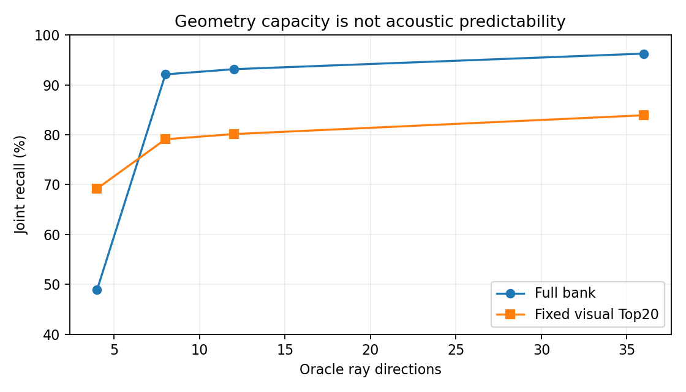
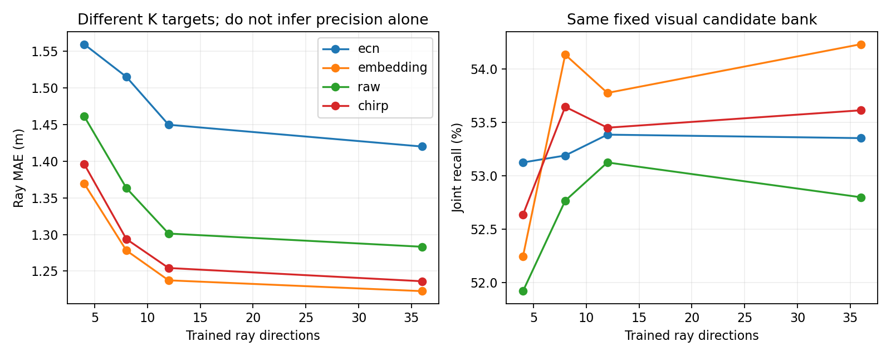
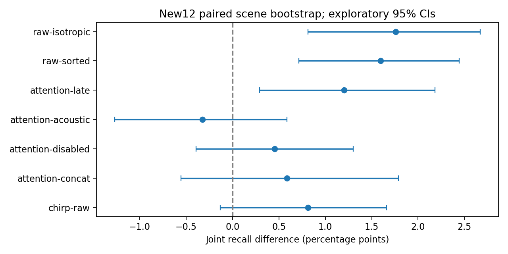
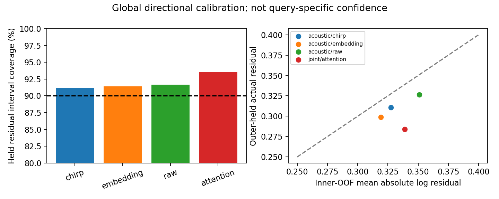
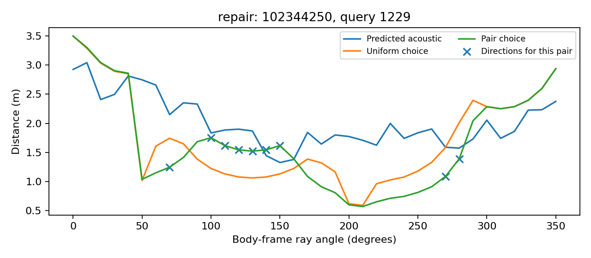
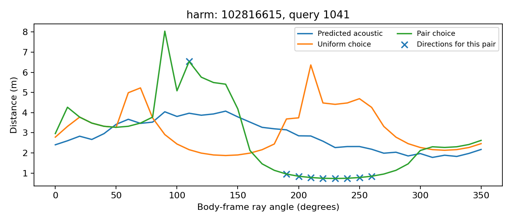
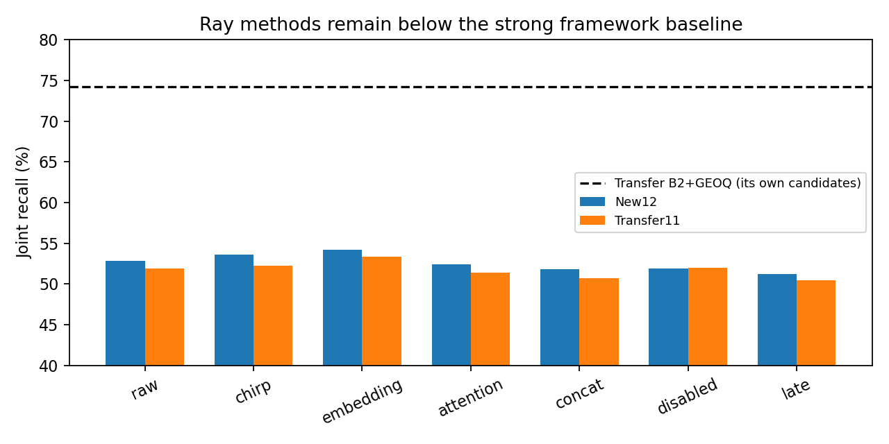

# Ray Representation & Joint Acoustic–Visual Learning

Track A · 2026-11-09 · Evidence level: **Exploratory** · Full-bank evaluation pending; this is an interim report.

## Findings and competing explanations

The geometry oracle shows substantial information beyond four extents, but learned ray precision does not establish localization utility. Frozen contrastive embeddings remain competitive with newly trained STFT models. Under this frontend and budget, neither chirp convolution nor joint attention establishes an advantage over its strongest matched control. The experiment does not reproduce or refute AVLoc's complete system.

A particularly informative negative control concerns vision outside its field of view: restricting late fusion to frontal rays recovers most of the gap between naive late fusion and acoustic-only. This supports avoiding unsupported visual extrapolation; it does not show useful cross-modal interaction. Learned joint attention has not surpassed the strong B2+GEOQ framework baseline.

## Protocol and validity

See [method](METHOD_AT_A_GLANCE.md), [protocol](PROTOCOL.json), [learning protocol](LEARNING_PROTOCOL.md), [joint protocol](JOINT_PROTOCOL.md), [Phase4](PHASE4_PROTOCOL.md), [optimization followup](OPTIMIZATION_FOLLOWUP.md), [Transfer freeze](TRANSFER_PROTOCOL.md) and [FOV diagnostic](FOV_LATE_PROTOCOL.md).

New12 contains128queries per scene,3outer8fit/4heldscene folds and seeds42/43. Transfer11 models fit New12 only;18checkpoints were frozen before Transfer predictions. Both cohorts are reused development scenes with historical visual teacher exposure. Head-held evaluation is not independent end-to-end validation. No Test observations/results were used for method selection. Two seeds are averaged within each scene; reported95%CIs use20,000paired scene bootstrap samples without multiplicity correction. These are exploratory estimates, not confirmatory significance tests.

Joint recall means position≤1m and circular yaw≤30degrees. Fine recall means position≤0.1m without yaw restriction. Pure visual Top20 and full-bank evaluation are distinct. B2/GEOQ uses its own historical candidate pipeline; it is a strong framework comparison, not a same-candidate ablation. All controls preserve the common scene/query grid.

## Phase1: representation capacity

See [complete oracle report](PHASE1_REPORT.md). Full-bank oracle joint recall rises48.893→92.122→93.164→96.289% for4/8/12/36directions; fixedpureV Top20 rises69.206→79.102→80.143→83.919%. Fixedcandidate coverage is90.690%. Front12 yields56.576% on the fixedbank versus80.143% for omnidirectional12. Eight interpolated rays and rounded36-subset8 differ, so angular sampling is not simply output count. Fine recall is nonmonotonic. Oracle GT rays are nondeployable and never inference features for learned methods.

Interpretation: more angular coverage distinguishes floorplan shapes that four extents alias. Remaining alternatives include grid quantization and ray-casting mismatch; the oracle does not show that audio can predict those distinctions.

## Phases2/3: fixed pure visual Top20

All table rows below fuse their ray score with the same visual score(.85/.15). The original visual baseline is50.195%; samecandidate visual+cosine is57.487%. These are different from the learned vision-ray row.

| Model | K | Ray MAE(m) | Joint% | Fine% | Ambiguous pair% |
|---|---:|---:|---:|---:|---:|
|acoustic/chirp|36|1.236|53.613|24.154|69.992|
|acoustic/ecn|36|1.420|53.353|24.186|68.912|
|acoustic/embedding|36|1.223|54.232|24.642|70.727|
|acoustic/isotropic|36|1.506|51.042|23.210|62.673|
|acoustic/raw|36|1.283|52.799|23.828|68.327|
|acoustic/sorted|36|1.510|51.204|23.372|63.280|
|joint/acoustic|36|1.363|52.702|23.828|66.519|
|joint/attention|36|1.132|52.376|23.600|67.335|
|joint/concat|36|1.348|51.790|23.828|62.894|
|joint/disabled|36|1.174|51.921|23.242|65.875|
|joint/late|36|1.246|51.172|23.112|62.449|
|joint/vision|36|1.388|49.186|22.135|58.079|

The complete K and common36output-subset comparisons are retained in analysis.json. NativeK targets differ, so lower MAE across K is not a controlled precision claim. Raw/chirp share architecture and updates; E/C/N and frozen embedding have different input/parameterizations. The frozen embedding has a100ms input shift relative to its historical128ms contrastive training.

| Paired contrast | Joint delta(pp) |95%CI(pp)|
|---|---:|---|
|chirp-raw|0.814|[-0.130, 1.660]|
|attention-concat|0.586|[-0.553, 1.790]|
|attention-disabled|0.456|[-0.391, 1.302]|
|attention-acoustic|-0.326|[-1.270, 0.586]|
|attention-late|1.204|[0.293, 2.181]|
|raw-sorted|1.595|[0.716, 2.441]|
|raw-isotropic|1.758|[0.814, 2.669]|

Ordered raw channels outperform energy-sorted and isotropic controls trained with the same CNN. This supports useful spatial-channel information under the simulated microphone convention. It does not isolate IPD from amplitude or establish device-transfer robustness. A fixed channel permutation applied only at inference is a distribution shift, not the same causal test as retraining after removing identity. Donor/shuffle records are preserved. In joint models, `donor` means audio replaced with vision fixed; generic primary `donor17` rolls the complete joint prediction and must not be described as an audio-only intervention.

Chirp improves mean ray MAE but its joint-recall contrast with raw includes zero. Fixed convolution adds no new scene information; it can change conditioning, spectral weighting and overlap. No frequency-specific mechanism is established without frequency-isolated controls. Attention improves naive late fusion, but not concat or equal-parameter interaction-disabled with decisive scene-level evidence; therefore attention-specific cross-modal benefit is unproven.

## Optimization and FOV alternatives

Quadrupling training updates to1280 lowers training loss without clear held localization improvement. Attention160−concat160 is+0.879pp[-0.033,1.855]; attention160−disabled160 is+0.130pp[-0.944,1.367]. A wider concat bottleneck uses more parameters and only320updates; it is a diagnostic of bottleneck capacity, not an equal-budget superiority comparison. These results weaken simple undertraining as the sole explanation, while leaving model/frontend capacity and representation alignment unresolved.

| FOV contrast | Joint delta(pp) |95%CI(pp)|
|---|---:|---|
|development/fov_late minus development/late|1.432|[0.553, 2.214]|
|development/acoustic minus development/fov_late|0.098|[0.000, 0.195]|
|transfer/fov_late minus transfer/late|1.385|[0.817, 2.024]|
|transfer/acoustic minus transfer/fov_late|0.000|[-0.142, 0.142]|

FOV-restricted late fusion uses vision only at11frontal ray bins and acoustic-only elsewhere. Its recovery relative to all-direction late fusion does not exceed acoustic-only. The plausible mechanism is removal of unsupported vision extrapolation, not discovered synergy. A transferable prediction is that a calibrated router should reject out-of-view visual structural claims before more complex fusion; this remains a hypothesis for another dataset, not a validated general rule.

## Phase4: matching and residual scales

Inner scene-OOF residual intervals cover approximately91–94% of outer-held log errors at nominal90%. They are global directional scales, not per-query reliability or guaranteed calibrated probabilities. No held labels fit these scales. Uniform matching, inverse-residual weighting and9direction geometry-difference selection are compared on identical predictions. Pair selection uses candidate FP geometry only; no GT picks directions.

| Prediction | Uniform joint% | Uncertainty joint% | Pair-selection joint% |
|---|---:|---:|---:|
|acoustic/raw|52.799|52.832|52.669|
|acoustic/chirp|53.613|53.646|52.995|
|acoustic/embedding|54.232|54.232|54.199|
|joint/attention|52.376|52.148|51.855|

There is no clear fixedcandidate benefit from the proposed matching refinements. Geometry differences identify potentially informative directions, but not whether audio predicts those directions accurately. Selecting the largest geometric contrast can amplify prediction error; global residual weights may miss query-specific reliability. These are interpretations consistent with the negative result, not uniquely proven causes. Full-bank anchor selection is evaluated separately and must not be confused with all-pair Top20 Borda scoring.

### Pair-selection case diagnostics

The first repair and harm in protocol scene/query order are retained without selecting attractive examples. Scene102344250 query1229 changes3.9m error to0.1m; scene102816615 query1041 changes0m to1.72m and85degree yaw error. Selected directions for the two displayed choices are illustrative; the actual Borda rank uses all candidate pairs. They show why geometry contrast alone does not guarantee accurate acoustic evidence.

## Transfer11 (reused, teacher-exposed development)

| Arm | Joint% | Fine% |
|---|---:|---:|
|acoustic/chirp|52.273|24.325|
|acoustic/ecn|52.592|24.609|
|acoustic/embedding|53.303|24.751|
|acoustic/raw|51.882|24.148|
|joint/acoustic|51.847|24.503|
|joint/attention|51.349|23.935|
|joint/concat|50.710|23.899|
|joint/disabled|51.953|24.041|
|joint/late|50.462|23.331|
|joint/vision|48.153|21.982|
|Baseline B2|70.135|24.645|
|Baseline GEOQ|74.219|25.852|
|Baseline cosine|43.608|21.094|
|Baseline visual|49.077|22.443|
|Baseline visual_cosine|54.972|25.355|

The frozen embedding remains the strongest new ray arm by mean, but below samecandidate visual+cosine and far below B2+GEOQ. The full strong-baseline gap is retained, not presented as a successful framework replacement. Transfer here is predictor-fit scene exclusion, not an independent untouched benchmark. No full-bank Transfer claim is made: the frozen Transfer protocol specifies fixedcandidate evaluation.

## Failures, corrections and preservation

- Strict deterministic CUDA backward rejected adaptive pooling. Replaced the16×16→4×4 operation with mathematically equivalent fixed4×4 average pooling; strict determinism retained, equivalence checked. Earlier vector fits and failed logs preserved.
- Two short3534sample RIRs triggered the initial100ms cache check. Applied the existing zero-tail contract to both raw/chirp inputs, preserving original samples and recording padding. This is not new rendering or additional evidence.
- Initial joint Phase4 donor rolled the complete prediction. Corrected to a forward pass with donated audio and unchanged vision; initial artifacts remain in diagnostics/pre_joint_donor_correction.
- Initial Transfer ambiguity diagnostics used36ray geometry instead of the established coarse4mask. Corrected diagnostic masks, preserving initial files; localization scores did not change.
- Full-bank Phase4 implementation shares candidate-only direction weights across model/control runs to avoid repeated computation. Original stopped logs remain. Scalar checks verify the scoring formula and visual anchor equivalence.

## Reproducibility and unresolved limits

All228checkpoints and1542stored prediction arrays replay exactly(max absolute error0), with matching receipt hashes, disjoint fit/held IDs and matching query IDs. Uniform Phase4 matches primary metrics exactly across1152comparisons; vectorized Spearman and pair scoring agree with independent implementations within2.23e-16. This verifies saved inference, not independent retraining. Source dependencies, container and local input hashes must accompany reproduction; caches/checkpoints are not uploaded. Clean-clone reproducibility without historical assets is not claimed.

Results apply to simulated HSSD6channel RIRs, pooled STFT/frozen vision and these budgets. They do not establish real-world, furniture/material/device shift robustness, the full AVLoc Laplace/router method, or Track B performance. Reused cohorts and multiple exploratory comparisons constrain evidence level. Next informative research should target calibrated query/direction reliability and ray-prediction errors that alter pose ordering, rather than assuming more rays, chirp or attention will help. A new independent scene protocol is required before promoting conclusions.

## Full-bank completion status

Pending. Primary all-K/subset evaluation and Phase4 control evaluation are still running. This report does not close the study or authorize a success claim before their aggregation, final provenance and Docs synchronization.
