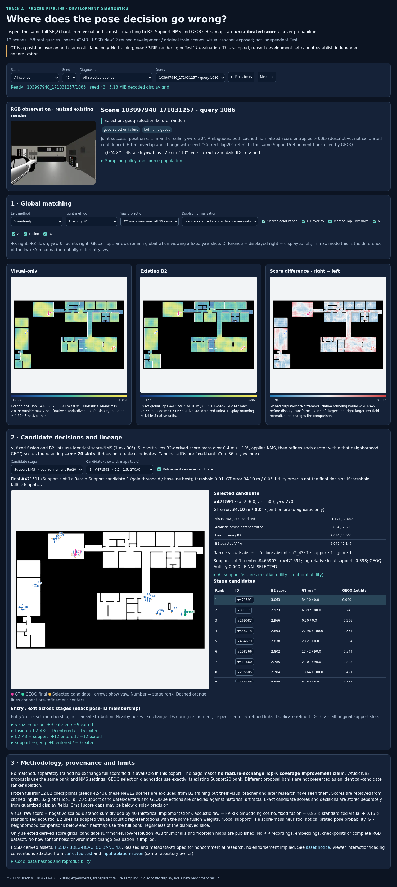

# Track A interactive pipeline diagnostic — 2026-11-10

- ID: `pipeline_viewer_20261110`; Primary Track: **A**.
- Status: complete: frozen replay, public branch publication and remote browser QA passed.
- Evidence: **Exploratory**. Engineering replay validation is not an upgrade to independently validated scientific findings.
- [Open interactive HTML](https://rawcdn.githack.com/LedersonLee/HTML-reports-2/f2cb4aaa2feb431ecacefef4cd018af6eaee577c/echoloc/av-fploc-track-a-pipeline/index.html) · [public source](https://github.com/LedersonLee/HTML-reports-2/tree/f2cb4aaa2feb431ecacefef4cd018af6eaee577c/echoloc/av-fploc-track-a-pipeline).
- Public branch: `research/av-fploc-track-a-pipeline`; public artifact commit `f2cb4aaa2feb431ecacefef4cd018af6eaee577c`.
- Actual final export code commit: `b85258053b3e1d6763fc18c600a62ea4ea3f73ff`.
- [Reproduction and code](../../../../../scripts/research/track_a/pipeline_viewer_20261110/README.md).

## Purpose and scope

This task builds a diagnostic viewer of already completed experiments. It trains no
network, renders no FP-RIR and selects no new method. The question is whether the
same query's full-bank scores and candidate decisions can be inspected faithfully,
including failures. Competing explanations for an apparent failure include a weak
visual/acoustic field, a harmful fixed fusion, proposal coverage failure, support
refinement movement, and selection failure within an otherwise adequate bank.
The viewer enables inspection; it does not establish causation between these stages.

The previous public `corrected-test/index.html` and `input-ablation-seven/index.html`
were inspected as UI/code references, not as evaluation data. Scene/query navigation,
canvas floorplan overlays, world-to-map conventions and gzip loading were reused in
an expanded interface. No historical Test17 observations or scores were loaded.

## Data, checkpoints and exposure

- Pilot: **3 scenes, 14 actual queries**, both seeds; browser interaction checks passed
  before expansion. Final: **12 scenes, 58 distinct queries, seeds 42/43**.
- Source population: 1,536 cached New12 development observations (128 per scene), from
  `hssd_scaling_20261108_1332/inputs` and `candidates_seed42/43`.
- New12 is original HSSD train split and excluded from fullTrain12 B2 training;
  the visual teacher has upstream exposure, and subsequent research reused these
  scenes. This is neither pristine Val19 nor independent Test evaluation.
- Frozen B2: `mbt_remaining_suite_20261106/runs/cap020/B2_seed42/43_full_epoch8.pt`.
  GEOQ: `structural_evidence_20261107_1730/GEOQ_seed42/43/model.joblib`.
- Pure V/A archived full-field anchors: `directional_structure_20261109` (one saved
  query-index-0 field per scene). Other fields are replayed from cached inputs.
- RGB thumbnails come from existing scheduled HSSD renders. Maps are existing 2DFP
  rasters; no new observations, models or acoustic rendering are generated.
- [Display manifest](display_manifest.json), [execution receipt](execution_receipt.json),
  and [public asset hashes](public_asset_inventory.json) identify exact sources.
  Historical training/inference Git SHAs are **UNRECORDED** where not recoverable;
  external source hashes are retained. The new exporter SHA is not substituted for
  historical training provenance. Clean-clone replay still requires private artifacts.

## Sampling and diagnostic categories

Four queries per scene: one saved-field replay anchor and three uniform random
queries, using fixed sampling seed 20261110. Add one random and one median-GEOQ-error
example from each diagnostic group, deduplicating to 58. All five conditions are
present; examples are not selected exclusively for successful fusion. Selection is
post-hoc diagnosis and never feeds inference/proposal filtering.

| Condition | Definition (seed 42 for sampling) | Source population | Viewer seed42 / seed43 |
|---|---|---:|---:|
| Visual repaired | V joint failure, A or fixed fusion joint success | 399 | 15 / 15 |
| Visual harmed | V joint success, fixed fusion joint failure | 94 | 8 / 8 |
| GEOQ selection failure | Support20 contains joint-correct pose, GEOQ final fails | 347 | 19 / 20 |
| Missing Top20 | No joint-correct pose in that same Support20 | 13 | 2 / 2 |
| Both ambiguous | Both cached normalized score entropies >0.95 | 1394 | 55 / 55 |

Groups overlap. The entropy criterion is a broad descriptive flag, not calibrated
confidence or proof of modality failure; its high prevalence limits its usefulness.
Sampled category frequencies are not population accuracy estimates. Joint success
is position≤1m and circular yaw≤30°; continuous position/yaw errors are shown. The
0.1m fine boundary can be read from position error, but no new fine-performance claim
is made. [Full selection record](selection.json).

## Methods and controlled comparisons

The bank is identical XY at 20cm and 36 yaw bins at 10° for every method for a query.
Visual raw score is the historical negative scaled-distance sum divided by40.
Acoustic raw score is observed–FP-RIR embedding dot product; all bank/observation
embedding norms were checked within1e-5 of1 ([cosine audit](cosine_norm_validation.json)).
Fixed fusion is .85 z(V)+.15 z(A). B2 uses adapted V/A with those weights.

All three diagnostic V/fusion/B2 lists use score-NMS with1m/30° suppression. They are
newly reconstructed diagnostic proposal lists and are clearly labeled as such.
Historical Support20 uses score-mass aggregation, NMS and .4m/±10° local refinement;
its centers, refined IDs and26 features are replayed. GEOQ evaluates precisely that
same20-slot bank; seed42 threshold0, seed43 threshold.01, with slot0 gain fixed to0
and fallback to slot0. Relative utility is never called probability. Exact IDs,
all stage ranks, center→refined lineage, scores and selection reasons are inspectable.
Duplicate refined IDs preserve all originating slots.

A separate matched trained no-exchange full field was not available for this export.
No feature-exchange Top-K improvement claim is made. Different proposal sets are
not mislabeled as an identical-candidate ranker ablation. Independent ray models and
Track B are not silently mixed into this B2 pipeline viewer.

## Replay and display validation

- 58 queries ×2 seeds: **zero mismatches** in V/A/fusion/B2 global Top1,
  all20 Support IDs, all20 center IDs, and GEOQ final selection.
- GEOQ utilities replay against historical arrays at absolute tolerance1e-10;
  support features at absolute2e-5/relative1e-5.
- 12 saved V/A full-field anchors: maximum absolute float64-versus-stored-float32
  difference **3.8118565441891405e-6**. Existing saved fields are not bitwise float64.
- Full XY×36 score fields use linear uint16 display encoding. Maximum measured
  reconstruction error **6.288849192609414e-5**; each field records its own bound.
  Exact candidate numbers/top1 IDs remain separate. Tiny gaps can be visually tied;
  difference maps inherit both quantization bounds and the chosen display transform.
- 406 data checks passed: decoded grid sizes, argmax tolerance, candidate coordinates,
  stage ranks, GEOQ fallback, metadata safety and image dimensions.
- Browser tests passed: gzip loading, method/seed selection, fixed-yaw projection,
  normalization/common colors, difference rendering, GT toggle invariance, candidate
  dropdown/table/map clicks, failure filter, rapid query switching and390px mobile
  layout without horizontal overflow. No JavaScript page errors.
- CUA had no connected browser surface. Headless installed Chromium/Playwright
  integration tests and rendered screenshot inspection supplied browser QA.

[Replay checks](replay_validation.json) · [data checks](data_validation.json) ·
[local browser checks](browser_validation_local.json) · [remote browser checks](browser_validation_remote.json) · [pilot checks](pilot_replay_validation.json).

## Observations, interpretations and unverified claims

**Observed:** historical candidate IDs and decisions replay, and all five diagnostic
conditions have accessible examples. GT toggling does not change final decisions.
**Interpretation:** this is suitable for inspecting where existing pipeline choices
change candidate membership, and for generating subsequent hypotheses.
**Causal hypotheses:** not tested here. A stage-to-stage change alone does not show
why a learned feature exchange helped or harmed.
**Validated conclusion:** this exporter/viewer reproduces the checked cached-input
pipeline decisions for this sampled development cohort within documented tolerances.
It does not validate raw RIR→encoder runtime, independent generalization, sensor noise,
environment shifts, learned uncertainty, or superiority of a new method.

## Failures and implementation corrections

The first exporter attempt failed immediately on a mistyped Torch memory-limit API;
no training/data result was produced. After correction the14-query pilot passed.
The first expanded attempt was deliberately interrupted because the historical
neighbor-cache reader repeatedly decompressed arrays inside a per-cell loop. A
single-decompression reader preserving the identical stored graph and neighborhood
rules replaced it; pilot replay passed again and the final58-query run completed.
The earlier partial output/log remains local and is not counted as completed replay.
An initial public-repository commit lacked local author configuration; the repository's
existing public noreply identity was reused, then the actual asset commit was created.
No original experiment, checkpoint or result was overwritten.

## Public assets and deployment

203 files, **102,370,965 bytes** total (~97.6MiB), loaded lazily by query; largest
compressed display file5,308,775 bytes. These are derived quantized display fields,
not raw feature arrays. Only58 resized RGB thumbnails (≤384×256) and12 resized maps
(≤1000×1000) are included, with metadata stripped. All thumbnails were visually
inspected; textual and compressed metadata were scanned for absolute private paths,
credential markers and forbidden raw/model formats. Full datasets/RIR/weights are absent.

HSSD is [CC BY-NC4.0](https://3dlg-hcvc.github.io/hssd/), with author attribution,
license URL and derivative modifications in the page and NOTICE. Publication is for
noncommercial research. This does not grant new rights to full source datasets/models.

GitHub Pages currently permits deployment only from `main`. Its protection was not
changed, and no direct main push/force push/automatic merge was performed. The URL
above serves the immutable public branch commit through rawcdn.githack.com; it is a
third-party preview/CDN, **not** a claimed deployment of the official Pages path.
The service may show its repository confirmation notice on first visit. Future
normal reviewed merge would enable the existing official Pages workflow.

Docs synchronization details are reported after commit, not self-inserted into the
index. The original two dirty runtime scripts are preserved; their combined diff
hash remains02ff3357f1cead0b70e2255c5f27eb15e325c161c6966ca1dbe06743fb1eabd3.

Remote verification: the immutable HTML URL loaded successfully in Chromium after
the hosting service’s normal “Open the page” notice. Seed/filter/yaw/candidate
interactions, another scene and mobile layout passed with zero JavaScript errors.
All public assets are pushed on the designated non-main viewer branch.
