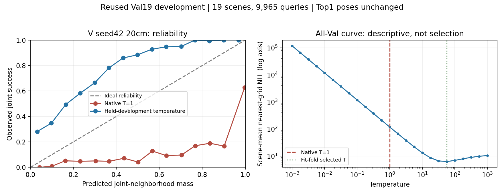
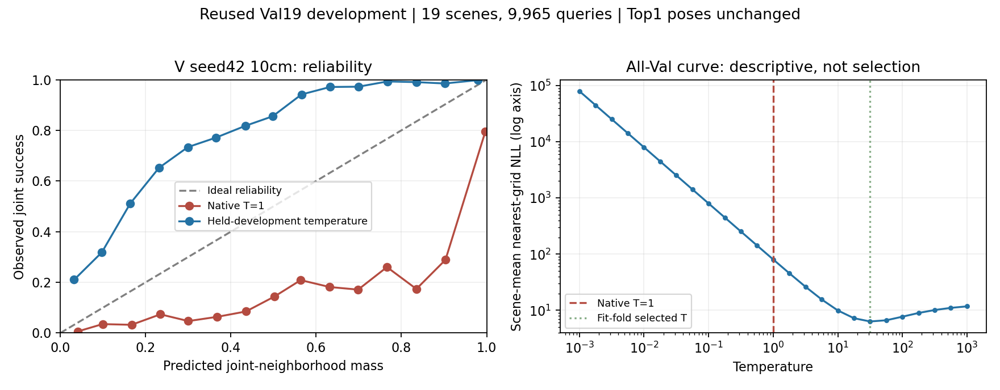

# A0 seed42 completed training and initial evaluation

Date: 2026-11-12 KST. Track A. Evidence: Exploratory, reused Val19 development and checkpoint selection. Full research remains incomplete.

## Observed results

A0 completed 100 epochs (max-epochs criterion). Best clean-Val ray MAE selected epoch99, 0.1795708863 m. Frozen FP32 prediction covers all19 Val scenes and9,965 queries. Checkpoint SHA256: `03942eba07916c8da6d494319b484c830e74a5740793765e864433ce58b091f7`. Training source: `62c58da20ed26ba95863638bbfd4926829999eec`.

On the shared20cm XY/10° yaw grid: R@1m50.9483%, Joint@1m&30°50.1054%, R@0.1m22.0271%, NMS Top5 coverage70.9784%, NMS Top20 coverage88.7506%. Scene-macro Joint49.6699%. FP32 ray MAE0.1795708835 m replays the selected validation metric within numerical precision. Native normalized entropy0.04297 and ECE0.39337 show that concentration alone must not be called calibrated confidence.

[Machine-readable aggregates and provenance](a0_seed42_initial_results.json). These are single-seed descriptive outcomes; paired scene intervals and matched baseline integration remain pending. No independent generalization or causal interaction conclusion follows. A1/A2/A3, multiple seeds, fusion/interaction ablations and10cm/calibration analyses remain required. Test17 was not used.

## Failure and correction

The original evaluation queue successfully completed prediction and20cm matching, then stopped in post-hoc ray analysis: NumPy `ptp` cannot subtract boolean localization outcomes. This was an analysis-type error, not a model or matching failure. Convert correlation inputs to floating point before finite filtering/range checks. Three regression tests cover varying boolean outcomes, constant boolean outcomes and NaN filtering; all passed. Corrected full19-scene ray analysis also passed all query-ID, source-hash and per-query MAE replay checks.

Correction/recovery source: `5f8fdc4e8fdd22a17f1a243646c263fcd23e9ae1`. The failed analysis directory and logs are preserved. Recovery copies the immutable original evaluation source snapshot, changes only `analyze_rays.py`, verifies receipts for the two completed stages, writes20cm analysis to a new `_v2` directory, then continues10cm evaluation/analysis and both calibration sweeps. All recovery stages stop on error and reject existing destinations. No retraining or checkpoint change was made. A1 continues independently.

## Reproduction

Set WORKSPACE to the workspace root and STUDY to the local large-artifact root. The prior queue snapshot and its receipts are required; this is not a clean-clone-only data release.

```bash
python3 AV-FPLoc/scripts/research/track_a/avloc_20261111/test_ray_correlation.py
python3 AV-FPLoc/scripts/research/track_a/avloc_20261111/recover_a0_evaluation.py --previous "$WORKSPACE/experiments/avloc_20261111/a0_evaluation_queue_v1" --out "$WORKSPACE/experiments/avloc_20261111/a0_evaluation_recovery_v2" --study "$STUDY"
```

Executed with the original pinned Docker image recorded in the recovery plan. Existing outputs intentionally cause refusal; never overwrite them to rerun. Inference49.06s was measured concurrently with A1 training and is not an isolated runtime benchmark. Reports contain aggregates only; checkpoints, query arrays and logs stay local.


## Matched baseline integration and separate10cm evaluation

All19 scenes/9,965 query IDs were aligned to the existing baseline cohort, with baseline file hashes verified. [Matched table](A0_MATCHED_COMPARISON.md) and [paired estimates/provenance](a0_matched_comparison.json). Aggregation source `81bcc165bba8bef19b43239d3d6a459f3cb938e6`.

At20cm, A0 Joint50.105% exceeds the existing visual baseline45.850% by4.255 percentage points micro. Equal-scene mean improvement4.370pp, paired19-scene bootstrap95% interval[3.546,5.197]pp (10,000 resamples, seed20261111). All19 scene differences are positive. A0 repairs1,215 visual failures and harms791 visual successes. This compares trained systems, not a controlled causal architecture ablation: training data/initialization/protocol differ, and the reused development cohort selected the checkpoint. Seed43 remains pending.

A0 remains below fixed fusion65.038%, B2(two-seed mean)69.313% and B2+GEOQ73.071% Joint. These are descriptive comparisons; the two-seed baseline mean is explicitly distinguished from A0's single seed. No claim about full AVLoc-style superiority or acoustic recoverability follows from vision-only A0.

Separate10cm evaluation completed on the same predictions and all9,965 queries: R@1m61.274%, Joint60.462%, R@0.1m38.906%, NMS Top20 coverage92.122%. [Metrics and hashes](a0_seed42_10cm_metrics.json). The Joint increase10.356pp versus20cm is a grid effect with unchanged network and predictions. Do not substitute this result into the primary20cm comparison table.10cm ray analysis also completed with source/ID/MAE replay checks.20cm temperature calibration completed;10cm calibration and independent review of the calibration aggregates remain pending.


## Temperature replay verification (both grids)

Analysis source `1a494e31f89a23fa42ef6f0dd371db707004880c`. All9,965 queries at each grid passed saved-curve hashes, scene/query identity, native T=1 NLL/confidence/entropy/mass replay, exact Top1 and joint labels, and exact reconstruction of the five-family-fold calibration summary. The first plotting invocation failed on an f-string quote syntax error before any output; corrected before execution, with both full-data runs then passing.

| Grid | Native → crossfit nearest-grid NLL | Native → crossfit ECE | Selected T in all5 folds | Joint unchanged |
|---|---|---|---|---|
|20cm|119.0391 → 6.2260|0.39337 → 0.28573|56.2341|50.1054%|
|10cm|81.4629 → 6.3283|0.25258 → 0.24211|31.6228|60.4616%|

Observed: native fields are sharply concentrated; temperature smoothing improves nearest-grid NLL substantially while leaving every selected pose unchanged. ECE improves less and remains high. Interpretation: sharpness is not sufficient evidence for calibration. The temperature objective is nearest-grid NLL, not joint-event ECE; those objectives differ. The20cm reliability curve becomes underconfident after smoothing, so lower NLL must not be described as perfect reliability. Family-fold fitting does not undo prior full-Val checkpoint selection; these remain reused-development diagnostics, not independent calibration.

[20cm verification](a0_calibration_20cm_verification.json) · [10cm verification](a0_calibration_10cm_verification.json).





Reproduce with `summarize_ray_calibration.py --baseline <native-evaluation-directory> --calibration <completed-calibration-directory> --out <new-review-directory>`. Raw curves remain local. A0 recovery stages are now complete; A1 and all remaining research arms remain pending.
