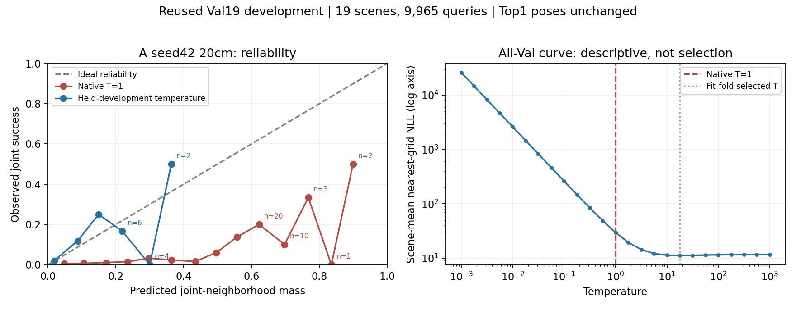
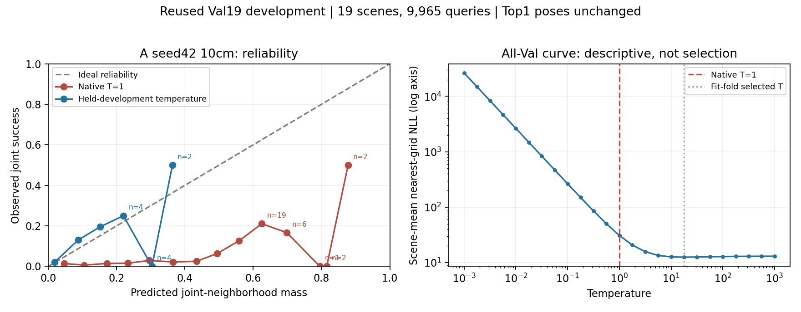
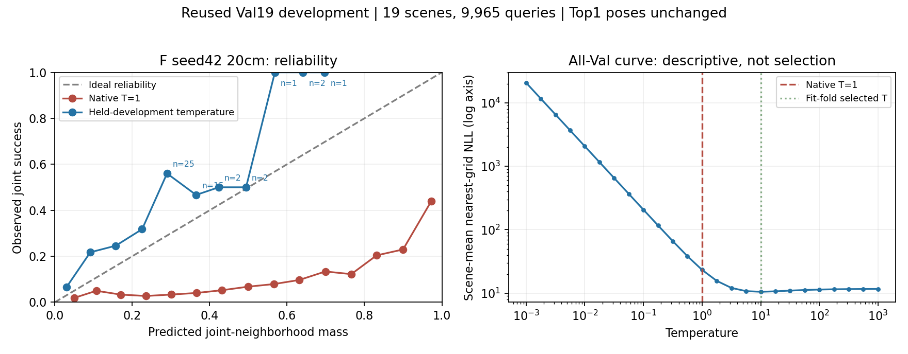

# Acoustic and independent-fusion calibration: low ECE without useful localization

2026-11-12 KST, Track A, Exploratory/reused Val19. Verification code `1a494e31f89a23fa42ef6f0dd371db707004880c`. Each of three reviews covers all19scenes/9,965queries with curve/native file hashes, query IDs, exact selected poses and outcomes, T=1 metric replay and exact five-family-fold reconstruction. Prior full-Val checkpoint selection remains; this is not independent calibration. Graphs were visually inspected. High-confidence bins with fewer than30 observations are marked; they must not support stable reliability claims.

| Model/grid | Nearest-grid NLL native→crossfit | ECE native→crossfit | Normalized entropy native→crossfit | Joint unchanged |
|---|---|---|---|---|
|A1/20cm|29.5726→11.2043|0.26169→0.00344|0.47836→0.95839|2.4285%|
|A1/10cm|30.8812→12.5841|0.25872→0.00423|0.52701→0.96272|2.5389%|
|Independent equal/20cm|23.2262→10.5403|0.40534→0.05015|0.41328→0.90588|9.5534%|

All5 fit folds choose T17.7828 for A1 and T10 for independent fusion. Temperature fitting minimizes scene-mean nearest-grid NLL; ECE is evaluated afterward, not optimized. All pose selections remain unchanged.

## Evidence and interpretation

For A1/20cm,9,558/9,965 queries fall in the lowest-confidence bin after calibration, with mean confidence0.017842 and observed success0.019669. Thus low aggregate ECE coexists with a low-success, high-entropy predictor. This is not a useful localization improvement or evidence of learned causal modality reliability. Sparse high-confidence points do not establish generalization. The alternative explanation of confidence being reduced to match a low base success rate is consistent with these observations.

Independent fusion at10cm also remains weak: Joint9.7742%,R@1m12.9553%,fine0.5018%,Top20NMS40.6724%. [Metrics](independent_fusion_10cm_metrics.json). Finer grid does not resolve the fusion failure. Its10cm calibration review is pending; A2 and seed43/control experiments remain pending.

## Reproduction and outputs

Use `summarize_ray_calibration.py --baseline <native-directory> --calibration <curve-directory> --out <new-review-directory>` with the immutable saved arrays. No training or raw data publication. Computation failure: none in these three runs. Checkpoint/training provenance remains in [A1 report](A1_TRAINING_COMPLETION.md) and [fusion report](INDEPENDENT_FUSION_RESULTS.md).

[20cm A1 verification](A1_seed42_20cm_calibration_verification.json) · [10cm A1 verification](A1_seed42_10cm_calibration_verification.json) · [fusion verification](independent_equal_seed42_20cm_calibration_verification.json).

