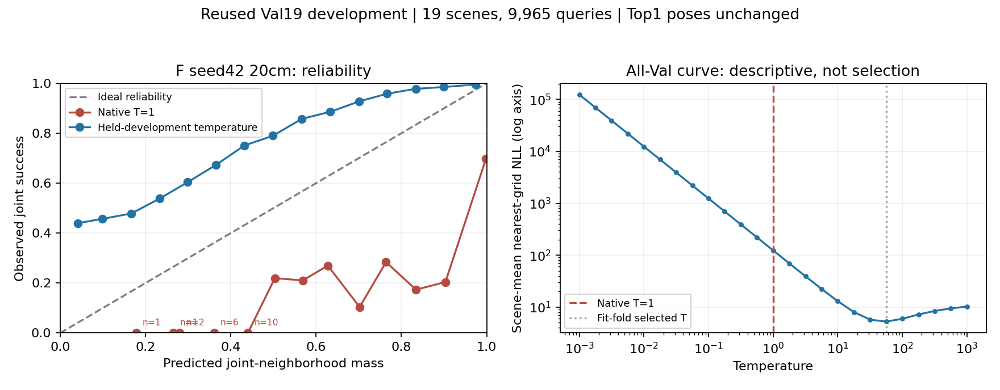
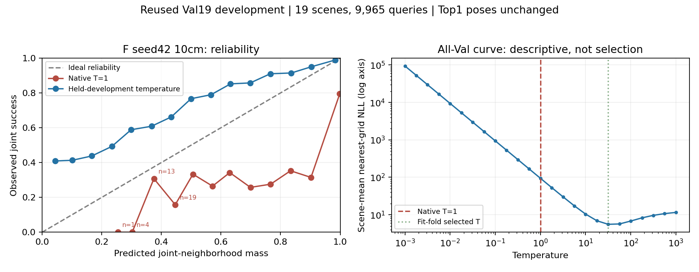
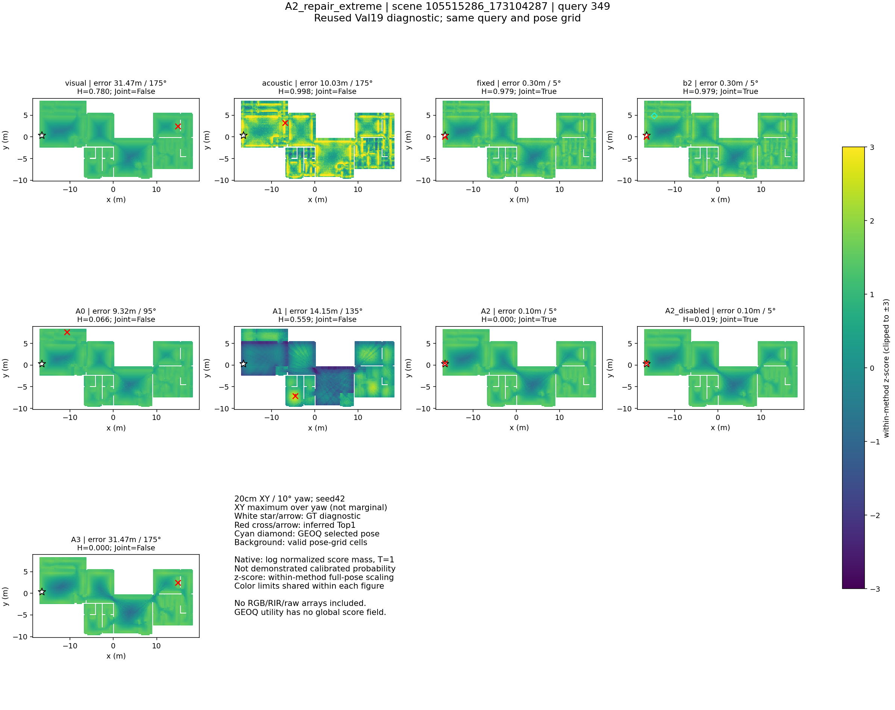

# A3 router diagnostics and calibration — 2026-11-17

Track A; Exploratory, reused Val19,9,965queries. No Test17 access or new training/rendering.

## Completed evidence

Both-grid checkpoint/input/hash/aggregate validation passed: [integrity](A3_integrity.json). [Updated seven-metric table](REQUESTED_METRIC_TABLE.md) now includes A3 at20/10cm. A3 Joint66.924/76.187%; fine30.918/49.473%. Grid changes are inference interventions, not new model learning. No native10cm B2+GEOQ result exists.

The previous driver and finalization process were absent, but10cm calibration output had completed. Recovery validated all existing per-scene file hashes and completion counts, then continued only missing router/uniform stages using the original frozen source snapshot. The two local recovery drivers preserve all existing outputs. No reason for the parent-process exit has been established.

## Router observations, not causal proof

[All36direction statistics and fusion replay](A3_router_diagnostics.json) reproduce saved means and moment-matched scales. Learned fusion rayMAE0.555558 versus0.632119 with uniform weights on the same heads (difference−0.076560m).

Direction-averaged weights inside FoV: visual0.804775, acoustic0.000861, joint0.194364. Outside FoV: acoustic0.211291, joint0.788709. Thus the standalone acoustic head is almost suppressed inside FoV; this does not show that acoustic information is absent from the joint head.

Mean directional scale/error Spearman correlations are positive: inside V0.7115/A0.6301/AV0.6740; outside A0.6349/AV0.6502. Weight/error correlations are mixed: inside V−0.2943/A−0.5746/AV+0.2387; outside A−0.2776/AV+0.1523. The maximum-weight expert has the minimum realized error only53.44%inside and58.97%outside. These are arithmetic means of direction-specific statistics, not pooled or scene-independent correlations. Expert asymmetry and relative weighting confound simplistic interpretations. This does not establish independently calibrated modality reliability.

## Calibration replay

Both native and scene-grouped crossfit calculations were rechecked over all9,965queries; all Top1 poses unchanged.

| Grid | NLL native→calibrated | ECE native→calibrated | Brier native→calibrated |
|---|---|---|---|
|20cm|125.723→5.264|0.31402→0.28117|0.30920→0.26755|
|10cm|96.589→5.608|0.21871→0.16358|0.21707→0.17643|

All five development folds select T56.234 at20cm and31.623 at10cm. Improvement is incomplete: reliability curves remain far from ideal, and prior checkpoint/teacher exposure prevents independent-validation claims. Nearest-grid NLL and Joint-neighborhood ECE assess different events. The calibrated A3 results do not erase the previously reported A2 negative10cm ECE/Brier result.

[20cm verification](A3_calibration20_verification.json), [10cm verification](A3_calibration10_verification.json). Both plots visually reviewed:

## Preserved failure case

The previously selected A2-repair extreme (scene105515286_173104287, query349) was not chosen using A3. A2 succeeds, but A3 selects a pose31.47m away with175°yaw error and nearly zero normalized entropy. This is a concrete counterexample to equating a sharp field or aggregate improvement with reliable inference. One example cannot explain all errors.

## Pending

Same-head uniform20/10cm localization and paired comparisons remain running/queued. They isolate an inference weighting change, not separately trained fixed-router learning. Full nine-method field replay generation passed; remaining figure visual review and final objective-by-objective audit are outstanding. This report is not study completion.

Training source62c58da20ed26ba95863638bbfd4926829999eec. Validator591e28e, calibration reviewer1a494e3, plotter48c7d61, finalizationbaf28c0. Exact executed source and input hashes are in linked receipts. Router statistics use the original evaluation snapshot; source hashes recorded in its JSON. Local recovery scripts and logs: workspace experiments/avloc_20261111/recover_a3_*_20261117.py and a3_tail_recovery_20261117/.

[External recovery-source hashes and base commit](A3_recovery_provenance.json). These local recovery scripts are outside Git; clean-clone execution still requires the original artifacts and source snapshots.
