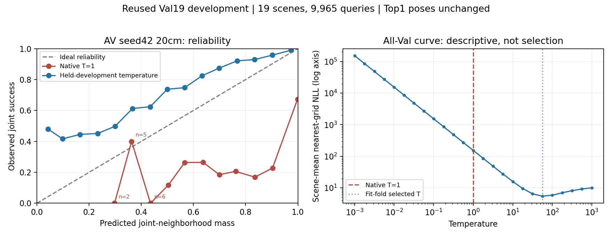

# Frozen-grid intervention and A2 calibration — 2026-11-12

Track A; Exploratory, reused Val19 / 19 scenes / 9,965 queries; seed42. The same prediction-manifest hash is required across each arm's two grid evaluations. No training or new FP-RIR rendering was performed. Test17 unused.

## Observations: resolution changes localization substantially

| Expert | Joint 20cm | Joint 10cm | Fine 20cm | Fine 10cm | Top20 NMS 20cm | Top20 NMS 10cm |
|---|---:|---:|---:|---:|---:|---:|
| A0 visual | 50.105% | 60.462% | 22.027% | 38.906% | 88.751% | 92.122% |
| A1 acoustic | 2.428% | 2.539% | 0.151% | 0.301% | 22.689% | 22.760% |
| A2 joint | 64.927% | 74.180% | 30.467% | 49.333% | 94.180% | 95.625% |

Fine means position error≤0.1m; Joint means position≤1m and circular yaw≤30°. Both grids retain10° yaw. A2 10cm R@1m is74.842%. Pairing scene/query IDs gives A2 micro Joint+9.252pp and fine+18.866pp; equal-scene macro Joint+9.469pp (paired19-scene bootstrap95%CI[8.287,10.853]) and fine+18.465pp [15.953,20.788]. A0 likewise benefits. A1 Joint macro+0.121pp CI[−0.158,0.409] includes zero; its poor localization is not resolved by denser sampling. See [complete metrics and paired contrasts](grid_resolution_seed42.json).

Interpretation: under these frozen experts, discretization materially affects A0/A2 localization. This controlled inference change establishes a grid effect conditional on the saved predictions, not network improvement, independent generalization, or evidence that acoustic rays alone recover geometry. The20cm comparison remains primary. A2 10cm must not be compared against B2+GEOQ20cm as proof of architectural superiority. Finer-grid compute/storage costs are separate.

## A2 20cm temperature calibration

Full-cohort native and cross-fit statistics replayed successfully; saved Top1 poses are unchanged. Five source-family folds fit temperature using other folds' equal-scene nearest-grid NLL over the predeclared25-value grid. Each fold selected T=56.2341. This is reused development, not independent test calibration.

| Quantity | Native T=1 | Cross-fit T |
|---|---:|---:|
| Nearest-grid NLL |154.84757|5.46040|
| Joint-event ECE |0.33631|0.21449|
| Joint-event Brier |0.33230|0.24132|
| Normalized entropy |0.00970|0.43270|
| Joint accuracy |64.927%|64.927%|

Native sharpness does not establish calibration. Smoothing improves the stated calibration metrics without improving localization. The post-calibration reliability curve remains underconfident over much of its range; ECE is still substantial. Temperature was fitted to nearest-grid NLL, not directly to the Joint event. Sparse bins are annotated; no claims should rest on those few samples. See [replay verification](a2_calibration20_verification.json). A2 10cm calibration review remains pending at this report.

## Reproduction and limitations

Training code `62c58da20ed26ba95863638bbfd4926829999eec`; evaluation `8e77076c4f9c0f7cb0db32fceb2b230a3f16f31b`; grid comparison `598696f`; calibration-review helper source hashes are preserved in verification JSON. Run `compare_ray_grids.py --study <study-root> --out <fresh-output>` and `summarize_ray_calibration.py --baseline <study-root>/evaluation/A2_seed42_20cm --calibration <study-root>/calibration/A2_seed42_20cm --out <fresh-review>` from the study code directory. All manifests/query sets and aggregate metrics were checked; the expert gate independently replayed per-query ray MAE. Dense fields are not re-evaluated by the comparison script. Figure visually reviewed.

Single seed, repeated validation use and upstream baseline exposure limit generalization. Scene resampling does not measure seed variance. A3 and interaction-disabled comparisons remain outstanding; this report is not the research termination criterion.
