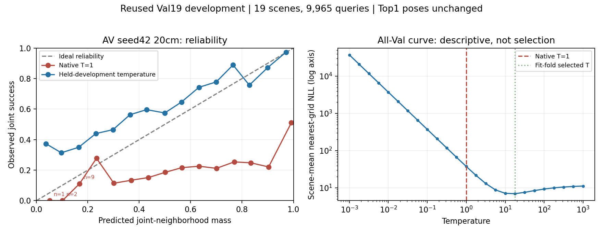
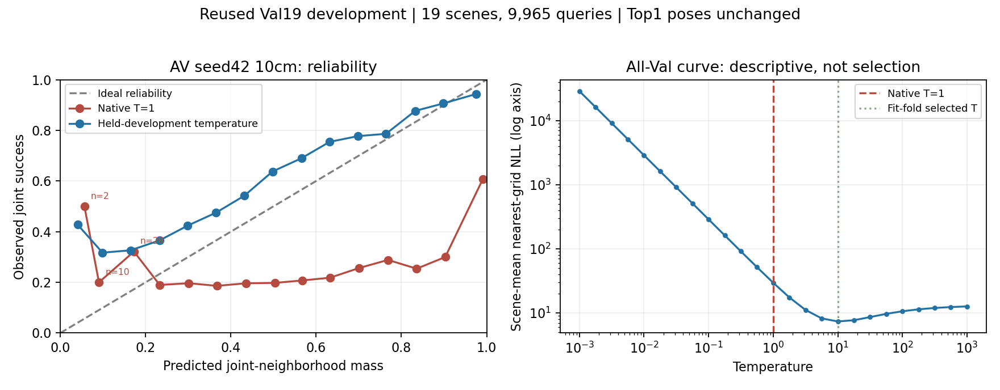

# Completed interaction-disabled control — seed42

2026-11-13 KST. Track A. Exploratory reused-development evidence; one seed, no independent Test evaluation. Full Train112/58,894 and Val19/9,965. Training, native20cm/10cm evaluations and both calibration reviews are complete. The follow-up below supersedes the initially pending10cm status. A3 has started and is not yet evaluated.

## Hypothesis, setting and competing explanations

The hypothesis is that a joint audio/visual expert improves localization beyond separately processed modalities. A2 uses joint attention; the control shares the same joint-expert parameters between isolated visual and acoustic forward passes, then combines their distributions with equal moment matching. Common seed42 initialization and full training protocol are retained. Neither inference path receives GT for scoring or candidate extraction.

The [control contract](INTERACTION_CONTROL_CONTRACT.md) establishes activation isolation but also documents shared gradients, different token counts, distribution fusion and optimization paths. Therefore this is a comparison between joint processing and a particular isolated-pass/equal-fusion design, **not a pure attention-edge causal intervention**. A weaker acoustic distribution harming the forced mixture, or different optimization dynamics, are competing explanations.

## Observed results

All values below are query-micro percentages except ray MAE. The primary grid is20cm XY/10° yaw. All methods use identical Val19 queries and pose grids; B2+GEOQ averages the existing42/43 results and has different training history.

| Method | Position≤0.1m | Position≤1m | Joint≤1m/30° | Top5 NMS | Top20 NMS |
|---|---:|---:|---:|---:|---:|
| A0 vision | 22.03 | 50.95 | 50.11 | 70.98 | 88.75 |
| A2 joint | 30.47 | 65.72 | 64.93 | 85.51 | 94.18 |
| A2 interaction-disabled | 12.75 | 41.71 | 40.34 | 72.30 | 90.61 |

The strong B2+GEOQ baseline remains Joint73.07% and position≤0.1m23.20%; the new control does not change that comparison. [Full requested threshold table](REQUESTED_METRIC_TABLE.md).

A2 minus disabled: Joint **+24.586pp micro**, +24.482pp equal-scene macro, paired19-scene bootstrap95%CI[21.565,27.330]pp. A2 is higher on all19 scenes. There are2,898 repaired and448 harmed queries relative to the disabled control. Fine-position gain is+17.712pp micro and+17.556pp macro, CI[15.460,19.615]pp. Bootstrap10,000 draws uses seed20261111; queries/seeds are not treated as independent scenes. [Contrasts, per-scene deltas and source hashes](joint_with_disabled_seed42.json).

On the separate10cm grid, disabled achieves R@1m47.51%, Joint46.39%, fine19.36%, Top5/20 NMS77.37/92.30%. A2 is74.18% Joint and49.33% fine on that same grid. This does not compare a10cm method against a20cm baseline.

Disabled ray MAE is0.717217m, in-FoV0.355342m, out-of-FoV0.876442m; A2 is0.560813/0.177372/0.729528m respectively. Thus the joint expert improves the geometric predictions in both angular regions. The control is also below A0 in final Joint success even though its Top20 coverage is higher, illustrating that candidate availability alone does not ensure correct selection.

## Calibration and counterevidence

At20cm, native entropy0.076978 does not imply calibrated confidence: native nearest-grid NLL37.9379, Joint ECE0.480334 and Brier0.457681. Five held-development folds select temperature17.7828; NLL becomes7.01871, ECE0.232555 and Brier0.289022, with unchanged poses and Joint40.3412%. Entropy rises to0.646056. The reliability plot shows substantial residual underconfidence after smoothing; no claim of independently calibrated reliability is supported. Full9,965-query native/crossfit replay passed and the figure was visually checked. [Verification](disabled_calibration20_verification.json).

The original A2 experiment's10cm ECE/Brier regression under NLL-selected temperature remains valid; this control's20cm improvement does not negate it.10cm control calibration must be reviewed separately when its running job completes.

## Interpretation, limits and next step

**Supported observation:** under this seed, dataset, selection rule and implementation, the joint design is substantially better than this isolated-pass/equal-fusion alternative. This complements the poor independently trained equal-fusion baseline and strengthens the case for how modalities are combined, rather than simply adding an acoustic prediction.

**Unverified causal/generalization claims:** the gain cannot be uniquely assigned to attention or physical acoustic structural evidence. Shared training, forced mixing and token/compute differences remain. Val19 was reused for checkpoint selection and prior research; upstream baseline exposure differs. Seed43 remains deferred under the user's seed42-first instruction. A3 learned routing and its fixed-weight inference control are still required; they may discriminate whether adaptive combination can avoid the observed harm, without proving separately trained fixed-router equivalence.

## Reproducibility and integrity

Control trained69 executed epochs and stopped by patience20; best epoch49, clean ray MAE0.7172172210710586. The existing `complete.json` reports loop counter70 because the patience check occurs before the next epoch; epoch001–069 files establish actual execution. The original receipt is preserved, not silently corrected.

Training code `62c58da20ed26ba95863638bbfd4926829999eec`, pinned runtime `sha256:e51cb712100f25d0018aa65e371e63deaa51d12601c465ce698c0c446800c318`. [Integrity gate](disabled_integrity_seed42.json) verifies best-checkpoint hash, manifest/source cohort, finite positive scales, all query IDs, replayed ray MAE and every stored metric mean for both grids. It does not re-execute every dense field or certify independent validation. Integrity code `591e28e`; matched aggregation `a8f1a60`; calibration review retains its executable source hash in the verification receipt.

Run `validate_expert_gate.py --study <study> --seed 42 --arm A2_disabled --out <fresh-json>`, `compare_joint_expert.py --study <study> --out <fresh-directory> --include-disabled`, and `requested_metric_table.py --study <study> --out <fresh-directory> --include-arm A2_disabled`. Prediction, bank and checkpoint artifacts remain local on SSD. No Test observations, new rendering or changes to Track B occurred.

## Follow-up:10cm calibration fully verified

The seven-stage control evaluation queue terminated successfully. All19scenes/9,965queries in the10cm native and crossfit calibration replay agree with saved IDs, Top1, success flags and summary statistics. All five held-development folds select T=10.

| Metric | Native T=1 | Held-development temperature |
|---|---:|---:|
| Nearest-grid NLL |29.68799|7.37607|
| Joint ECE |0.401622|0.171899|
| Joint Brier |0.384847|0.259398|
| Normalized entropy |0.113329|0.542151|
| Joint success |46.3924%|46.3924%|

The control improves NLL/ECE/Brier at both grids, but retains underconfidence over much of the calibrated curve. This is a method-dependent outcome: A2's10cm ECE/Brier regression remains counterevidence against universal improvement from NLL-selected temperature. No new temperature objective, checkpoint or model was selected. Reused-development folds do not remove upstream exposure or checkpoint-selection effects.

[Verification with executable source hash](disabled_calibration10_verification.json). Figure inspected; sparse bins remain labeled and are not interpreted as stable estimates. Reproduce with `summarize_ray_calibration.py --baseline <study>/evaluation/A2_disabled_seed42_10cm --calibration <study>/calibration/A2_disabled_seed42_10cm --out <fresh-review-directory>`. This uses the existing committed reviewer; no training source change.

