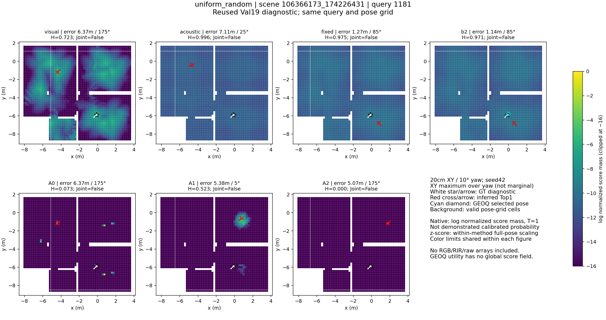
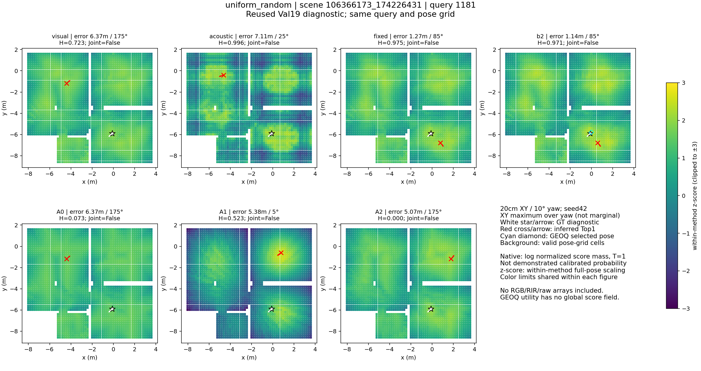
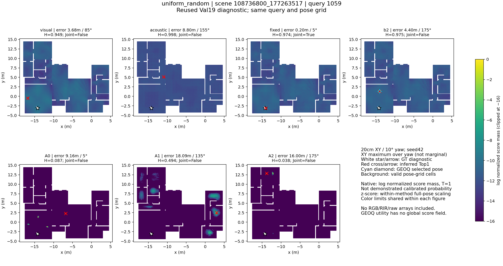
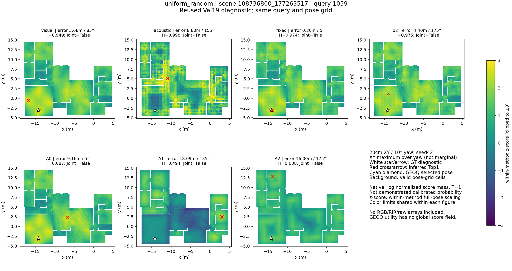
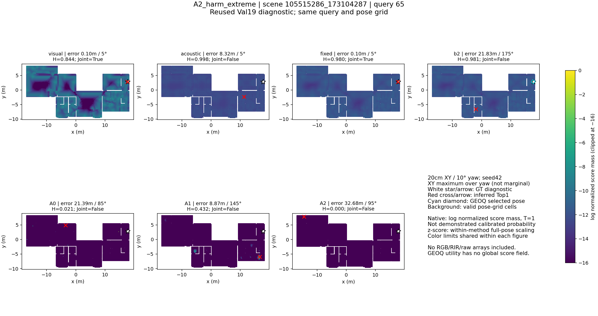
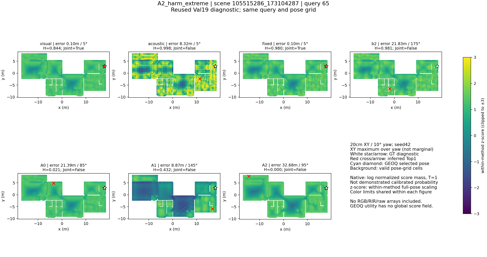
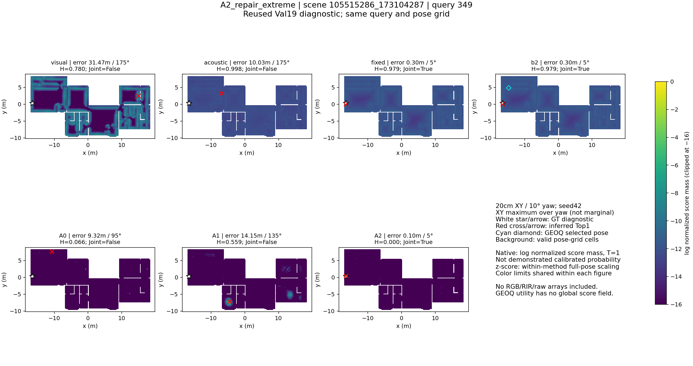
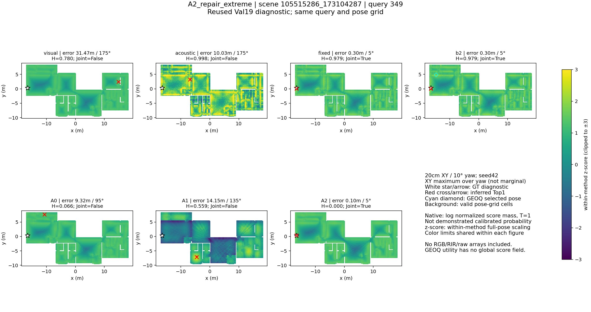

# Matched score-field diagnostics — 2026-11-12

Track A, Exploratory, seed42, reused Val19. Four queries in three scenes; 28 full-field diagnostic replays across existing visual, FP-RIR cosine, fixed fusion, B2, A0, A1 and A2. All use the same20cm XY /10° yaw grid. Reconstructed Top1 IDs, Joint/fine/Top20 outcomes match stored evaluations exactly; position/yaw error, entropy, nearest-grid NLL and GT-region mass match to rtol/atol1e−9. Input receipts, adapted embedding hashes, prediction hashes and geometry-bank hashes were checked. Raw fields remain local; only figures and small verification metadata are stored in Docs.

## Selection and interpretation

Two queries were drawn uniformly without replacement from the full9,965-query cohort using RNG seed20261111. Two diagnostic extremes maximize absolute positional-error difference between A2 and the existing visual baseline, separately within A2-repair and A2-harm Joint outcomes. They illustrate possible failure modes, not their population frequency. Both random cases happen to be A2 failures; they were not replaced with attractive successes. The harm/repair comparator is the existing visual baseline, not A0, and this case selection does not isolate the causal effect of acoustic interaction.

Each case has native log-normalized score mass at T=1 and within-method z-score views. Colors share fixed limits within each view, with clipping indicated. XY values are maxima over yaw, not yaw-marginal probability. Native score scales differ; normalized scores are not demonstrated calibrated probabilities. Z-scoring is display-only. The background consists of valid pose-grid cells rather than an independent floorplan image. GT is an overlay for post-hoc diagnosis and never enters score generation or proposal selection. GEOQ is a selected-pose overlay on B2; its utility is not a global posterior field.

The A2 harm example has32.68m position error despite near-zero normalized entropy. The repair example improves a31.47m visual error to0.10m, but fixed fusion and B2 also succeed. Thus it does not establish unique information in the joint network. Positive and negative cases support the distinction between peak sharpness and correctness, without estimating generalization or method superiority. Global frequencies and paired comparisons remain in the quantitative reports.

## Case 0: uniform_random

Scene `106366173_174226431`, Query `1181`.

## Case 1: uniform_random

Scene `108736800_177263517`, Query `1059`.

## Case 2: A2_harm_extreme

Scene `105515286_173104287`, Query `65`.

## Case 3: A2_repair_extreme

Scene `105515286_173104287`, Query `349`.

## Reproduction and remaining work

Figure/replay code `4117246`; underlying expert training `62c58da20ed26ba95863638bbfd4926829999eec`. Run `plot_matched_fields.py --workspace <workspace> --study <study-root> --out <fresh-output>` from the research code directory. It reconstructs fields from frozen local assets, checks saved diagnostics, and writes figures plus [verification metadata](matched_fields_seed42/verification.json). All eight figures were visually inspected via overview and a full-size failure panel. No new training, FP-RIR rendering, or Test17 access.

A3 and interaction-disabled results are pending and must be added to the full comparison when available. These are native-temperature and standardized views; existing temperature-calibration analyses remain separate. Four illustrative cases cannot replace full-cohort quantitative evaluation. Current artifacts are an intermediate deliverable, not completion of the benchmark.

## Completed-control extension — 2026-11-13

The original four cases (two uniform-random queries, plus A2-versus-existing-visual harm/repair extremes) are retained unchanged and extended with A2 interaction-disabled. All32 method/query fields reproduce saved Top1/Joint/fine/Top20 and diagnostic metrics within the original tolerances; all eight rendered figures were inspected in a contact sheet and the repair example at full size. Source `48c7d61`. [Replay verification](matched_fields_with_disabled/verification.json). Original seven-method figures remain intact.

These four cases have identical Joint success flags for A2 and disabled: both fail the two random queries and the existing-visual harm extreme, and both succeed on the repair extreme. This is useful counterevidence to treating a selected repair image as proof of a unique interaction mechanism. It does not contradict the full-cohort A2 advantage; case selection predates the disabled result and is not a representative estimate of its repair/harm rates. [All-query control comparison](INTERACTION_CONTROL_RESULTS.md).

The new views retain identical color limits,20cm/10° candidates, XY maximum-over-yaw and explicit uncalibrated score-mass labels. No raw observations or reference arrays are copied into Docs. A3 is still absent until its completed evaluation is available.

| Case | Native log score mass | Within-method standardized scores |
|---|---|---|
| uniform_random | [Figure](matched_fields_with_disabled/case_0_native_logmass.png) | [Figure](matched_fields_with_disabled/case_0_standardized_score.png) |
| uniform_random | [Figure](matched_fields_with_disabled/case_1_native_logmass.png) | [Figure](matched_fields_with_disabled/case_1_standardized_score.png) |
| A2_harm_extreme | [Figure](matched_fields_with_disabled/case_2_native_logmass.png) | [Figure](matched_fields_with_disabled/case_2_standardized_score.png) |
| A2_repair_extreme | [Figure](matched_fields_with_disabled/case_3_native_logmass.png) | [Figure](matched_fields_with_disabled/case_3_standardized_score.png) |
