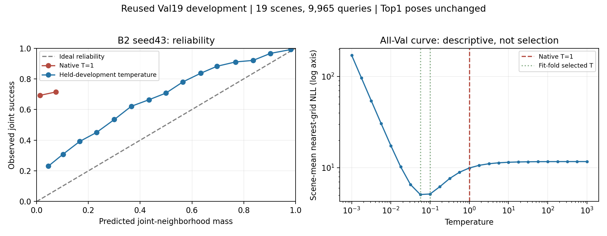
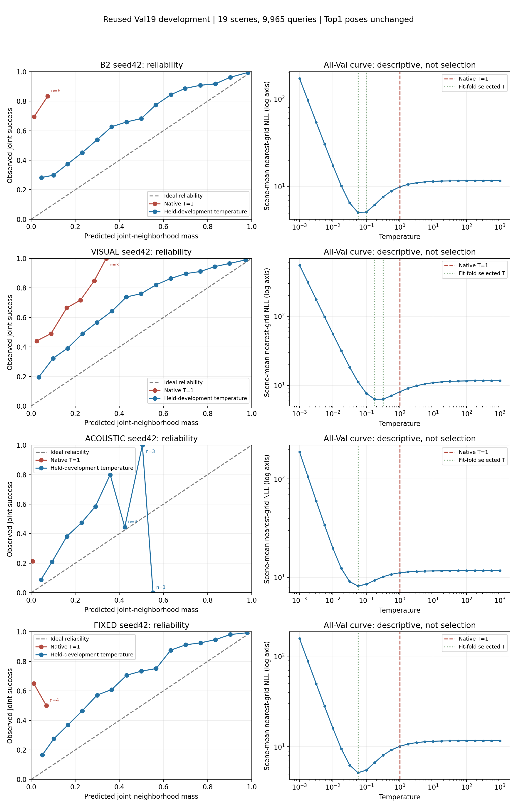

# AVLoc independent reimplementation and matched HSSD benchmark

Study `avloc_20261111`, Primary Track A, started2026-11-11. **Active, incomplete**. Evidence level Exploratory.

Objective: reproduce the paper-based architecture as an explicit6ch HSSD adaptation, train on the full eligible cohort, and complete all requested matched baseline, calibration, observability, interaction and cost comparisons. No superiority of Track A is assumed.

## Current evidence

Paper Method3/AppB,C,G and the three supplied reviews were read. The implementation reproduces the specified token/expert depths and routing formula, with deviations explicitly listed. Synthetic full-resolution architecture checks passed for A0/A1/A2/A3 and the interaction-disabled control. Unimodal predictions are invariant to changes in the other input; detached routing gradients and absent vision weights outside FoV were checked. Independent SciPy tests verify the chirp and convolution, and reflection is involutive. These are code checks, not learned localization results.

Full Train/Val asset validation completed: all68,859 scheduled queries in112 Train and19 Val scenes passed after family exclusions. Both image decoding and RIR finite/shape/checksum/pose checks are performed, rather than one waveform per scene. Test metadata was used only to exclude source families; no Test observation evaluation. Existing checkpoints/results and Track B are unchanged.

## Hypotheses and competing explanations

- Audio36-ray predictions may localize by geometry; alternatively direct-path or sensor-layout shortcuts may produce apparent accuracy. Diagnose ray error, fine-pose success conditions and geometry uniqueness.
- Joint attention may add information beyond independent V/A fusion; alternatively complementarity alone or extra capacity explains gains. Use independent fusion and matched-parameter interaction-disabled controls with compute reported.
- Sharp posterior may correlate with correctness; alternatively scale/temperature causes overconfidence. Separate entropy/margins, GT mass, NLL/ECE and held-development temperature calibration.
- FP-RIR matching may justify its storage/render cost; alternatively ray matching achieves similar accuracy without that bank. Measure both accuracy and deployment/training cost definitions.

## Results and failures so far

A0 seed42 full-cohort training has been launched; no completed trained A0–A3 benchmark table exists yet. Baseline/ablation numeric rows are pending, not zero or failed methods. The alternative SSD-root audit found no observation schedules (0 valid queries) and is unusable; it is preserved as a failed asset-location attempt. The authoritative network-backed HSSD audit completed with no invalid queries. SSD RGB availability does not imply the entire RIR dataset is mirrored.

## Remaining completion gates

1. Completed: whole-cohort asset audit/cache, exact geometry bank checks, real-data backward smoke and deterministic optimizer-resume integration checks.
2. Training/augmentation/checkpoint pipeline implemented; train A0/A1/A2 sufficiently on all valid queries, validate before large A3 router optimization.
3. Train A3 and required independent/disabled/router controls with paired initialization and multiple seeds.
4. Evaluate UnLoc,cosine,fixed fusion,B2,B2+GEOQ,A0–A3 on the identical cohort/grid; report all requested pose/ray/coverage/repair-harm/scene metrics, and separate10cm grid.
5. Complete posterior comparison figures, acoustic-only observability, calibration/correlation and cost analysis, with failure cases and paired scene uncertainty.
6. Update this report with actual numbers and all required deliverables. Keep the active goal until requirement-by-requirement audit proves completion.

See [method](METHOD_AT_A_GLANCE.md), [paper/implementation audit](IMPLEMENTATION_AUDIT.md), and [assumptions](implementation_assumptions.md). Reproduction currently covers only the initial code tests; full experiment reproduction must be added with checkpoint/data provenance after runs.

## Full-cohort training launch and engineering evidence

Train112 has58,894 queries; Val19 has9,965. An extra Train scene sharing a Val source family is excluded in addition to the requested three Test-family exclusions. Scene labels are finite/bounded, query IDs unique per scene, and all RGB/RIR inputs were audited. All data preparation jobs are terminal and successful.20cm and10cm Val banks are prepared independently of acoustic observations.

Real full-resolution backward/optimizer checks passed for A0/A1/A2/A3/interaction-disabled. A mixed-precision indexed assignment failed in the first smoke run, was corrected, and all five arms then passed; the original failure log remains local. Common initialization, ImageNet conv1 equality and perspective-column ray seeding tests passed. A four-query disposable A2 integration test exercises the real DataLoader, ESC/Gaussian augmentation, FP32 validation, optimizer checkpoint and exact resume. These checks establish implementation behavior, not learned accuracy.

A0 seed42 starts with full clean Val19 evaluation, then full-cohort training for at most100epochs and patience20 by minimum clean query-mean ray MAE. No model selection uses Test17. The source commit and run protocol identify the actual executable implementation; initial tests used base0480eb7 plus the now-committed source additions. A3 remains gated on completed A0/A1/A2 validation.

See [training state test](training_state_test.json), [initialization test](initialization_test.json), [backward smoke](runtime_smoke_v2.json), [geometry test](geometry_test_v2.json), and [asset audit](asset_audit_summary.json).

Production training source commit: `62c58da20ed26ba95863638bbfd4926829999eec`. Local run root: `$AVLOC_STUDY/runs/A0_seed42`; `$AVLOC_STUDY` is the dedicated SSD study directory, not a Git asset.

## Current run reproduction

Runtime image: `avfploc:cu124-clean` (PyTorch2.4.1+cu124, torchvision0.19.1+cu124). Mount the committed source at `/source`, audited SSD study at `/study`, and ImageNet weights at `/weights`; use GPU,4 data workers,8 CPU limit,20GiB memory,2GiB shared memory. Set `CUBLAS_WORKSPACE_CONFIG=:4096:8`, disable bytecode writes. Command inside the runtime:

```bash
python /source/train.py --data /study/data_v1 --noise /study/esc50_v1 \
  --weights /weights/resnet50-11ad3fa6.pth --out /study/runs/A0_seed42 \
  --arm A0 --seed 42 --batch 8 --workers 4 \
  --code-sha 62c58da20ed26ba95863638bbfd4926829999eec
```

Use the full training source SHA stated above for `--code-sha`; the local `protocol.json` records it together with source/data/noise/ImageNet hashes. A new run requires a new output directory. `--resume` is only for an incomplete run with matching protocol and `latest.pt`; do not restart a live container. No trained-checkpoint hash is claimed before a checkpoint is created. Dataset/cache access is required; this is not self-contained public-data reproduction.

## Geometry-only matching implementation

Source `8eaaf247ae20ac39e132e2192bafee3f8b18ae4c` adds Eq2 summed Laplace log densities over36 rays (11 for V), positive logical-yaw bank permutations, stable GT-free joint-distance/yaw NMS, and separate diagnostic functions. Independent SciPy log-density agreement has maximum absolute error1.14e−13. All19 Val scenes × two grids pass known-profile maximum consistency, including circular yaw and symmetric ties. [Numeric tests](matching_test.json), [real bank tests](real_bank_matching_test.json), [execution provenance](matching_provenance.json). These are numerical tests, not a trained localization claim.

`predict.py` requires completed training, selects the recorded best clean-Val checkpoint, validates architecture/data hashes, and extracts all9,965 clean Val ray distributions in float32. `evaluate_fields.py` verifies prediction/bank hashes and query IDs, then evaluates either20cm or10cm. Both CLI paths compile; end-to-end learned inference awaits completed training.

Reported Top5/20 will distinguish raw score ranks from1m/30° NMS candidates. GT affects only subsequent error/coverage/region diagnostics. Eq2 normalization uses a uniform discrete pose prior and conditional ray-independence assumption, not demonstrated calibration. Record entropy, raw and distinct-peak gaps, nearest-grid NLL, GT joint-region mass/NLL, and predicted-pose neighborhood confidence against joint correctness. Regions outside grid support are explicitly flagged, not silently assigned zero NLL. Fifteen-bin ECE and Brier are descriptive; scene-held temperature fitting and independent-fold correlation analysis are still pending.

Reproduction after training completes (inside the documented runtime):

```bash
python /source/predict.py --run /study/runs/A0_seed42 --data /study/data_v1 --out /study/predictions/A0_seed42
python /source/evaluate_fields.py --predictions /study/predictions/A0_seed42 --data /study/data_v1 --banks /study/banks_v1 --out /study/evaluation/A0_seed42_20cm --grid-cm 20 --head V
```

Use a separate output for10cm and the appropriate A/AV/F head for subsequent arms. Do not treat partial output without a complete manifest/summary as a completed evaluation. Matching never loads an acoustic reference bank.

## Full-cohort baseline replay and first training epoch

The [baseline cache audit](baseline_input_audit.json) checks all19 Val scenes/9,965 queries, exact query IDs, poses within1e−6, primary20cm XY within1e−7, stored file hashes, finite fields, and unit observed/reference embedding norms. Eight scenes use the original B2 input cache; eleven use the historical independent-data cache. Cached raw-image/RIR encoder provenance is inherited; this audit does not re-execute those encoders. Historical ray windows remain the original baseline representation, not replaced by the new uncapped DDA targets. Report this representation difference in later ray/error analysis.

Frozen GEOQ replay uses actual final Train-only selection receipts, **threshold0 for seed42 and0.01 for seed43**. The initial fit result files have older thresholds and are not the final selection. The model hashes match the selected receipts; all19,930 utility rows reproduce historical gains within1e−10. Identical Support20 IDs/features, query IDs and labels are checked. No new fitting, candidate selection from GT, or Test evaluation occurs.

| Seed | R@1m | Joint@1m/30° | R@0.1m | Support Top1 joint | Support Top20 joint coverage |
|---|---:|---:|---:|---:|---:|
|42|74.5309%|73.1360%|23.2112%|71.0788%|96.7687%|
|43|74.3001%|73.0055%|23.1912%|71.1992%|96.7787%|

[Seed42 summary](geoq_seed42_summary.json) and [seed43 summary](geoq_seed43_summary.json) include scene-level results, repair/harm and source hashes. Observed: candidates cover many more correct poses than the ranker selects. Interpretation: within-bank selection remains a major diagnostic bottleneck. This does not prove that missing acoustic evidence or any particular interaction causes the residual errors. Val19 has prior development/upstream exposure. The AVLoc/B2 trained comparison and complete field-based baseline metrics remain pending.

A0 seed42 epoch1 processes all58,894 training queries with1,841 optimizer updates. Clean Val19 ray MAE changes from2.24835533m at initialization to0.42209575m; ray NLL0.46605635. [Epoch record](A0_seed42_epoch001.json). These are intermediate learning diagnostics, not a frozen localization benchmark. Training continues under the original100epoch/patience20 protocol. The epoch1 checkpoint is retained and hashed in [provenance](baseline_replay_provenance.json).

Actual baseline replay source commit: `c81f817b2e8a17cd2d12e2b0d845e17337cd5cef`. Full per-query baseline results remain local under `$AVLOC_STUDY/baselines/geoq_replay_v1`; only small summaries and receipts are committed.

## Score-field replay and sequential training queue

Baseline fields source83e8046 reconstructs native UnLoc visual score, raw cosine, standardized fixed fusion and adapted B2 from hash-checked historical caches. It checks each regenerated B2 score-NMS20 centre list against its historical list before writing diagnostics. NMS uses the historical1m+1e−7 numeric tolerance and30° yaw window; GT success thresholds remain unchanged. [Four-query integration smoke](baseline_fields_smoke.json) passed. Full19-scene jobs are running for seed42 (all four fields) and seed43 (B2; pure fields shared with seed42). Partial scene files are not a completed cohort; full summary is written only after9,965 queries. No raw global arrays are committed. Native softmax temperature1 alone is not a fair calibration claim across differing score units; temperature controls remain required.

A0 epoch2 clean Val19 ray MAE0.36494568m, [epoch record](A0_seed42_epoch002.json), with full58,894-query training again. Epoch3 is live. No early selection or training completion is inferred from these interim diagnostics.

Sequential queue source `981487ebc1f233800fc6af3ae92e6668fe59f37e` waits on the verified live A0 container. After successful terminal status AND completion artifacts, it trains A1/A2 seed42, A0/A1/A2 seed43, then the interaction-disabled control for both seeds. It pins the runtime image ID, verifies the original training source hashes before every launch, refuses existing run directories, and stops on failure. It does not restart interrupted experiments. **A3 is excluded** and still requires expert validation. [Queue configuration](expert_training_queue.json). All models retain max100epochs/patience20 and the same full data, paired initialization, batch and augmentation protocol. The queue has started waiting; subsequent runs have not yet launched.

## Matched aggregation and calibration protocol

Source `010e75dcbb9426505db9b788286e7d1fb61eb47f` adds strict ID-aligned aggregation of completed baseline and ray evaluations. Duplicate/missing scene/query rows are rejected. Reports include query-micro and scene-macro metrics, repair/harm and10,000 paired scene-bootstrap replicates with seed20261111. Model seeds are averaged within scenes, not treated as extra independent scenes. [Tests](paired_summary_test.json) verify unequal scene-size behavior, ID errors, and invariance to query/seed replication. Full baseline aggregation is queued behind the two verified running score-field jobs; it will reject incomplete cohort summaries. No comparison table is claimed before that completes.

Temperature selection is specified before the full trained comparison:25 fixed log-spaced temperatures10^-3…10^3; five stable source-family-grouped development folds; minimize mean scene nearest-grid NLL on the four fit folds, evaluate the omitted fold. Region NLL, mass, entropy, confidence ECE and Brier remain separate from the selection criterion. Boundary optima are flagged. [Tests](temperature_calibration_test.json) verify score-offset invariance, diagnostic formulas, family separation and that changing held-fold labels/objective does not change its selected temperature. These are code tests; actual model temperature curves and calibration outcomes remain pending. Full-Val checkpoint selection prevents calling this fully independent validation.

The all-method comparison remains incomplete: A0 training and the subsequent expert queue are active; A3, trained ray inference, temperature curves, observability, figures and cost analyses still require execution.

## Completed B2 seed43 fields and calibration execution

The full seed43 B2 field replay completed all19 Val scenes/9,965 queries; every reconstructed score-NMS20 centre list matches the archived list. [Summary](baseline_fields_seed43_summary.json): R@1m70.8279%, joint69.2423%, R@0.1m22.3783%, raw Top5/20 joint coverage86.1616%/93.3869%, NMS Top5/20 coverage91.0687%/96.8690%. These are frozen historical model results on reused development data, not independent generalization. The seed42 all-field run remains active; the combined baseline table awaits it.

At native temperature1, B2 seed43 normalized entropy is0.9746704 and joint-event ECE0.6796990. This softmax of standardized fusion scores spreads mass across a large bank and is not a calibrated probability model. The numeric ECE alone is not evidence that B2 has worse discriminative localization than another method; raw score units and temperature differ. The planned held-development temperature curves now run on both seeds. Their outputs will be assessed separately from the uncalibrated result.

Calibration driver source `50407925a2e49123797020ab8f84d067019822e1` evaluates all25 predetermined temperatures using regenerated fields, preserving per-query curves and source hashes locally. Before full execution,16 actual query-method pairs matched the independent field diagnostic outputs at temperature1 within1e−10 and had identical Top1 IDs; [smoke verification](calibration_real_smoke_check.json). Smoke did not fit any temperature. No source fold/temperature is chosen using Test17.

A0 seed42 epoch3 clean Val ray MAE0.33415187m; [epoch3](A0_seed42_epoch003.json). Epoch4 continues. Subsequent expert runs remain queued; no A3 or final trained localization comparison yet.

## Floorplan observability diagnostics

Source `76e0307c295b02e10c37930218d4a08d4b362f9f` implements a separate post-hoc geometry analysis. For each existing Val query it compares the GT-derived36-ray profile (and11-ray FoV profile separately) against the same20cm candidate geometry. The geometry margin is best incorrect-region profile MAE minus best joint-correct-region profile MAE. A positive margin means the best geometry match lies in the success region; a zero/negative margin flags a tie or competing profile. The count within0.05m of the best correct profile is a predeclared descriptive ambiguity statistic, not a success threshold. Missing correct regions produce null margins.

[Tests](geometry_observability_test.json) verify identical distant profiles, a distinct correct profile and out-of-support labels; a four-real-query [smoke check](geometry_observability_smoke.json) passed. Synthetic ties demonstrate that zero ray discrepancy can coexist with an incorrect pose, but this is not claimed as a measured HSSD frequency. The full19-scene job is active; later analysis will join these descriptors to learned acoustic ray errors and localization outcomes by scene/query ID.

GT-derived profiles never enter model inference, uncertainty prediction or proposal generation. This equal-scale perfect-profile experiment is not an upper bound on a learned model with direction-specific scales. It isolates geometry/grid ambiguity for interpretation. No new dataset rendering, model fitting or Test access occurs in this diagnostic. A0 training and the full baseline/calibration jobs continue independently.

## Matched bank storage audit

[Storage audit](bank_cost_audit.json), source `d92fe413fc0d269dcf1f1f899b9888de64129bd8`, covers the same19 Val scenes,71,383 XY cells and2,569,788 poses at20cm/10°. It reads verified FP manifests and cached representations, not raw waveforms.

| Artifact | Total bytes | Scope |
|---|---:|---|
| Historical FP-RIR raw files |323,380,029,888|428,298 files; manifest-recorded sizes, not fresh waveform audit|
| FP acoustic embeddings |1,315,731,456|float32 pose×128 array payload|
| Historical visual windows |113,070,672|existing pose×11 ray windows|
|20cm world-ray bank + XY |11,421,280|uncompressed array payload|
|20cm compressed bank files |2,629,328|actual on-disk NPZ size|
|10cm world-ray bank + XY |45,876,960|separate finer grid, not a primary matched acoustic comparison|

The FP embedding payload is115.2× the20cm ray-bank-plus-coordinate payload. This difference follows from storing a128-vector at every yaw pose versus36 world-ray distances per XY with headings obtained by index rotation. It is a representation/storage observation, not evidence that both encode equivalent acoustic information. No10cm FP-RIR bank is synthesized.

Recorded geometry preparation wall time is103.40seconds for **both grids together**, under the existing machine workload; it is neither an isolated timing nor a20cm-only estimate. Original FP rendering time is unmeasured here. Model weights, training, query encoders, B2/GEOQ compute and shared map assets are outside the bank figures. The requested accuracy/compute tradeoff remains pending trained matched evaluation and isolated runtime measurements.

## B2 seed43 held-development temperature result

All9,965 query temperature curves completed. Source `43c5eda1264030243f4fb9f8a99b2fe1931a5819` verifies curve temperature1 statistics against the separately executed native field evaluation, exact Top1 IDs and success labels, and recomputes the stored crossfit result. All checks pass. Four fit folds select T=0.0562341 and one selects0.1, with no boundary optimum. [Verification](calibration_seed43_verification.json), [fold/source summary](calibration_seed43_summary.json).

| Statistic | Native T=1 | Held-development temperature |
|---|---:|---:|
|Nearest-grid NLL (query mean)|9.949639|5.164361|
|Joint-neighborhood ECE (15bins)|0.679699|0.154966|
|Joint-neighborhood Brier|0.674410|0.177783|
|Normalized entropy|0.974670|0.374741|
|Top1 joint success|69.2423%|69.2423%|

**Observed:** scalar temperature changes concentration and confidence diagnostics without changing any Top1 pose. **Interpretation:** native standardized-score softmax is severely diffuse; a smaller temperature corrects much of this scaling mismatch. **Controlled conclusion:** the sharper distribution in this transformation is not a localization accuracy gain. **Limits:** residual ECE remains0.155 and confidence is mostly below observed success. Nearest-grid NLL fitting is not directly event-ECE minimization. Neither conditional independence nor cross-domain reliability is established. These are descriptive point estimates on reused development; model/teacher/checkpoint exposure prevents independent calibration claims.



The right curve uses all-Val scene means for visualization only; fold temperatures were selected without each held family. The figure was rendered and visually inspected. This is an intermediate B2 calibration figure, not the still-pending AVLoc-versus-TrackA score-field comparison.

## Completed full Val19 baseline comparison

Both seed field jobs and strict matched aggregation completed:19 scenes/9,965 queries, identical20cm/10° bank and source queries. All B2 score-NMS20 lists replay. [Full table](BASELINE_COMPARISON.md) and [paired statistics](baseline_comparison.json). Aggregation source `81bcc165bba8bef19b43239d3d6a459f3cb938e6`; seed42 supplies the shared frozen visual/acoustic inputs (not a new seed42-only training experiment), while B2/Support/GEOQ average adapter/ranker seeds42/43.

| Method | R@1m | Joint@1m/30° | R@0.1m |
|---|---:|---:|---:|
|UnLoc Visual|46.994%|45.850%|17.431%|
|FP-RIR Acoustic cosine|30.376%|21.365%|5.349%|
|Fixed .85V/.15A fusion|66.754%|65.038%|24.285%|
|B2|70.968%|69.313%|22.499%|
|B2+GEOQ|74.415%|73.071%|23.201%|

Observed query-micro GEOQ−B2 joint gain is3.758pp and fine gain0.702pp. The corresponding scene-macro differences are3.815pp [paired scene95% CI3.205,4.468] and0.716pp [0.538,0.902]. Compared with fixed fusion, GEOQ gains8.033pp micro joint but **loses1.084pp micro fine**. Scene-macro fine difference is−0.906pp [−1.688,−0.102]. B2 itself loses1.786pp micro fine against fixed fusion. These regressions must remain visible in the later AVLoc comparison. The result establishes this reused-cohort behavior, not an independent/general causal advantage of feature exchange or geometry.

Bootstrap resamples19 paired scenes10,000times with seed20261111, averaging model seeds within scene. Query-micro and scene-macro estimates differ and are not interchanged. Existing upstream teacher/research exposure remains. New AVLoc training uses112 scenes versus the historical B2 training regime; architecture/data-volume confounding must be reported rather than attributing later differences to architecture alone.

## Completed20cm geometry-only diagnostic

All9,965 GT-derived diagnostic profiles and IDs were verified. [Summary](geometry20_summary.json), [paired verification](geometry20_verification.json). With equal-scale perfect36-direction geometry profiles, joint localization is98.304% and fine41.284%; with11FoV directions, joint66.111% and fine27.416%. Median incorrect-minus-correct ray-MAE margin is0.41349m for36directions versus0.06826m for11. Missing joint-correct grid regions:0.

The paired scene-macro joint difference is32.511pp [29.718,35.464]. This shows the **potential discriminative information in additional floorplan directions when their true values are supplied**. It does not show that observed audio recovers them. It is not a learned-model ceiling: equal scales, off-grid profile mismatch and ray-weighting choices differ from learned inference. The10cm version is running separately to distinguish grid effects. Learned A1 ray/pose errors and observability correlations remain pending.

## Frozen fusion controls prepared

Source `a405fb3f51f23e320632949baed87ec322e6db2d` supplies two no-fitting controls for completed predictions: `independent_equal` combines paired-seed A0 V11 and A1 A36 using equal mixture moment matching inside FoV and audio alone outside; `A3_uniform` reuses the same A3 V/A/AV predicted distributions but replaces learned routing by uniform weights over available experts. The11-ray wrap-around ordering is preserved and no vision is introduced outside FoV. Query IDs, source hashes, seed and input manifests must match before combining. No GT or candidate scores are inputs. [Analytic tests](fusion_predictions_test.json) verify two/three-expert means, within/between variance, identical-expert invariance and directional indexing.

These controls are implemented and numerically tested but **not yet executed on trained predictions**. They separate independent modality combination from joint experts, and router inference effects from fixed experts. The uniform A3 intervention is not equivalent to training A3 with a fixed router; do not interpret it as that training ablation. Shared training exposure and different compute/parameter use must remain explicit. The requested interaction-disabled model is separately queued.

After completed prediction extraction:

```bash
python /source/fusion_predictions.py --mode independent_equal --first /study/predictions/A0_seed42 --second /study/predictions/A1_seed42 --out /study/predictions/independent_equal_seed42
python /source/fusion_predictions.py --mode A3_uniform --first /study/predictions/A3_seed42 --out /study/predictions/A3_uniform_seed42
```

Use `evaluate_fields.py --head F` for each resulting manifest, with20cm and10cm outputs kept separate. Repeat for seed43. These commands are pending trained checkpoints and do not authorize bypassing the A3 expert-validation gate.

## Completed seed42 temperature diagnostic and sparse-bin review

All19 scenes/9,965 queries and four cached baseline methods completed. [Verification](calibration_seed42_verification.json) checks39,860 query-method pairs against the independently evaluated native T=1 statistics and exact Top1 IDs/labels, and reconstructs the family-fold calibration. [Safe summary](calibration_seed42_summary.json). Review source `9da96e33607fe0ce8ce9b105e444d2673cfba2f7`; calibration driver source5040792 (full provenance in source history). The plot annotates bins with fewer than30 observations.

| Method | Native nearest-grid NLL → crossfit | Native ECE → crossfit | Joint accuracy, unchanged |
|---|---:|---:|---:|
|B2 seed42|9.94789 →5.14342|0.68112 →0.15393|69.383%|
|Visual|8.05253 →6.37353|0.41815 →0.21182|45.850%|
|Acoustic cosine|11.15884 →8.15896|0.20753 →0.11587|21.365%|
|Fixed fusion|10.14092 →5.15638|0.63904 →0.17210|65.038%|



Observed: sharpening improves these development calibration metrics without changing pose ranking or Top1 accuracy. Each held-family fold uses a temperature selected on other folds from25 fixed candidates, minimizing equal-scene nearest-grid NLL. NLL fitting does not directly minimize event ECE. B2 usesT0.056234 in four folds and0.1 in one; visual uses0.177828 or0.316228; acoustic/fixed use0.056234 throughout. Residual ECE remains substantial. Acoustic high-confidence bins contain only9,3,1 observations, so their irregular curve cannot support a general calibration claim. All-Val NLL curves are descriptive, not the fitting rule.

Interpretation: score scale is an important contributor to apparent diffuse posterior mass. This intervention does not improve localization, prove acoustic reliability, or establish independent calibration. Teacher/checkpoint/research exposure to reused Val19 persists despite family-fold temperature fitting. Learned ray-model comparison remains pending.

## Completed10cm geometry diagnostic, separated from learned accuracy

The process exited and all19 scenes/9,965 IDs and per-scene hashes passed [verification](geometry10_verification.json); [summary](geometry10_summary.json). Same true query profiles and10° yaw resolution, separate10cm XY bank:

| Perfect-profile diagnostic | Joint20cm →10cm | Fine20cm →10cm |
|---|---:|---:|
|36 directions|98.304% →99.378%|41.284% →67.687%|
|11 FoV directions|66.111% →77.832%|27.416% →52.363%|

At10cm, median incorrect-minus-correct ray-MAE margin is0.44415m for36 directions and0.09218m for11; no joint-correct regions are missing. The paired scene-macro36-minus11 joint difference is21.733pp [19.843,23.622]. These are GT-derived geometry diagnostics, never inference inputs/proposal filters, and not learned-model ceilings. The finer bank changes geometric approximation and candidate density; its large fine-metric effect must not be credited to a network. Whether audio predicts these informative profiles remains untested until A1 completes. No Test17 observations were used.

## Matched ray calibration path prepared, trained execution pending

Source `a3731d07c0a747307b7d544820f81ffbdfb48725` adds `calibrate_rays.py`, using the same25 temperatures and five source-family folds as baseline calibration. It requires completed19-scene/9,965-query predictions and completed native evaluation at the selected20cm or10cm grid. Prediction/data/bank manifests, file hashes, IDs, head and grid must agree. Before accepting each temperature curve, nativeT1 nearest-grid NLL, confidence, entropy, GT mass, exact Top1 ID and success label must match the separate full-field evaluation. Output preserves per-scene source hashes and records the training/checkpoint-selection exposure. It neither selects a network checkpoint nor uses Test17.

[Tests](ray_calibration_test.json) pass for synthetic11/36-ray distributions and reject corrupted Top1 IDs and confidence. This is numerical interface evidence only; full trained-model execution remains pending. Existing training closure was unchanged and A0 continues to its predefined stopping criterion.

Example after completed A0 prediction and native20cm evaluation:

```bash
python /source/calibrate_rays.py --predictions /study/predictions/A0_seed42 --data /study/data_v1 --banks /study/banks_v1 --native /study/evaluation/A0_seed42_20cm --out /study/calibration/A0_seed42_20cm --head V --grid-cm 20
```

Repeat with appropriate headA/AV/F only after the corresponding model and native evaluation complete. Keep10cm calibration/evaluation separate. Do not count implementation or synthetic checks as a trained comparison result.

## Post-hoc ray observability analysis prepared

Source `c44ce51cc7c2fcbaf4a8726f2dd4d8ef496f3a26` adds `analyze_rays.py` for completed19-scene/9,965-query predictions and their matching full-field evaluation. It checks prediction/data hashes, exact scene/query IDs, grid agreement with the ideal-profile geometry diagnostic, and per-query MAE consistency before combining evidence. Outputs include direction-wise MAE/scale, in/outFoV MAE, fixed target-distance bins[0,1,2,4,8,infinity)m, Laplace central interval coverage at50/80/90/95%, and scale–absolute-error Spearman correlations. Per-scene statistics are retained; pooled correlated rays are not treated as independent observations. Constant-variable correlations are null, not misleading zeros.

Geometry-margin versus joint-success correlation is descriptive. Cases include high ray MAE(≥1m) with correct joint pose, low ray MAE(≤0.2m) with wrong joint pose, and fine localization successes. Fixed sampling seed20261111 selects up to5 uniform examples per group, alongside ray-error extremes; full case rows remain local. These thresholds are diagnostic definitions, not a method/checkpoint selection rule. Labels never enter inference or proposals.

[Synthetic tests](ray_analysis_test.json) verify11/36-direction summaries, FoV null handling, exhaustive distance bins, analytic interval coverage, correlation degeneracy and rejection of nonpositive scales. The first test failed because the installed older SciPy result lacked `.statistic`; portable tuple indexing corrected compatibility. No trained-model finding is claimed: full integration, figures and acoustic conclusions remain pending.

```bash
python /source/analyze_rays.py --predictions /study/predictions/A1_seed42 --data /study/data_v1 --evaluation /study/evaluation/A1_seed42_20cm --geometry /study/observability/geometry20 --head A --out /study/analysis/A1_seed42_20cm
```

Run only after corresponding training/prediction/evaluation completion; repeat otherheads/seeds/grids separately. This does not replace the still-required A3 router-weight analysis or controlled joint/independent/disabled comparisons.
