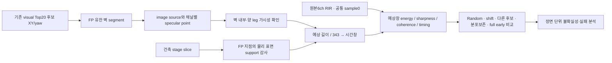

# Method at a glance — 기하가 예측한 시간과 실제 음향 증거를 분리한다

**FP의 벽까지 가까우면 돌아오는 경로가 짧아진다.** 단, 임의 방향의 왕복거리만으로 반사를 만들 수는 없다. 입사/반사 법칙을 만족하는 유한 벽점과 가시 경로가 있어야 한다.

1. **Geometry hypothesis:** 각 후보의 위치·방향에서5cm ring을 배치한다. 실제 query pose로 창을 고르지 않는다. Architectural support는 FP 자체의 검증 보조 정보이며 배포 시 공짜 입력이라고 가정하지 않는다.
2. **Physical constraint:** 벽에 source를 대칭시킨 image와 receiver를 직선으로 연결하면 반사 경로 길이를 구할 수 있다. 벽 밖 specular point나 가려진 경로는 제외한다.
3. **Clock alignment:** RIR sample0을 유지한다. 마이크별 peak에 맞춰 창을 옮기지 않는다. 48kHz에서±0.5ms는각방향24samples다.
4. **Evidence:** 강한 peak가 있는지,창 내부에 sharp한 변화가 있는지,예상 delay 정렬 후 채널 waveform이 닮는지 측정한다. Noise에도 argmax가 있으므로 이것만으로 reflection detection을 선언하지 않는다.
5. **Discrimination:** 동일 시간·거리 marginal을 유지한 다른 query RIR을 대입한다. 이 대조를 이겨야 단순 '이른 시간은 원래 에너지가 큼'을 넘어선 연관성을 말할 수 있다. Full early는 길이가 길어 per-sample power로 비교한다.
6. **Causal verification:** 통제 벽을 제거·이동한다. 신호가 벽 때문에 생겼는지와 계산한 시각에 도착하는지는 별개 질문이다.

## 이번에 배운 물리적 구분

벽 의존적 return은 있지만 좁은 예상 시간 대응은 실패했다. HSSD의 matched-control energy 차이는 양수였지만 coherence는 개선되지 않았다. 따라서 **geometry-associated energy ≠ verified first-order reflection identity**다.

새 예측: 정확한 path-time export를 지원하는 renderer에서 same-wall causal arrival이 확인되면,offset을 임의로 맞추지 않아도 single-wall response는벽1m 이동에 약5.83ms 지연해야 한다. 반대로 broad temporal association만 존재하면 넓은 창의 energy 차이는 유지돼도 세밀한 channel timing·wall identity는 실패할 수 있다. 이는 향후 검증 가능한 예측이며 이번 작업에서 다음 실험을 시작한 것은 아니다.

[정량 결론](RESEARCH_REPORT.md) · [물리 검증](PHYSICAL_VERIFICATION.md) · [상호작용 보기](interactive.html)
