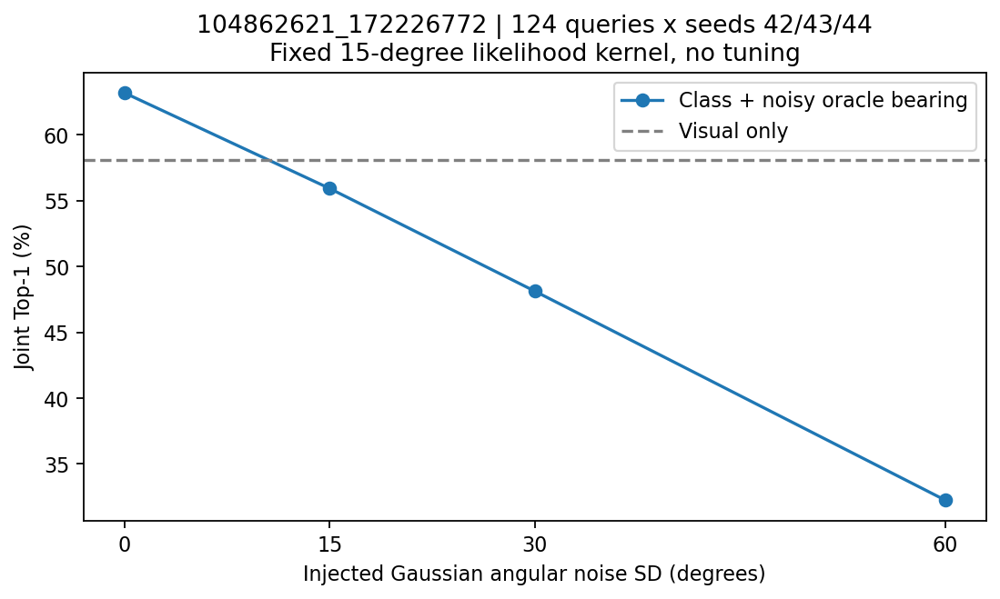
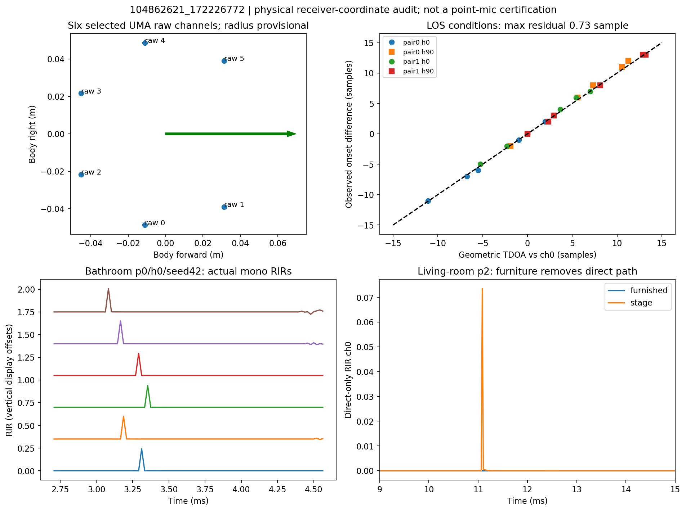
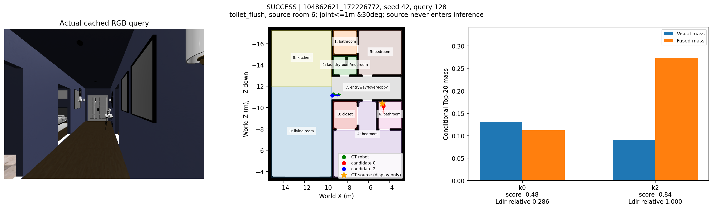
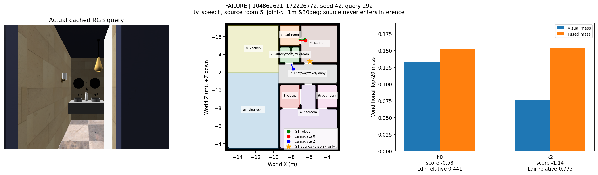

# HSSD semantic sound-guided pose disambiguation PoC — 2026-11-11

**실제 cached Visual-only Top-20 score 사용.** Calibrated full SE(2) posterior가 아니며 T=1 softmax로 정규화한 조건부 질량이다. **단일 training scene, GT sound class + GT geometric bearing oracle, Exploratory**. CLAP/BEATs/실제 DoA 성능이 아니다.

| 항목 | 판정 / 근거 |
|---|---|
| HSSD Semantic FP 정합 | PASS — 원본 semantic SHA 일치, free pixels 99.368% polygon 내부, 1cm grid roundtrip 오차 0 |
| HSSD SoundSpaces 2.0 RIR | PASS — native stage + 165 static furniture objects; 21 six-position RIR records, 별도 direct-only probe 12 records |
| 물리적 6-mic IR / TDOA | FAIL / 부분 검증 — 실제 위치별 mono IR은 생성. 3쌍×2heading 중 4조건 TDOA≤0.73sample, 2조건 직접음 차단. 기본 10cm receiver sphere와 잠정 5cm ring으로 실제 point-MEMS 재현 주장은 BLOCKED |
| 실제 Visual posterior | PASS: 실제 visual-only candidate score 사용 / calibrated posterior 검증은 없음 |
| N | 124 unique RGB queries / 75 위치 / seeds42,43,44 총372 paired event trials |
| B0~B3, C1~C2 | B0=58.06%, B1=58.06%, B2=55.91%, B3=63.17%, C1=42.74%, C2=24.19% |
| B3−B0 | +5.11%p, query-cluster paired bootstrap95% CI [-2.15, +12.63] |
| Go / No-go | **No-go: 실제 시스템 개선·일반화 주장 및 모델 통합/학습 확대.** CI가0을 포함하고 angular noise에 취약. 제한적 geometry mechanism 연구의 가능성만 남음 |

## 연구 질문과 경쟁 설명

생활 소리의 종류가 잠재 음원 공간을 제한하고 방향과 결합될 때 시각적으로 모호한 후보를 구분하는가? 경쟁 설명은 (1) 방향만으로 충분, (2) GT 방향/장면 구조/사전분포가 만든 낙관적 효과, (3) 강한 spatial prior가 correct visual 후보도 훼손한다는 것이다. Semantic label shuffle, random angle, class marginalization, silence, angular-noise controls로 구분했다. 비교는 모두 같은 후보와 관측·source schedule이다.

## Dataset / Evaluation Protocol

Scene `104862621_172226772`: living room1, bathroom2, bedroom2, kitchen1, laundry1, closet1, entryway1 =9 rooms. Training scene 중 실제 visual 후보·반복 bathroom·literal living room·compact geometry를 기준으로 선택했고 성공률로 scene을 고르지 않았다. 모든9 representative room 사이 navmesh path가 존재한다. Scene Test와 같은 source family가 아님을 split 메타데이터로 확인했으며 Test 관측을 읽지 않았다.

기존128 queries 중 **top1−top2 raw visual score ≤ log(3)**인124개를 GT 읽기 전에 선택. NMS20는 기존 코드의1m/30° 억제 조건이며 후보 삽입·GT coverage filtering 없음. Success는 selected pose의 position≤1m AND circular yaw≤30°. 원래 strict pair 대신 실제20후보를 사용하므로 유효한 SE(2) joint selection을 primary로 썼다. Top20 coverage=95.97% (119/124). Correct-pose mass는 성공조건을 만족하는 모든 후보의 질량 합이다. NLL은 calibration·복수정답/미포함 문제로 categorical NLL로 보고하지 않으며 covered-query success-set log loss만 JSON에 진단으로 제공한다.

Visual teacher Train116/Val19 및 기존 development 재사용에 노출됐다. 이번에는 checkpoint load·fit·threshold/temperature tuning을 하지 않았다. Seed 반복을 독립 RGB sample로 세지 않았고 query별3seed 차이를 평균 후 10,000 paired cluster bootstrap했다. 추가 위치75개 cluster sensitivity CI=[-2.067587209302325, 12.308123249299713]. **Scene-generalization CI가 아니다.** Single scene, 기존 연구의 sample 선택과 upstream 노출은 제거되지 않았다. Project의 다른 학습형 B2/GEOQ/FP-RIR baselines는 이번 사전 고정 oracle PoC의 승인된6개 대조 범위 밖이며 새로 실행하지 않았다.

## 생성 모델과 추론 경계

Event prior: running_water=.3, toilet_flush=.3, tv_speech=.3, silence=.1. Class별 room weights는 [config](config.json)에 고정했다. Water는 kitchen/bathroom 모두 weight1, laundry .5; flush는 bathroom/toilet1; TV는 living/tv1, bedroom .25. 모든 다른 room에도 작은 양수 확률을 둔다. 이는 측정된 생활 통계가 아닌 가설 검증용 사전분포다. 같은 class가 여러 방, 같은 방에 여러 class가 가능하다.

Robot GT를 읽기 전에 event→room→source index 전체를 샘플링한다. Source는1.2m, listener1.5m. 실제 sink/TV 객체에 붙이지 않고 region polygon·canonical free-map clearance·furnished navmesh 및 최종 depth clearance를 적용한 rule-based placement다. Generation과 integration 위치 집합은 서로 겹치지 않는다. Room마다 제한된0.2m grid quadrature를 사용하여 실제 연속 source distribution의 정밀 적분은 아니다. Source를 robot pose에 따라 고르거나 audibility로 sample을 필터링하지 않았다.

Inference 함수는 candidate pose/visual score/event/angle/known FP latent source support/config만 받는다. **GT robot pose, GT source xyz, raw source-generation pool을 전달하지 않는다.** Source-room prior와 모든 잠재 위치에 대해 von Mises 형태의 방향 likelihood를 평균한다. Kappa=1/rad(15)², alpha=beta=1 고정. Angles: map X/Z, yaw0=+X, 양의 yaw=+Z 방향. θ=wrap(atan2(source_z−q_z,source_x−q_x)−yaw). Sensor ring도 같은 body/world convention이다.

**B1=B0는 구현 결함이 아닌 생성 모델의 결과다.** 활성·위치가 robot과 독립이고 검출/청취거리 모델이 없으면 P(class|pose)=P(class)이므로 class만으로 pose를 구별할 수 없다. 임의의 robot-room/event 호환 점수를 넣으면 이 독립성 가정과 모순된다. Class는 B3에서 방향을 설명할 source-room mixture를 바꿀 때 기여한다. B2는 고정 active-event prior로 class를 marginalize한다. C1은 seed마다 room label permutation, C2는 독립 uniform angle. Silence에서는 모든 방법이 visual posterior와 bitwise 동일하다.

## 관찰 사실: Oracle 결과

| Method | Joint Top1 % | R@0.5m % | Fine@0.1m % | Correct mass | Entropy | improved / harmed / same | Δ vs B0 pp [95% CI] |
|---|---:|---:|---:|---:|---:|---|---|
| B0 | 58.06 | 54.03 | 23.39 | 0.128 | 2.839 | 0 / 0 / 372 | +0.00 [+0.00, +0.00] |
| B1 | 58.06 | 54.03 | 23.39 | 0.128 | 2.839 | 0 / 0 / 372 | +0.00 [+0.00, +0.00] |
| B2 | 55.91 | 50.54 | 22.04 | 0.230 | 2.350 | 50 / 58 / 264 | -2.15 [-9.95, +5.65] |
| B3 | 63.17 | 57.53 | 25.00 | 0.263 | 2.216 | 60 / 41 / 271 | +5.11 [-2.15, +12.63] |
| C1 | 42.74 | 37.90 | 17.47 | 0.215 | 2.165 | 39 / 96 / 237 | -15.32 [-23.66, -6.99] |
| C2 | 24.19 | 22.58 | 9.14 | 0.114 | 2.202 | 19 / 145 / 208 | -33.87 [-42.20, -25.81] |
| B3_noise15 | 55.91 | 51.88 | 22.85 | 0.244 | 2.231 | 53 / 61 / 258 | -2.15 [-9.68, +5.65] |
| B3_noise30 | 48.12 | 44.35 | 18.82 | 0.214 | 2.234 | 44 / 81 / 247 | -9.95 [-17.47, -2.15] |
| B3_noise60 | 32.26 | 27.69 | 12.10 | 0.166 | 2.212 | 29 / 125 / 218 | -25.81 [-34.14, -17.47] |

Event availability=90.86%, silence 34trials는 정확히 visual prior 유지. B3 correct-mass/entropy와 개선·훼손 수는 위 표, class/source-room/FP-line subgroup와 seed별 값은 [metrics.json](metrics.json)에 있다. Room breakdown은 **source room**이며 robot room별 결과는 [subgroup_details.json](subgroup_details.json)에 있다. Noise는 같은 event/source에 동일 표준정규 draw를0/15/30/60°로 scaling; likelihood kernel 자체는 재최적화하지 않았다.

B3−B2=7.26%p, CI=[3.225806451612903, 11.559139784946236]; B3−shuffled semantics=20.43%p, B3−random angle=38.98%p. 이 대조는 **현재 simulator/prior와 oracle 관측 하에서** 의미·방향 정합의 기여를 지지한다. B3가 B0보다 안정적으로 우수하다는 결론은 지지하지 않는다.

## 관찰 사실: 물리적 RIR와 실패

각 채널은 Ambisonics 계수가 아니라 서로 다른 receiver xyz에서 얻은 mono IR이다. Native SoundSpaces binding은 `getJoinedMesh(true)`로 stage 및 STATIC object geometry를 올린다. 165개 모두 STATIC임을 별도 확인했다. Material IDs는 사용하지 않았고 default material로 렌더했다. **HSSD 재질별 흡음/반사 매핑은 미검증**이다. 48kHz, indirect20,000/source512 rays, depth50, diffraction on(max10), transmission off, temporalCoherence off, units=meters, CPU2 acoustic threads. Full exposed settings는 [audio_validation.json](audio_validation.json) 및 [manifest](manifest.json)에 기록했다.

3source/listener pairs ×2headings ×3seeds furnished =18rings, paired stage-only bathroom3rings. 6채널은 sequential static renders이며 동일 source/time origin을 유지했다. Habitat seed는 주었으나 RLR RNG control은 검증되지 않아 bitwise 재현을 주장하지 않는다. Point-center TDOA=(distance_i−distance_0)/343을 onset>0.1% channel-peak와 비교했다. 1sample=20.833µs. 욕실·주방4조건의 worst residual0.725sample, 반복 onset SD0. 거실2조건에서는 직접음이 없고 multipath onset이 seed마다 달라져 실패했다. 실패를 channel order 성공으로 숨기지 않았다.

직접음-only 대조12rings에서 거실 furnished6channels 모두0, stage-only는6channels 모두 nonzero. 이는 가구 inclusion과 직접 경로 차단의 intervention evidence다. 욕실 matched stage/furnished late energy 평균은 5.7054/3.1491; Monte Carlo 반복 SD는 각각 0.0298/0.0211. 실제 방 재질을 재현했다는 뜻은 아니다.

절대 직접 도착이 center distance/c보다 약14samples 이른 현상도 보존했다. 설치 RLR header의 default listener radius=0.1m이고 Habitat binding에 이를 바꾸는 호출이 없다. 0.1/343×48000≈13.99samples와 부합하지만 radius 변경 개입을 이 PoC에서 하지 않았으므로 **원인 설명은 유력 가설**이다. 이 receiver sphere는 작은 MEMS point microphone과 다르다. 로컬7-MEMS UMA angular calibration 중 raw0..5를 선택했고 ring 반경5cm는 미측정 잠정값이다. 따라서 물리적6-mic 완료판정은 부분 실패/제한이며 실제 DoA 성능 검증은 수행하지 않았다.

## 정정과 실패 보존

초기 native import는 `free(): invalid pointer`; 문서화된 system libstdc++ preload로 해결했다. Geometry v1/v2는 결과 작성 직전 Git ownership 검사에서 실패했고, 전역 설정을 바꾸지 않고 detached HEAD 파일을 읽어 provenance를 확보했다. 원본 로그는 로컬에 남겼다.

**초기 `cast_ray` clearance/LOS 판정은 철회했다.** Physics off/on 모두 floor downward ray가 no-hit을 반환하는 무효 backend였으며 independent positive-control 검사가 이를 발견했다. Furnished navmesh/region checks는 유효하지만 ray-based 높이 clearance의 증거는 아니었다. 실제 1×1 depth camera6방향으로 1108점을 재검사했고 초기 invalid=16. 무효 위치를 제외한 source support로 모든 oracle baseline을 재실행했다. 초기 결과는 상위 디렉터리에 보존하며 correction.json으로 연결한다. 이 정정은 성능을 높이기 위한 선택이 아니라 물리적 유효성 검사 복구다. 6방향 depth+navmesh 역시 완전한 volumetric collision certification은 아니다.

추가 경계 정리: 초기 inference dictionary에 사용되지 않는 generation support가 포함되어 있었으나 선택된 source identity나 해당 좌표를 읽는 연산은 없었다. 최종 실행에서는 generation 필드를 함수 입력에서 제거했다. [inference_boundary_verification.json](inference_boundary_verification.json)의 posterior 배열 bitwise 일치 검사로 수치가 변하지 않음을 확인했다.

## 사례와 한계

첫 개선 query=128, 첫 훼손 query=292, seed42. 사례 선택 규칙은 seed/query 순 첫 해당 사례이며 대표 빈도 추정이 아니다. RGB는 실제 기존 HSSD query다. Source 별 표시는 생성/평가 시각화용이다.

Geometric bearing은 벽을 관통해도 제공되는 이상적 oracle이다. FP straight-line flag는2D 구조 proxy이며 actual furnished visibility나 반사·투과 likelihood가 아니다. Source/event별로 청취 가능성·거리감쇠·검출 실패·동시 음원은 모델링하지 않았다. Source prior와 simulation rule이 공유되어 낙관적이며 다른 장면/room distribution으로 전이되지 않을 수 있다. Nonuniform noise kernel, point receiver, real sound classifier/DoA, learned fusion은 미검증이다. FP와 semantic region은 같은 upstream annotation에 의존하므로 정합은 독립 정확도 검증이 아니다.

## 해석 / 인과 가설 / 검증된 결론

- 관찰: B3가 평균적으로 일부 후보를 복구하지만 정답 visual 후보도 훼손하며,15° 이상의 오차에 취약하다.
- 해석: 소리 class는 robot의 방을 직접 알려주는 것이 아니라 **방향 관측을 설명할 잠재 음원 영역의 분포**를 좁힌다. 이 모델에서 B1은 pose에 대해 상수다.
- 인과 지원: 같은 candidates/관측에서 label/angle 개입 시 성능이 하락한다. Native furnished→stage 개입은 거실 직접음의 존재를 바꾼다. 현실 세계 인과·일반화 증명은 아니다.
- 검증된 범위: 실제 visual candidate+known semantic FP+synthetic independent source+oracle angle의 고정 확률 모델을 재현했고, 침묵 보존·GT inference leakage 방지·대조 평가를 검산했다. 실제 센서 기반 localization 개선은 검증하지 않았다.
- 전이 예측: 동일 class가 여러 방에서 발생하거나 angle uncertainty가 커지면 source-region 제한 효과가 약해질 것이다. 현재 noise 결과는 후자를 지지한다. 더 많은 장면에서의 전자는 아직 가설이다.

## 다음 연구 제안 — 실행하지 않음

작은 receiver radius를 명시적으로 제어한 native timing 검증, audibility/detection 및 NLOS uncertainty를 포함한 생성·추론 모델, 독립 scene에서 사전 고정 평가 순으로 검토할 가치가 있다. 이번에는 새 모델 학습·CLAP/SELD 통합·추가 scene sweep을 실행하지 않았다.

## 재현·비용·출처

실행 명령은 [reproduction.md](reproduction.md), 정확한 source/input/output hashes와 코드 SHA는 [manifest.json](manifest.json), 자산 감사는 [audit.md](audit.md). 대형 RIR/WAV·raw predictions·원본 데이터/체크포인트는 로컬에만 둔다. 현재 보고서 생성 코드 SHA `0950b2d8fa2b44dc7befc6ebbd18634da428cda4`는 Docs commit과 구분한다. Source-only clean clone은 로컬 dataset/cache/native image 없이는 재현되지 않는다. Acoustic primary renderer 37.34s, oracle 1.99s; 전체 wall time·storage는 manifest. CPU4/8GB 제한, GPU/유료 resource 사용 없음.

공식 API와 설치 근거: [SoundSpaces2 API](https://github.com/facebookresearch/sound-spaces/blob/main/SoundSpaces2.md), [설치 안내](https://github.com/facebookresearch/sound-spaces/blob/main/INSTALLATION.md), [HSSD dataset card](https://huggingface.co/datasets/hssd/hssd-hab/blob/main/README.md). 실제 판정은 설치된 binding/실행 결과를 우선했다.
