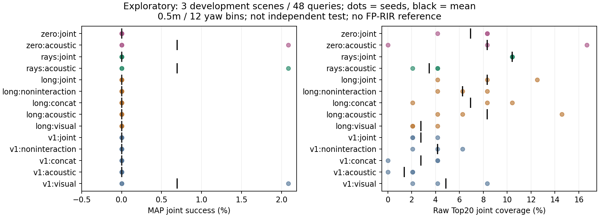
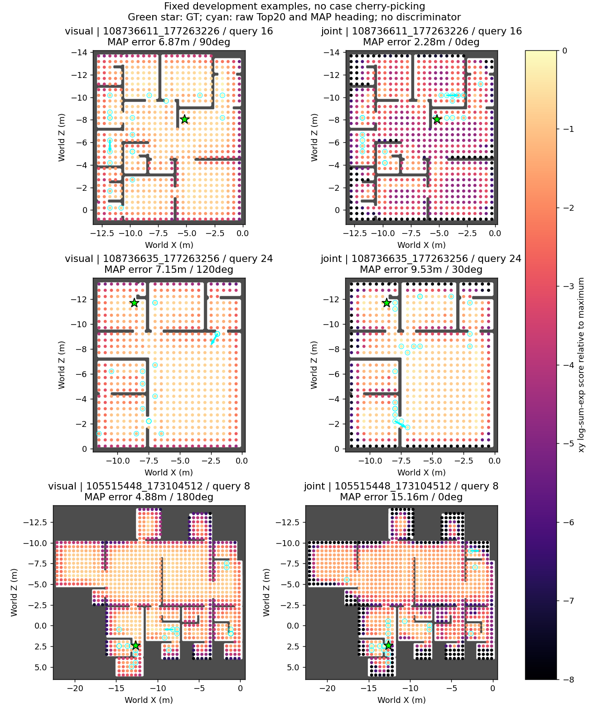

# 초기 실험 판정 — 성공한 구현 검증과 실패한 성능 가설

**42fits/3seeds의 초기 개발 실험을 완료했다. 현재 작은 dense 모델은 새 장면 localization을 해결하지 못했다. 전체 Track B 프로토콜의 완료/성공이 아니다.**

## Observation

- Stage0: 135개 Train/Val장면·71,467query의 경로/metadata정합 확인. Test관측 미사용. 전체 파형 검증이 아닌132장면 표본파형 QC.
- 구현:14tests통과, synthetic8query 암기100%, 실제 최대375,156후보의0.25m/36bin full field 검증. FP-RIR reference를 조회하지 않는 별도모델.
- 실험: 초기120step15fits + 2000step15fits + ray6fits + zero-geometry6fits =42. 실제학습은4scene/64query, 평가3scene/48query. 0.5m/12bin 전체 후보를 사용했다.
- 2000step local joint: Train Joint23.96%, Val Joint0%, Val Raw@20 8.33%.
- 2000step ray joint: Train Joint25.00%, Val Joint0%, Val Raw@20 10.42%, Fine0%.
- 동일구조 zero-geometry joint: Train Joint19.27%, Val Joint0%, Val Raw@20 6.94%, Fine0.69%.
- Ray−zero joint Raw@20차이 +3.47pp, paired scene bootstrap95%구간[−2.08,+8.33]pp. R@1m차이−2.78pp, fine차이−0.69pp. 3scene의 재사용 개발 결과이며 확증/독립 Test가 아니다.
- Ray acoustic: ValJoint0.69%, Raw@20 3.47%; zero-geometry acoustic도 Joint0.69%, Raw@20 8.33%. Acoustic 정보의 scene-generalizing 이득을 확인하지 못했다.
- 고정 score fusion(.85V/.15A, 후보 내 z-score)은2000step ValJoint0%, Train8.85%. Uniform valid pose 기대 Joint는 Val0.323%. 이 작은 표본에서 이를 안정적으로 넘는 성능을 입증하지 못했다. Temperature-calibrated fusion은 미실시.

## Interpretation / alternative

Synthetic overfit과 gradient검증만으로 실제 localization이 된다고 주장할 수 없다. 학습 관측에도100%를 달성하지 못했지만, local/ray joint에서 Train약24–25%와 Val0%의 격차가 있다. 작은 데이터·약한 visual encoder·초기 waveform표현·목적함수 최적화·map geometry 분별력·scene shift가 함께 경쟁 설명으로 남는다.

Local FP query의 큰 근사중복을 long-range ray signature가 줄였어도 개발Top1은 회복되지 않았다. **FP 후보를 서로 다르게 표현하는 것과 관측을 올바른 후보에 연결하는 것은 별개의 문제**라는 관찰이다. 단독 원인/물리적 acoustic mechanism은 미검증이다. 좁은 데이터에서 실패한 작은 모델로 FP-RIR-free원리 자체를 반증하지 않는다.

## Frozen 음향 개입

[Local](local_failure_analysis_summary.json), [ray](rays_failure_analysis_summary.json), [zero/replay](zero_failure_analysis_summary.json)를 보존했다. Direct-only0:32sample, direct-masked32:8192, late-only7200:8192(150–170.7ms)를 사용했고 masking후 재정규화하지 않았다. 이 조작은 에너지와 입력분포도 바꾸므로 특정 물리경로의 인과효과만 분리한 실험은 아니다. Joint의 ValTop1은 대부분0–0.69%로, 유용한 반향 정보를 확인할 충분한 성공 사례가 없다.

## 실패/중단·검증 기록

Zero-geometry 실행은6fits와 COMPLETE로그를 저장했지만 process exit143이었다. 이유는 확인되지 않았다. 결과를 정상종료라고 덮어쓰지 않았다. 모든42fits의144개per-query intervention결과를 다시 집계해 일치했고, zero의6checkpoints를 새 container에서 로드해288개 normal query/model조합의 Joint/R@1m/Raw@20을 재평가했다. **불일치0, 재평가 process exit0**. [검증 기록](completion_validation.json). 원본로그/checkpoint는 로컬에 그대로 보존했다.

추가 정정: audit의0.1m경계 floating비교와 NLL명칭 문제를 별도 문서에 기록했다. Archive validator의 기존 provenance schema와 신규 report schema가 처음 충돌해 report출력만 기존schema에 맞췄다. 기존 아카이브 내용/validator코드는 수정하지 않았다.

## Decision / falsification next

**현재 작은 모델의 성능 가설은 retain하지 않고 modify**한다. Stage2를 통과했다고 선언하지 않으며 낮은 retrievercoverage를 후단 discriminator로 가리지 않는다. 후속 우선순위는 (1) 실제query에서 supervised 구조 descriptor/시각 관측 matching이 학습되는지 확인, (2) 충분한 학습 장면·query와 강한 visual baseline 확보, (3) 같은 split/compute에서 joint·단순fusion·동용량대조, (4) fullresolution/robustness와 독립평가 순이다. 이 문서 작성은 전체 연구의 종료 조건이 아니다.

전이 가능한 예측: 후보signature가 모두 달라도 관측encoder와 연결하는 감독 신호가 약하면 localization은 실패할 수 있다. 따라서 더 복잡한 interaction만 추가하기보다 train-only 구조 prediction/observation matching을 먼저 통과시키는 후속 실험이 이 설명을 구분한다.

## Qualitative evidence

각 개발장면의 균일샘플 목록에서 **첫 query를 고정**해 visual/joint를 비교했다. 성공 사례 선택이 아니며6패널 모두 Joint실패다. GT는 시각화/평가에만 표시했다. Furniture mismatch/GTabsent/falseecho 등 미실험 범주를 임의 생성하지 않았다.

