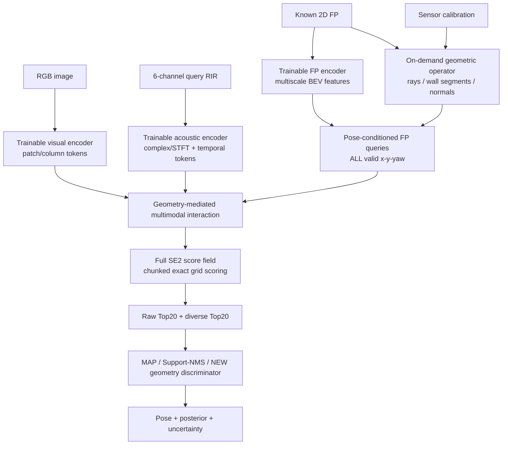

# AV-FPLoc Track B — FP-RIR-free Tri-branch Dense SE(2) Localization

> **Codex 실행 프로토콜 v1.0** | 2026-11-09 | 목표: IJCAI 2027  
> 연구 트랙: **Track B (독립)**. Track A의 B2+GEOQ 코드·후보·학습 가중치를 새로운 제안법의 입력 또는 지름길로 사용하지 않는다.  
> 문서 상태: **실험 설계 및 구현 명세**. 아래 수치·구조는 검증 전의 *초기 설정/가설*이며, 실험 결과가 아니다.

---

## 0. Codex에게 주는 최상위 지시

너는 이 문서를 실행하는 독립적인 연구 엔지니어이자 검증자다. 목표는 **RGB image + 6-channel active RIR + known 2D floorplan**만으로 각 유효 SE(2) pose 후보에 직접 joint score를 예측하는 전체 파이프라인을 구축하고, 대안·반례를 포함해 평가하는 것이다.

**반드시 지킬 사항**

1. **Full-bank scorer가 주 모델이다.** 기존 B2의 Top-20/GT-neighbor/기존 acoustic RIR reference 후보를 입력받아 학습하는 ranker 실험으로 바꾸지 말 것.
2. **추론 단계에 FP-RIR reference bank 생성·저장·조회 금지.** FP CNN feature cache, floorplan raster, floorplan geometry/raycast cache는 허용한다. 이들은 어떤 pose에서도 *음향 RIR을 시뮬레이션하거나 예측한 reference*를 포함하면 안 된다.
3. **세 modality는 각각 학습 가능한 encoder를 가진다.** frozen/partial/joint 학습 비교를 유지하고, 무작정 3개 pairwise cross-attention을 강제하지 않는다.
4. 점수장 전체에서 **Top-20을 추출한 후에만** 판별기를 적용한다. Top-20 외부 GT 후보를 판별기에 추가하면 안 된다.
5. **관찰 사실 / 원인 가설 / 검증 결과 / 해석**을 보고서에서 명확히 구분한다. 실험 없이 성공을 선언하거나 임의의 성능 숫자를 기입하지 않는다.
6. 제공된 repository/data에 실제로 접근할 수 없다면 그 사실과 누락된 입력·필요 경로를 명시한다. 구성 파일·실험·로그·성능을 꾸며내지 않는다.
7. 독립적인 대안 모델을 탐색하되, **공통 데이터 분할·후보 bank·평가 코드**를 사용하고, 변경점은 개별 ablation으로 귀속시킨다.
8. 사용자의 승인 없이 Track A 파일/체크포인트/결과물을 수정·삭제하지 않는다. 새 branch 또는 별도 `track_b/` 폴더에서 재현 가능한 버전 관리를 한다.
9. 본 문서의 초기 하이퍼파라미터는 데이터 규모/VRAM 측정 후 조정 가능하다. 조정 시 동기·변경 전후·검증 기준을 `decisions.md`에 기록한다.
10. 코드를 직접 수정할 수 있는 환경에서는 **구현→smoke test→학습→평가→결과 해석**까지 가능한 범위에서 실행한다. 불가능한 단계는 blocker와 재현 명령을 남긴다.

---

## 1. 연구 문제, 입력, 출력, 경계

### 1.1 Formalization

입력 `I ∈ R^{3×H×W}` (단일 RGB), `R ∈ R^{6×T}` (동일 pose에서 측정한 6ch active RIR), `F` (world-coordinate가 정의된 2D floorplan), `C` (RGB intrinsics, gravity alignment, 카메라/스피커/마이크 rig extrinsics, 마이크 순서/배치, 샘플레이트·시간 동기 메타데이터)이다. **추론에 GT pose는 없다.**

`P(F) = {(x_i, y_j, ψ_k) | (x_i,y_j) ∈ Ω_valid(F), ψ_k = 2πk/Nψ}`.

- 초기 dense grid: `Δx = Δy = 0.25 m`, `Nψ = 36` (10°). 0.20 m 및 0.50 m grid, 12/36/72 yaw 민감도를 추가 평가.
- `Ω_valid`: 구조 floorplan상 후보를 둘 수 있는 실내 위치의 보수적 마스크. **free footprint ≠ collision-free navigation**. black은 물리적 벽뿐 아니라 exterior/unknown일 수 있으므로 벽 신뢰도 mask 별도 사용.
- `sθ(I,R,F,C,p)`는 유효 후보 모두에 대한 스칼라. `(x,y,yaw)` grid와 1:1 대응하는 `S ∈ R^{H_F × W_F × Nψ}`를 반환하고, 유효하지 않은 후보는 `-∞` mask를 사용한다.
- `Pθ(p|I,R,F,C)=softmax_{p∈P(F)}(sθ(p)/τ)`; `τ`는 validation에서만 조정.
- 정규화된 posterior에서 local maxima / diverse hypotheses를 추출하되, **raw Top-K**와 **diversity-aware Top-K**를 항상 각각 저장한다.

### 1.2 허용/불허 구분

| 허용 (query 또는 FP 구조 기반) | 불허 (FP-RIR reference 의존) |
|---|---|
| Query의 실제/시뮬레이션 RGB·6ch RIR | 각 candidate pose에서 사전 생성한 RIR 사용 |
| FP raster, SDF, 벽 segment/normal, 비학습 raycast | 각 candidate의 reference RIR에 대한 embedding lookup |
| 학습 가능한 FP feature map 및 후보별 FP patch/geometry sampling | B2에서 생성한 Top-20을 전체 후보 대신 사용 |
| 학습 데이터 구축을 위한 query 위치의 SoundSpaces RIR | test pose를 사용하여 후보를 생성·정렬·마스킹 |
| 임의 scene에서 추론 시 FP 특징 1회 계산/캐시 | GT-derived wall distance 등 test GT를 observation input에 삽입 |

**중요한 범위:** FP-RIR-free는 **추론용 reference bank 불필요**를 의미한다. 지도 학습에 필요한 **query RIR 생성 비용**까지 제거한다는 주장이 아니다.

### 1.3 Pose convention / 센서 캘리브레이션

- 기존 프로젝트 convention과 호환: world 평면의 `(x,y)`, body **forward-left-up**, `ψ`는 world 기준 body heading. 각 좌표계 변환을 행렬·unit test로 명시.
- 카메라 optical axis, 이미지 좌/우, FP ray 각도, UMA 6개 외곽 마이크 인덱스 및 rig yaw zero-point를 동일 기준으로 정의. 중앙 마이크는 사용 금지.
- 시뮬레이션 6ch circular mic array 반경은 설정으로 전달(기본 실험 조건 약 5 cm). 실제 UMA-8 v2는 **실측 geometry/센서 specification**으로 별도 기록한다. 시뮬레이션/실측 간 불일치 여부를 숨기지 않는다.
- `T_world_rig`, `T_rig_cam`, `T_rig_tx`, `T_rig_mic[k]` 및 audio timing offset 포함. 위치와 yaw를 따로 적용하여 RGB/RIR 동일 pose 정합을 검사한다.

---

## 2. 핵심 가설 및 실패 조건 (사전 등록)

| ID | 검증 가설 | 반증 관찰 / 실패 조건 |
|---|---|---|
| H-B1 | FP-RIR bank 없이도 RIR–FP 구조 정합을 학습해 **held-out scene**의 후보 분별에 유용하다. | Acoustic-only 후보 score가 map-only/random prior보다 유의미하게 낫지 않음, query RIR shuffle에도 변화 없음 |
| H-B2 | FP를 매개로 한 joint interaction은 동용량 late/concat fusion보다 **시각 저하 조건에서** 더 유용하다. | matched-capacity 대조군과 거의 차이 없거나, 시각 안정 조건에서 systematic degradation |
| H-B3 | Candidate-conditioned 구조 입력은 acoustic/visual descriptor의 단순 결합보다 **Top-20 coverage**를 개선한다. | Top20 향상 없이 discriminator만 향상 / pose-conditioned FP 경로 제거해도 동일 |
| H-B4 | query-dependent acoustic reliability가 가구, reverberation, material mismatch에서 negative transfer를 제한한다. | OOD에서 acoustic이 visual-only 결과를 지속적으로 악화시키고 gate가 이를 차단하지 못함 |
| H-B5 | FP-RIR reference의 선행 계산·저장·새 맵 배포 비용을 줄이는 실용적 가치가 있다. | cache/FP encoding 비용이 커서 amortized total cost 이점이 거의 없거나 accuracy–cost Pareto 열세 |
| H-B6 | full posterior의 support가 애초에 정확한 후보를 담을 때만 stage-2가 이득을 준다. | Oracle@Top20 낮은데 reranker로 Top1만 해결하려 시도 / GT 후보를 강제로 삽입 |

**식별성 한계:** 2D FP만으로 천장 높이·재질·가구·정확한 잔향을 알 수 없다. 반복된 평면 구조와 대칭 후보는 RGB/RIR 관측이 충분히 구별하지 못할 수 있다. **물리적으로 구분 불가능한 pose를 강제로 단봉 posterior로 만드는 것은 실패 모드**이다. 높은 accuracy와 잘 보정된 uncertainty를 함께 평가한다.

---

## 3. 기본 제안법: PC-TriLoc (working name)

### 3.1 End-to-end graph



**주 모델은 `I,R,F,C → S`이다.** `S → Top-20 → discriminator`는 별도 분석 가능한 후단이다. GT pose 또는 B2 후보가 모델 입력으로 들어가지 않는다. **용어 주의:** 여기서 end-to-end는 세 인코더부터 전체 score field까지의 공동 학습을 의미하며, 이산적인 Top-20 추출을 통한 전체 체인의 gradient를 반드시 전파한다는 뜻은 아니다. Discriminator는 우선 독립적으로 학습하고 joint fine-tuning은 별도 실험으로만 취급한다.

### 3.2 각 encoder

**Visual `E_V`**
- RGB에서 `L_v=32–96` image column / patch tokens (`d=128` 초기)를 생성. FoV, camera intrinsics, gravity alignment를 명시적으로 반영.
- 초기 구현: 경량 CNN+projection 또는 기존 검증된 visual backbone의 trainable adapter; 추후 ViT patch tokens 비교.
- 선택 보조 head: 시야각별 floorplan-aligned depth *distribution*, confidence. GT depth supervision은 **train에서만** 가능. 테스트에서는 RGB 외에는 입력하지 않는다.

**Acoustic `E_A`**
- **raw query RIR 자체로부터 trainable features**를 만든다. 6ch waveform, log-magnitude STFT, complex phase/real-imag/IPD, adjacent microphone GCC-PHAT 등 중 학습·비교. 6채널을 단순 평균해 DoA 정보를 제거하지 말 것.
- 제안 기본형: `early RIR`(예: direct 이후 ~0–150 ms)와 `late reverberation`(예: 150 ms–1 s)의 2-stream conv/patch encoder. Window/hop/FFT 길이는 실제 waveform·메모리를 audit해 정한다. absolute onset timing, phase reference, direct impulse response calibration 기록.
- `L_a=32–96` acoustic tokens: time/frequency/channel/array-angle 메타 정보를 positional embedding으로 첨부.
- physics-inspired 보조 표현(phase, TDOA, sharpness, SNR 등)은 **ablation**이며 필수 encoder 대체물이 아님.
- Direct Tx→Rx 성분은 Tx–mic geometry가 고정이면 위치 분별력이 제한적일 수 있으므로 **direct-only, direct-masked, early-only, late-only** 실험으로 확인.

**Floorplan `E_F`**
- 단순 wall binary뿐 아니라 `free/structural wall/unknown` mask, metric SDF, wall normals, doorway/opening confidence(확실한 경우)를 입력하는 2D CNN / U-Net feature pyramid.
- `E_F(F)`는 임의 크기 FP의 multi-scale BEV feature map. candidate `(x,y,ψ)`에서 회전 정렬한 local feature patch를 `grid_sample` 등으로 읽어 `q_F(p)`를 형성.
- raycast geometry: camera horizontal FoV에 해당하는 FP first-hit distances `d_V(p,α)` 및 wall segments의 perpendicular distance / normal / line-of-sight confidence 등. 저장된 값은 **FP 기하 정보**이지 reference RIR가 아님.
- FP 오류/unknown은 hard wall로 확정하지 않고 별도 reliability mask로 전달. renderer의 differentiability 자체는 필수 아님; **FP encoder 및 interaction/head 학습 가능**이 필수.

### 3.3 핵심 interaction: geometry-mediated

후보 `p`마다 `q_F(p)`를 query로 하고, 같은 query 관측에서 추출한 `V_tokens`, `A_tokens`을 key/value로 사용한다.

```text
v_p = CrossAttention(q_F(p), V_tokens)
a_p = CrossAttention(q_F(p), A_tokens)
g_p = Gate(q_F(p), v_p, a_p, acoustic_quality, visual_quality)
j_p = MLP([q_F(p), v_p, a_p, v_p ⊙ a_p, |v_p-a_p|, g_p])
s(p) = s_VF(p) + g_p · s_AF(p) + s_joint(p)
```

- `v_p`는 RGB 관측과 후보 FP의 구조 호환도, `a_p`는 RIR과 후보 FP의 구조 호환도를 표현하도록 학습.
- 위 `CrossAttention`은 **후보별 FP queries가 modality tokens에서 정보를 가져오는 실제 Q/K/V attention**이다. 같은 차원 투영 후 평균하는 연산은 cross-attention이 아니다.
- 후보별 gate와 비선형 joint head가 있어야 단순 score 합산 모델과 구조적으로 구분된다. 학습된 `g_p`가 시각·음향 reliability를 실제로 반영하는지 별도로 검증한다.
- FP가 두 modality의 **정보 교환 매개**가 되는 구조이며, V↔A를 반드시 직접 2-way attention으로 연결하지 않는다.
- 대안 M2: 장면 관측의 `V_tokens↔A_tokens`를 **4–8 bottleneck latent**로 먼저 제한적으로 교환(MBT형)한 뒤 candidate scoring 수행. M3: unrestricted pairwise CA는 상한 실험으로만 수행.

### 3.4 Physics-guided echo alignment (별도 ablation, 기본 모델에 강제하지 않음)

학습할 수 있는 acoustic echo token `(t, azimuth, confidence)`을 후보의 wall-segment geometry와 soft matching시키는 추가 bias를 검증한다.

- collocated active source/receiver의 **1차 specular wall echo**는 적절한 평면벽/정면 반사 조건에서 `Δt ≈ 2d_⊥/c` (`c≈343m/s`, 실제 환경에 따라 교정). wall normal과 acoustic arrival direction 정합을 함께 고려.
- **임의 방향으로 raycast한 거리 `d_ray`를 항상 `2d_ray/c`로 해석하지 말 것.** 비스듬한 ray는 monostatic specular reflection이 송신 위치로 되돌아오지 않을 수 있다. 벽 segment의 수선 발과 가시성을 검증한다.
- 실제 RIR에는 floor/ceiling·가구·diffuse/multiple reflections·speaker direct path·clock offset이 존재. Echo prior는 **confidence-weighted soft bias**로만 적용하고 제거 실험을 반드시 수행.
- 이 모듈도 acoustic reference RIR를 생성하지 않는다. FP geometry로부터 **기대 반사 조건**을 계산할 뿐이다.

### 3.5 연산·메모리 계획

- 후보 bank는 `N≈A_valid/(ΔxΔy)·Nψ`. 예: 유효 면적 100 m², 0.25 m / 36 bins이면 **약 57,600 후보**(상한/기하와 grid 정렬에 따른 차이는 별도).
- Observation encoders는 query당 **1회**, FP encoder는 map당 **1회** 수행. `q_F(p)`의 cross-attention/head를 `C=512–4096` 후보 chunk로 배치.
- 최종 inference는 **전체 valid candidate**를 한 번씩 평가하고 score를 raster에 재배치. 1차 풀 grid 대신 상위 후보만 평가하는 pruning은 baseline과 coverage를 정확히 검증하기 전에는 기본법으로 채택하지 않는다.
- Full-softmax loss의 gradient memory가 문제이면 activation checkpoint, torch compile, mixed precision, query chunking을 적용. 필요시 **2-pass exact global logsumexp gradient**를 검증 구현. sampled negatives만으로 대체하면 full-field 학습 실험과 별도 라벨로 표시.
- FP feature cache 허용. **새로운 맵에서 cache를 생성하는 비용도 latency/배포 총비용에 포함**한다.

---

## 4. 학습 목표와 훈련 순서

### 4.1 Dense posterior objective (주 목적함수)

GT continuous pose `p*`에 대해 유효 grid의 soft target을 정의:

`q(p) ∝ 1_valid(p) · exp[-||t_p-t*||²/(2σ_xy²) - wrap(ψ_p-ψ*)²/(2σ_ψ²)]`.

`L_dense = - Σ_{p∈P(F)} q(p) · log softmax(S(p)/τ)`.

- 초기 `σ_xy≈0.25–0.50m`, `σ_ψ≈10–20°`는 후보 resolution과 센서 잡음에 따라 validation에서 정한다. angle은 반드시 circular wrap을 적용.
- GT가 후보 grid/valid mask 밖이면 **out-of-bank**으로 별도 계산. GT를 가장 가까운 valid 위치로 조용히 clamp하지 않는다.
- 인접 모드·반복 방의 근본 ambiguity를 모니터링. 단일 GT 근처만 고득점하도록 강요하는 손실의 한계가 있으므로 scene symmetry subgroup과 calibration을 분석.
- 보조 목적 `L_aux`(visual ray depth distribution 등), `L_pair`(hard negatives), `L_consistency`(rigid map-coordinate transform equivariance)는 각각 on/off 비교. 기본 loss `L_dense`로 시작.
- 불확실성 calibration용 post-hoc temperature는 train과 별개로 val에만 fit.

### 4.2 실행 순서

1. **E0 - 데이터/FP QA:** split manifest, GT frame alignment, valid mask 및 grid/quantization upper bound.
2. **E1 - Visual-only dense scorer:** FP를 포함하는 visual-only score field. 외부 F3Loc/UnLoc 등의 결과와 *동일 protocol에서만* 비교.
3. **E2 - Acoustic-only dense scorer:** query RIR + FP geometry만으로 full pose field. Query shuffle / direct masking / material mismatch 포함.
4. **E3 - Score-level fusion:** B1+B2 scorer의 정규화/calibrated scores 결합. 반드시 강한 고정 baseline.
5. **E4 - Joint non-interaction:** 동일 encoders, concat MLP 및 parameter-matched non-interaction.
6. **E5 - PC-TriLoc geometry-mediated interaction:** 주 제안. full-field 학습 및 fusion benefit 분해.
7. **E6 - Advanced alternative:** MBT-style bottleneck V↔A, optional physics echo bias; 개선 원인 ablate.
8. **E7 - Pose discrimination:** scoring model 고정, MAP / Support-NMS / 새 geometry-conditioned discriminator.
9. **E8 - Full evaluation & audit:** scene-held-out, shift/OOD, cost, uncertainty, failure examples.

**Frozen/Partial/Joint 비교:** 동일 backbone initialization과 data/order/compute budget에서 (a) encoder frozen+head, (b) 마지막 1–2 stage/adapter tuning, (c) 세 encoder joint fine-tuning을 비교. FP encoder도 포함해 어떤 부분을 고정했는지 정확히 표기. 성능뿐 아니라 GPU memory·학습 시간·추론 시간을 기록.

### 4.3 증강 원칙

- RGB: brightness / contrast / low-light / blur / texture degradation. 정해진 test severity와 train augmentation 혼합을 구분.
- Audio: signal gain, channel gain imbalance, noise, speaker/mic response, bounded timing offset, material/reverb shift, mic dropout. **아무 근거 없이 채널 순서를 뒤섞거나 IPD·TDOA 정보를 파괴하지 않는다.**
- FP: translation/rotation의 **world-coordinate 재정의** 시 GT/candidate 좌표만 일관되게 변환하고 body-centric RGB/RIR observation은 불변이어야 한다. metric scale을 임의 변형하면 ToF physics가 무너질 수 있음.
- Full / furniture-free RIR 데이터가 있으면 FP는 동일 구조로 유지하고 furniture mismatch에 대한 generalization 실험 구성.

---

## 5. 후보 추출과 geometry-conditioned discriminator

**후보 생성은 trained full scorer의 결과만 사용한다.** 후보 선택 방식 자체가 oracle 성능에 직접 영향을 주므로 엄격히 분리.

### 5.1 세 후보 선택 정책

- **Raw Top-20:** full score tensor 상위 20개 cell. **주요 retriever coverage 지표**.
- **Local-Max / NMS Top-20:** score tensor의 지역 최대점에 `xy/yaw` NMS 적용하여 서로 다른 mode를 추출. 점수와 suppression radius는 val에서 설정.
- **Support-NMS:** 각 local mode 주변의 posterior mass(예: `||Δxy||≤r`, `|Δψ|≤δ`)를 합산해 선택. MAP와 차이를 보려면 NMS 반경/온도/calibration 고정.

이 세 정책은 서로 다른 후보 집합을 낼 수 있으므로 **raw/다양성/지원량 각자의 Top20 oracle coverage**를 보고한다.

### 5.2 비교할 최종 선택기

1. **MAP:** full score field의 argmax. 추가 학습 없음.
2. **Support-NMS:** 지역 mode support를 합산해 최종 선택. 추가 학습 없음.
3. **NEW Geometry-conditioned Discriminator:** Track B의 frozen dense scorer가 얻은 실제 Top20과 RGB/RIR/FP-derived candidate geometry, neighborhood posterior statistics를 입력으로 score를 추가 학습. **기존 GEOQ B2 가중치/특징을 재사용하지 않음.**

Discriminator 학습용 후보는 scorer가 생산한 **out-of-fold 또는 별도 scene train split** predictions에서 얻는다. Train-time GT는 정답 label에만 사용하고, **candidate feature에 GT와 GT 근접 여부를 넣지 않는다.** 후보에 GT가 없으면 discriminator가 불가능한 한계를 그대로 기록한다.

비교항목: `Top-20 oracle success`, `MAP top-1`, `Support-NMS top-1`, `Discriminator top-1`, `oracle→final gap`, inference latency.

---

## 6. 데이터 contract와 split / 누수 방지

### 6.1 첫 단계에서 반드시 조사할 파일

- Scene mesh / GT structural FP / FP extent·resolution·world transformation / unknown mask
- RGB file + camera intrinsics + gravity alignment + pose
- Query RIR file 6ch + fs(원칙 48kHz) + Tx/Rx + room materials/config + pose·yaw
- Camera↔RIR pose alignment, mic order·rig extrinsics, direct impulse / timing definition
- 실제 데이터셋의 full/furniture-free scene pair 유무 및 데이터 라이선스
- B2 기존 protocol의 **사용 데이터 split 및 success 정의**(참조 목적으로만)

manifest 한 row는 `scene_id`, `building_group_id`, `split`, `query_id`, `rgb_path`, `rir_path`, `fp_path`, `world_to_fp`, `pose_world`, `sensor_calib`, `sim_version`, `asset_hash`, `validity_flags`, `furniture_state`를 포함. 모든 path는 reproducible resolver 사용.

### 6.2 Split 정책

- **Scene-held-out 필수:** 같은 scene의 서로 다른 pose/lighting/furniture/RIR 생성 변형이 train·val·test에 동시에 존재하면 **strict novel-scene 평가가 아님**.
- 동일 건물·동일 mesh derivative·같은 구조의 asset 재가공본은 `building_group_id`로 묶어 split. 3D-Front 중 유사 layout 복제 등은 hash/geometry near-duplicate audit.
- 12 HSSD scenes는 **pipeline pilot / leave-scene-out 탐색** 용도로 사용 가능하지만, 그것만으로 대규모 scene generalization 또는 IJCAI 수준의 일반화를 주장하지 않는다.
- 충분한 장면이 확보된다면 scene-group 기준 약 70/15/15 train/val/test를 starting point로 하고 실제 유효 scene 수에 맞춰 조정. split manifest를 학습 시작 전에 freeze; test 결과로 재설계 금지.
- 별도 cross-dataset evaluation(예: HSSD→Structured3D / real-scan)은 데이터가 물리적으로 호환될 때만 실행. 정확한 GT·FP 품질·RIR 정합이 검증되지 않은 scene은 실패 표본으로 은폐하지 말고 QA exclusion log.

### 6.3 Leakage guard (코드 수준)

- 모델 inference forward signature는 `(rgb, rir, floorplan, calibration, candidate_grid)`뿐. `gt_pose`, `gt_depth`, `gt_rays`, `scene_id`, `query_index`, `precomputed_reference_rir`, `B2_top20` 금지.
- GT로 학습 loss용 target 생성 가능. **Test forward 전에 GT를 담은 batch field 제거**하고 output hash invariant 테스트.
- split 집합 교집합 0; scene assets hash/geometry duplicate 검사; seed 고정; query RGB–RIR source pose 동일성 검사.
- floorplan contour를 만들 때 test GT camera trajectory/pose를 사용해 편향된 후보 mask를 생성하면 안 됨. GT position으로 유효 grid 보정 금지.
- Top20 scorer training/fine-tuning에서 test scene 노출 금지. Test 조정 결과를 validation으로 취급 금지.
- Score field 후보 indexing과 GT 좌표 변환에 관한 단위 테스트 필수.

---

## 7. 정량 metric — frontend / backend / 비용을 분리

### 7.1 Core localization

- **Full-bank Raw Coverage@K** (`K∈{1,5,10,20}`): full grid 상위 K 중 조건 `||t_i-t*||≤r` 및 `|wrap(ψ_i-ψ*)|≤δ`을 충족하는 후보 존재 비율.
- **Diverse Top-K Coverage**: mode NMS 등을 적용한 후보 집합의 동일 metric.
- **Final Top-1 success**: MAP / Support-NMS / discriminator 각각. 기본 보고 `r=1.0m, δ=30°` + 더 엄격한 `(0.5m,15°)`와 `(0.2m,10°)`.
- **Continuous precision**: translation error (m), yaw error (deg), median/percentile, joint success. Quantization upper-bound(최근접 grid GT success)을 같이 보고.
- **GT bank inclusion / excluded rate**: GT가 floorplan valid candidate 영역 밖인 비율. 주 metric에서 제외가 필요하면 별도 all-query/valid-subset 결과 모두 표시.
- **Oracle@20 − final@1 gap**: 좋은 후보를 놓치는지, 좋은 후보를 판별 못 하는지 분리.
- **Uncertainty & reliability:** entropy (candidate count에 따른 normalization 고려), NLL, expected calibration error / selective risk, true pose posterior rank. Calibration은 val에서만 조정.

**과거 B2+GEOQ 75.98%는 제한된 HSSD 12-scene 설정의 historical reference이며, threshold·candidate bank·split이 같다는 점이 확인되기 전까지 동일 조건 수치로 직접 비교하지 말 것.**

### 7.2 일반화와 subgroup (사전 정의)

- `clean`, `furnished`, `no/low light`, `low texture`, `high visual confidence`, `low visual confidence`, `acoustic low SNR`, `high reverb`, `repeated geometry`, `FP imperfect`, `large scene`, `direct-masked`, `sensor mismatch`.
- **Performance under visibility degradation**를 핵심으로 보되, test 결과를 보고 유리한 subgroup만 선택하지 않는다.
- Acoustic contribution: visual-only 대비 `ΔJoint Success`, `ΔTop20 coverage`, `ΔNLL` per scene; acoustic-only vs random/shuffled query.
- Noisy modality negative transfer: audio 증강/교란 때 fusion이 visual-only보다 악화된 비율.
- Per-scene macro 평균을 주 결과로 제시; query 가중 micro 평균 보조. Scene-cluster bootstrap 95% CI(예: 1,000회)와 3 seeds로 불확실성을 표시.

### 7.3 계산 비용 — FP-RIR-free의 독립적 가치

**각 방법에 대해** 학습비용, scene deployment 비용, query latency, total amortized cost를 분리.

| 항목 | B2(+GEOQ) | Track B |
|---|---|---|
| 신규 FP당 FP-RIR reference 생성 시간 | 실제 측정 | **0이어야 함** |
| Reference raw/embedding storage | 실제 파일크기 측정 | **0이어야 함** |
| FP preprocess/geometry/feature cache | 실제 측정 | 실제 측정 |
| Query encoder+scorer latency | cold/warm; batches | cold/warm; batches |
| Top20+postprocess latency | 실제 측정 | 실제 측정 |
| Query RIR simulation/recording cost | 동일 query data 기준 별도 측정 | 동일 query data 기준 별도 측정 |
| Training total GPU hours / peak VRAM | 실제 측정 가능 시 | 실제 측정 |

- FP-RIR bank가 raw RIR, compressed RIR, embedding 중 어느 표현을 쓰는지 실제 확인. **임의의 큰 raw RIR 저장량을 B2 실제 용량인 것처럼 제시하지 않는다.**
- `T_total(Q)=T_deploy + Q·T_query`를 Q∈{1,10,100,1000,...}로 보고. 저장량, scene 업데이트 시 재계산량, amortized break-even Q*도 해당하는 경우 기록.
- 반복 timing warmup, GPU synchronization, peak allocated memory, data loader / FP preprocessing 포함·제외 값 명시.
- 비교는 동일 GPU와 batch size, 동일 resolution/yaw-grid 기준; 불가능하면 비교 조건의 차이를 표기.
- 데이터 생성(학습 query RIR)은 Track B에도 남음. **절감되는 것은 inference-map reference bank 구성**이라는 사실을 명확히 한다.

---

## 8. 필수 비교군과 ablation matrix

| ID | 실험군 | 비교·검증 가설 | 필수 여부 |
|---|---|---|---|
| V0 | FP-only spatial prior / random valid pose | 공간 prior 편향 제거 | 필수 |
| V1 | Visual-only + FP dense field | RGB 구조 matching baseline | 필수 |
| A1 | Acoustic-only + FP dense field | FP-RIR-free acoustic information | 필수 |
| F1 | Calibrated score-level fusion | 단순 결합 baseline | 필수 |
| F2 | Concatenation MLP | feature-level 합치기 baseline | 필수 |
| F3 | Capacity-matched non-interaction | 성능 향상이 param/compute 증가 탓인지 | 필수 |
| M1 | Geometry-mediated tri-branch (제안) | 후보별 joint matching | 필수 |
| M2 | Bottleneck V↔A + geometry | 직접 멀티모달 정보 교환 가치 | 권장 |
| M3 | Full pairwise attention | 복잡한 교환의 상한 및 비용 | 선택 |
| P1 | M1 + echo/alignment physics bias | 구조 반향 prior가 실제로 작동하는지 | 권장 |
| D0 | MAP | 후보 그대로 | 필수 |
| D1 | Support-NMS | posterior support 이점 | 필수 |
| D2 | new FP geometry discriminator | 새로운 입력 조건의 재학습 후단 가치 | 필수 |
| T0 | Frozen encoders | pretrain transfer baseline | 필수 |
| T1 | Partial tuning | 비용-정확도 절충 | 필수 |
| T2 | Joint training | 목표 방식 | 필수 |
| X1 | Audio shuffle / zero / direct-only / late-only | 실제 acoustic evidence 검증 | 필수 |
| X2 | FP geometry removed / random FP orientation | 기하학적 조건화 검증 | 필수 |
| X3 | Equal compute / model parameter matched | 단순 용량 confound 통제 | 필수 |
| X4 | RIR feature raw vs spectrogram vs spatial features | encoder에 정보 손실이 있는지 | 권장 |
| X5 | Yaw/grid density & valid mask sensitivity | discretization effect | 필수 |
| B2ref | 기존 B2(+GEOQ) isolated historical/control reproduction | accuracy-cost Pareto 참조; 본 모델에는 입력 금지 | 가능 시 |

**외부 visual-only reference**: F3Loc(CVPR 2024), SemRayLoc(ICCV 2025), UnLoc(ICLR 2026), Ye et al.(CVPR 2026)을 조사. 동일 데이터·전처리·평가 프로토콜이 가능하면 재현하고, 불가능하면 paper-reported 숫자를 공통 표의 직접 비교 칸에 넣지 않는다.

---

## 9. 실행 순서·마일스톤·검증 게이트

### Stage 0 — Workspace 및 audit (코드 작성 전에)

1. `pwd`, repository tree, Git status/branch, installed CUDA/PyTorch/SoundSpaces version, GPU/RAM/disk, dataset tree를 read-only로 조사.
2. Track A 보호를 확인하고 새로운 `track_b/` 작업 범위 생성.
3. 입출력 file schema, valid scenes/queries, calibration, reference bank 실체와 비용, duplicated assets / scene-level split audit.
4. `audit_report.md`, `manifest.csv|parquet`, `split_manifest.json`, `dataset_qc.jsonl` 작성.
5. `P(F)` GT inclusion / nearest-grid quantization upper bound 계산.

**Gate 0:** 좌표/마이크/카메라 정합 unit test 통과. GT in-bank 비율과 exclusion 사유가 정량화되어야 다음으로 진행.

### Stage 1 — Minimal fully dense baseline

1. FP valid cell + yaw bank construction, FP raycast, batched renderer/FP feature sampler 구현.
2. Visual-only 및 Acoustic-only를 먼저 완성. `S.shape`, mask, grid indexing, full bank completeness 검사.
3. Synthetic tiny scene 8–32 queries로 overfit 및 gradient-to-each-encoder test.
4. GPU memory를 profiling하고 `C` chunk size 및 mixed precision 선택.
5. Frozen/partial/joint 시각 baseline 학습, score fusion 재현.

**Gate 1:** 예측 score가 full bank의 모든 valid 후보에 대응하고, RGB/RIR shuffle 및 rigid-map transform test가 합리적으로 작동. 실행 로그 없는 결과 없음.

### Stage 2 — Joint interaction

1. M1 geometry-mediated 모델 구현과 학습.
2. F1/F2/F3 동용량 비교. 동일 query/split/seed/budget.
3. Acoustic-only와 FP-geometry 제거/shuffle 통제군 확인.
4. M2 bottleneck/physics bias는 M1의 오차 분석을 근거로 순서대로 도입.

**Gate 2:** 성능 상승이 (i) capacity (ii) FP leak (iii) 특정 scene memorization이 아닌지 검증. 개선이 없으면 더 복잡한 attention보다 구조/데이터/물리 가정 검증을 먼저 수행.

### Stage 3 — Pose discrimination

1. scorer freeze; out-of-fold 후보 생성과 Top20 oracle 측정.
2. MAP, Support-NMS, new discriminator 동일 후보·held-out scene 조건 평가.
3. Oracle@20 한계 대비 판별기 개선폭 검증.

**Gate 3:** discriminator가 없더라도 **기본 dense model과 full coverage 결과를 독립적으로 보고**해야 함. GT를 candidate list에 넣어서 oracle을 높이면 실패.

### Stage 4 — Robustness, scale, compute, paper evidence

1. Scene-held-out 3 seeds, full vs furnished, photometric degradation, acoustic perturbations, FP corruption.
2. Per-scene paired differences, CI, entropy/calibration, ambiguity multi-modal visualization.
3. FP-RIR generation/storage cost 절감과 end-to-end latency 측정.
4. 실패 분류와 hypothesis falsification report. 절대 accuracy뿐 아니라 accuracy–cost Pareto curve와 scaling.

**Gate 4:** 재현 가능한 최종 결과 및 limitation 정리. Track B가 GEOQ보다 Top1 낮아도 **새 map 배포비용과 scene-held-out 일반화 측면 독립 평가**.

---

## 10. 코드 구조 제안 (실제 repo에 맞춰 조정)

```text
track_b/
  README.md
  configs/
    data_hssd_pilot.yaml
    data_scene_heldout.yaml
    model_visual.yaml
    model_acoustic.yaml
    model_noninteraction.yaml
    model_pctriloc.yaml
    train_frozen.yaml
    train_partial.yaml
    train_joint.yaml
    eval_strict.yaml
  data/
    schema.py              # paths/calibration/query pose contract
    manifest.py            # grouped scene split, hashes, QA
    floorplan.py           # ternary masks/SDF/metric transforms
    candidate_bank.py      # exhaustive valid xy yaw grid
    transforms.py          # coordinate frames/calibration
    rir.py                 # 6ch preprocessing, channels, timing
  models/
    visual_encoder.py
    acoustic_encoder.py
    fp_encoder.py
    geometry_operator.py
    modality_interaction.py
    dense_scorer.py
    dense_baselines.py
    echo_bias.py
    discriminators.py
  train/
    losses.py
    trainer.py
    optimization.py
  eval/
    metrics.py
    hypothesis_extract.py
    posterior_calibration.py
    profiling.py
    eval_runner.py
    failure_cases.py
  tests/
    test_geometry_frames.py
    test_rir_channel_order.py
    test_full_bank_indexing.py
    test_gt_inference_leakage.py
    test_split_integrity.py
    test_score_chunk_equivalence.py
    test_dense_loss_grad.py
    test_candidate_extractor.py
    test_no_rir_ref_bank.py
    test_map_frame_equivariance.py
  scripts/
    audit_dataset.py
    build_split_manifest.py
    run_experiment.py
    evaluate.py
    benchmark_cost.py
    make_figures.py
  reports/
    audit_report.md
    decisions.md
    experiment_registry.csv
    results_master.csv
    failure_analysis.md
    final_report.md
```

CLI는 실제 프로젝트 표준과 일치하도록 구현. 아래는 **구현할 인터페이스 예시**이며 현재 존재하는 명령이 아님:

```bash
python -m track_b.scripts.audit_dataset --config track_b/configs/data_hssd_pilot.yaml
python -m track_b.scripts.build_split_manifest --config track_b/configs/data_scene_heldout.yaml
python -m track_b.scripts.run_experiment --config track_b/configs/model_pctriloc.yaml --seed 42
python -m track_b.scripts.evaluate --checkpoint <model_ckpt> --config track_b/configs/eval_strict.yaml
python -m track_b.scripts.benchmark_cost --model <method> --config track_b/configs/eval_strict.yaml
pytest -q track_b/tests
```

---

## 11. 최소 test contract — pass/fail 자동화

1. `test_full_bank_indexing`: `N_valid × Nψ`를 모두 정확히 score; masked indices가 선택될 수 없으며 chunked/full scores 동일(오차 허용치 기록).
2. `test_gt_inference_leakage`: eval batch의 GT 값을 임의로 바꿔도 score 동일; GT key를 삭제해도 inference 가능.
3. `test_split_integrity`: train/val/test scene/building-group hashes intersection가 0. query/derivative duplicate 검사.
4. `test_map_frame_equivariance`: FP/world origin 회전·평행이동과 candidate 좌표 변환 시 같은 physical pose의 score 대응이 유지(수치 interpolation tolerance 표기).
5. `test_rir_channel_order`: 6ch array indexing, azimuth, direct impulse, RIR time origin 확인.
6. `test_dense_loss_grad`: `L_dense` 역전파가 세 trainable branch와 interaction에 도달. frozen 구성에는 해당 grad 없음.
7. `test_score_chunk_equivalence`: 메모리 절감을 위한 chunk 계산이 unchunked exact dense result와 일치.
8. `test_candidate_extractor`: Raw/NMS 후보가 score tensor에서만 나오고 GT-injection/invalid cell inclusion 없음.
9. `test_no_rir_ref_bank`: Track B inference 경로가 FP-RIR reference loader/generator을 import/call하지 않음. 실행 파일 I/O tracing으로 증빙.
10. `test_query_shuffle`: acoustic 관측 permutation 후 acoustic-conditioned scores가 실제로 변하는지 확인(매 학습의 기본 smoke test). **변한다는 사실만으로 유용한 정보라고 결론내리지 말고 정확도 대조군 추가.**
11. `test_new_scene`: 학습 중 등장하지 않은 scene ID/FP size·orientation으로 forward 가능; scene별 재학습이나 lookup 없음.
12. `test_cost_bench`: GPU sync/timer warmup, FP cache setup, CPU/GPU peak usage 포함.

---

## 12. 보고서 규격 (Codex는 각 단계 완료 시 반드시 업데이트)

### 12.1 실험 레지스트리

`experiment_registry.csv`에 최소 필드:

`run_id, git_commit, timestamp, method, dataset_version, split_hash, scene_count, train_query_count, val_query_count, test_query_count, input_variant, fp_variant, grid_xy, yaw_bins, encoder_regime, pretrained_checkpoint_hash, parameter_count, flops_est, gpu, seed, train_steps, gpu_hours, best_val_metric, test_metric, status, note`.

### 12.2 결과 테이블

필수 열: `method`, `FP-RIR ref required?`, `New-scene training required?`, `Raw Coverage@20`, `Diverse Coverage@20`, `MAP@1`, `SupportNMS@1`, `Disc@1`, `Visual-degraded@1`, `Furnished@1`, `NLL`, `new-scene setup s`, `storage MB`, `warm query ms`, `peak VRAM`, `train GPUh`.

**없는 값은 `NA/not measured`로 표시. 과거 historical 75.98%는 별도 historical table에서만 보고.**

### 12.3 질적 예시

- GT pose를 표시한 FP 위 full score field (xy marginal `logsumexp_ψ`), yaw-conditioned score, raw Top20 및 diverse Top20, MAP vs discriminator final.
- `visual-only succeeds / joint fails`, `joint corrects visual`, `both ambiguous`, `GT absent bank`, `furniture mismatch`, `false acoustic echo` 각각 최소 몇 개와 공통 전시 규칙 명시.
- attention heatmap을 보여주더라도 **인과적 설명으로 단정하지 않는다.** 실제 귀무 가설은 해당 token/branch 제거·교란 ablation으로 검증.

### 12.4 필수 결론 형식

각 실험 결과마다:

1. **Observation:** 수치·표본수·분할·신뢰구간.
2. **Interpretation:** 관찰이 지지하는 가설과 지지하지 못하는 주장.
3. **Confound / alternative:** 용량·정보 누수·시뮬레이터 texture/material artifact·map prior·grid resolution.
4. **Falsification next:** 경쟁 설명을 구분하는 최소 추가 실험.
5. **Decision:** retain / modify / reject / inconclusive 및 이유.

---

## 13. 주요 위험과 독립 대안

### 위험 A: 2D floorplan에서 RIR이 식별 불가능

- 동일 layout의 다른 실내/재질, 유사하게 반복된 corridor, 천장 높이·가구, monostatic early reflections가 약한 상황.
- **대안 1:** acoustic branch가 posterior *likelihood correction*만 수행하고, floorplan geometry matching이 불명확할 때 `g_p→0`이 되도록 학습.
- **대안 2:** 직접 예측된 acoustically informative descriptors(벽 normal/nearest distances/room scale)의 분포를 FP 후보 구조와 정합. RIR bank 불필요.
- **대안 3:** multiple observations/short temporal sequence의 pose score accumulation을 후속 연구로 분리. 현재 단일 query의 약점을 시퀀스 결과로 숨기지 말 것.

### 위험 B: RIR magnitude feature가 다채널 위상/방향 정보를 버림

- waveform conv vs log-STFT vs complex/STFT+IPD+GCC variant를 실험.
- 다채널 spatial cue 보존과 speaker/amp transfer robustness 간 tradeoff 측정. 주파수별 spatial aliasing 및 time offset calibration 영향 분석.

### 위험 C: FP 기하 matching이 단순 visual-only 강자에 의존

- A1 Acoustic-only / shuffled audio / low-light subgroup / geometry removal 필수.
- fusion 개선이 visual baseline 품질 또는 더 많은 parameter 탓이면 새로운 audio–FP 상호작용 기여로 주장하지 않음.

### 위험 D: 3D mesh–2D FP 오차 및 학습 오염

- 실제 scan floorplan의 incomplete walls / false connections / outside/unknown을 별도로 태깅.
- `FP quality`별 failure analysis. FP 오류를 RIR encoder 한계와 혼동하지 않는다.

### 위험 E: dense softmax의 연산비용

- 기본은 **full candidate exhaustive inference**. 하드 메모리 한계로 hierarchical 추론을 도입한다면 (i) coarse stage도 *전체 범위*를 점수화 (ii) pruned fine bank의 coverage upper bound 별도 보고 (iii) full-bank exact 설정과 비교.
- Candidate pruning 후 결과만 제시하고 full-bank를 수행했다고 주장하면 안 됨.

---

## 14. 최신 관련 연구 / novelty hygiene

문서 작성 시점에 확인한 출발점(원 논문 전문의 세부 차이는 추가 리뷰 필요):

1. **F3Loc**, CVPR 2024 — floorplan ray-based observation likelihood 및 temporal filtering. <https://openaccess.thecvf.com/content/CVPR2024/html/Chen_F3Loc_Fusion_and_Filtering_for_Floorplan_Localization_CVPR_2024_paper.html>
2. **SemRayLoc**, ICCV 2025 — semantic rays와 coarse-to-fine floorplan probability volume. <https://openaccess.thecvf.com/content/ICCV2025/html/Grader_Supercharging_Floorplan_Localization_with_Semantic_Rays_ICCV_2025_paper.html>
3. **UnLoc**, ICLR 2026 — monocular depth uncertainty와 floorplan localization generalization. <https://proceedings.iclr.cc/paper_files/paper/2026/hash/59883a1524bf58cf2dd86d0fc8d499e2-Abstract-Conference.html>
4. **Fusion of Depth and Semantics for Probabilistic Floorplan Localization**, CVPR 2026 — probabilistic depth/semantic floorplan matching. <https://openaccess.thecvf.com/content/CVPR2026/html/Ye_Fusion_of_Depth_and_Semantics_for_Probabilistic_Floorplan_Localization_CVPR_2026_paper.html>
5. **Attention Bottlenecks for Multimodal Fusion (MBT)**, NeurIPS 2021 — 작은 bottleneck latent로 modality 교환 제한. <https://proceedings.neurips.cc/paper_files/paper/2021/hash/76ba9f564ebbc35b1014ac498fafadd0-Abstract.html>
6. **SoundSpaces 2.0**, NeurIPS 2022 — mesh/material/microphone geometry 조건의 on-the-fly RIR simulation. <https://papers.neurips.cc/paper_files/paper/2022/hash/3a48b0eaba26ba862220a307a9edb0bb-Abstract_Datasets_and_Benchmarks.html>
7. **PALMS+**, WACV 2026 — geometry-based floorplan posterior를 예측하는 추가 visual baseline 후보. <https://openaccess.thecvf.com/content/WACV2026/html/Cheng_PALMS_Modular_Image-Based_Floor_Plan_Localization_Leveraging_Depth_Foundation_Model_WACV_2026_paper.html>

**Novelty 주의:** `full SE(2) likelihood`, `candidate ray matching`, `uncertainty-aware floorplan matching`, `bottleneck fusion` 자체는 새로운 제안이 아니다. 제안 논문의 실질적 가치는 **RIR reference 없이 acoustic evidence를 후보 FP geometry와 joint match하도록 학습하는 기작**, 해당 evidence의 신뢰성/실패 조건, 그리고 **신규 map에서의 accuracy–cost Pareto**로 입증해야 한다.

---

## 15. Codex가 처음 응답할 때의 요구사항 (구현 착수)

먼저 repository와 dataset을 inspect한 뒤 **한 번의 결과 보고**에 다음을 제출하라.

- **A. Environment/data audit:** 실제 확인한 경로, 데이터 크기, scene/query 수, pose/calibration, FP quality, SoundSpaces status, GPU resource.
- **B. Leakage / compatibility risks:** scene split 상태와 B2 공유 파일의 위험. Track A 비침습 정책.
- **C. Final implementation plan:** 실제 파일 트리·module/function signatures·dependency choices·estim. peak memory·chunk policy.
- **D. Minimal runnable tests:** 좌표계, 후보 bank, GT masking, full score, gradient. 실패 시 출력과 원인.
- **E. Next runnable command(s):** 해당 repository에서 실제 작동한 명령 또는 blocker/필요 정보.

경로·원 코드가 제공되면 audit 없이 계획만 반복하지 말고 구현을 진행한다. 후속 단계마다 새로운 실행 결과를 요약하고, 다음 실험을 성공·실패 양쪽 증거에 맞춰 결정한다.

---

## 16. 연구자 판단을 위한 필수 중간 의사결정

**D1: Acoustic-only가 FP 구조를 학습했는가?** Query-audio shuffle, geometry removal, novel-scene 결과를 통해 확인. 아니면 encoder 표현·센서 물리·2DFP 식별성부터 점검.

**D2: Joint interaction이 실제로 정보를 교환하는가?** 단순 concat/late fusion 및 동용량 non-interaction 대비 matched budget에서 subgroup 개선을 확인. 향상이 없다면 더 복잡한 attention을 추가할 근거 없음.

**D3: Retriever가 병목인가?** Oracle@20 낮다면 후단 개선 중단, dense score field의 구조적 결함 우선 수정. Oracle 높고 MAP 낮을 때만 geometry discriminator 투자.

**D4: FP-RIR-free의 가치가 무엇인가?** 정확도 차이가 작다면 신규 FP 준비시간, 반복 query 손익분기점, storage, 새 맵 generalization을 우선 지표로 사용. 반대로 비용 절감이 커도 구조적 discrimination이 무의미하면 성능 주장 제한.

**D5: 관측된 실패는 모델의 학습 실패인가, 정보 부족인가?** 대칭 구조/환경의 실제 식별성 부족을 GT 강제 single-mode 학습과 구분. Posterior calibration과 multimodal uncertainty를 함께 평가.

---

### 사용 방법

Codex CLI/IDE에 이 Markdown 파일을 작업 지침으로 전달하고, 첫 실행은 **Stage 0 (실제 repo/data audit + 테스트 가능한 구현 명세)**로 시작한다. 이후 Stage 1부터 `experiment_registry.csv`와 `decisions.md`를 갱신하며 실험 반복. 본 프로토콜은 실행 가능한 설계 **명세**이며 아직 repository에 반영되거나 학습·성능 검증된 코드가 아니다.
