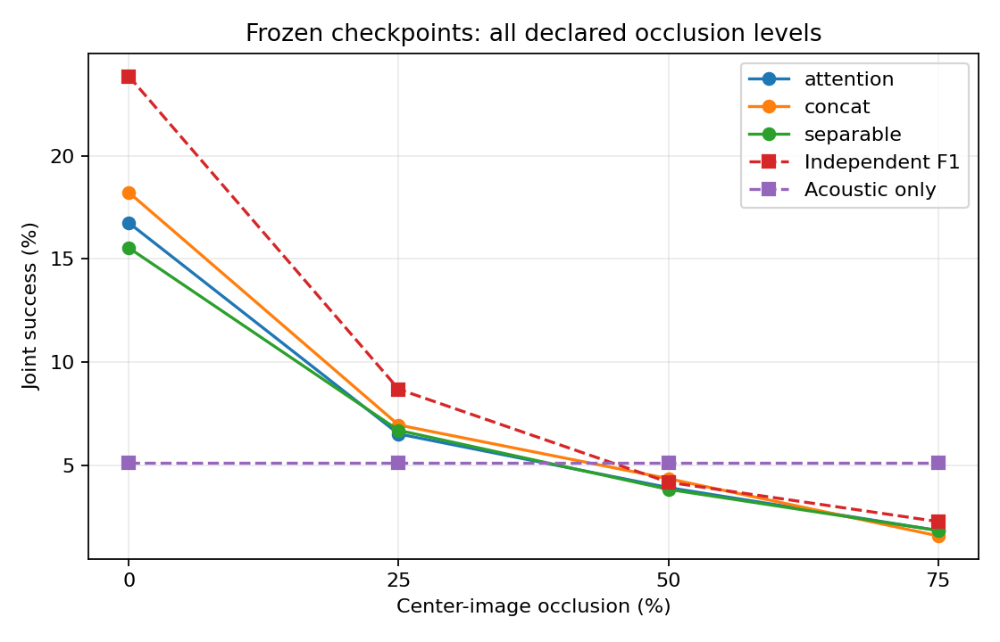

# Nine matched foundation fits: no interaction advantage established

2026-11-09. All nine scheduled fits completed; resumed batch exited0. Aggregation verifies identical initial tensors per seed across all three modes,2,834,908 parameters per model,1,000 updates per fit and all expected final artifacts. The earlier first-fit device-assertion failure and original log are preserved. Evidence remains Exploratory on the reused16 Train/6 Val cohort,64 queries per scene, three seeds. No Test observations were used.

## Observation

| Method | Joint % | Fine≤.1m % | Raw20 % | Diverse20 % | nearest-grid NLL |
|---|---:|---:|---:|---:|---:|
| Preserved initial independent F1 |23.872|2.170|61.892|84.375|9.58039|
| Attention |16.753|.694|49.826|76.649|9.21889|
| Concat |18.229|1.302|49.913|76.563|9.23024|
| Separable |15.538|.955|48.438|75.955|9.20139|

Attention−concat Joint: −1.476pp, paired six-scene95% bootstrap CI[−3.212,.781]. Attention−separable: +1.215pp CI[−.868,3.559]. Neither establishes attention superiority. Against the independent starting scorer, attention drops7.118pp CI[−10.590,−3.646], concat drops5.642pp CI[−8.507,−2.865], separable drops8.333pp CI[−9.896,−6.771]. Fine and both candidate coverages also regress. Initial checkpoint hashes exactly match the independent control's visual/acoustic sources; query sets align exactly.

Attention NLL improves by.36150nats CI[−.38641,−.33697] despite the Joint decline. All three models show this objective/decision discrepancy. This is an observed mismatch between nearest-grid probability fit and MAP success, not proof that NLL caused the degradation. The visual/FP anchor and other loss terms, model updates, scale changes and optimization may contribute.

Audio replacement reduces normal Joint from16.753→3.819% for attention,18.229→5.035% for concat,15.538→4.774% for separable. Attention normal−replacement is+12.934pp CI[9.809,16.146]. This demonstrates dependence on query-aligned audio and a beneficial normal-vs-replacement comparison within this cohort; it does not prove the claimed geometry-mediated interaction mechanism or superiority over the strong independent baseline. Brightness .2 gives16.059/18.316/15.017%; it remains an insufficient visual degradation test for these foundation features. The predeclared25/50/75% occlusion evaluation is complete; see below.

## Controls, alternatives and decision

All models share visual/acoustic/dual-FP initial tensors and sampling, optimizer, step budget and losses described in the README. Their final weights differ. Matching nominal parameters and updates does not equate FLOPs or effective optimization difficulty. The original assertion interruption did not change training loss or data: attention42 uses source6285d4b; remaining fits use18c0e3b. Checkpoint-level execution sources are retained in experiment_registry.csv.

**Decision:** reject a positive interaction-advantage claim for this configuration. Retain the strong independent baseline as the performance reference. The representation change did not remove the scratch study's lack of attention advantage. Do not launch a more complex attention variant merely because it is more expressive.

**Competing explanations:** the dense objective can improve probability calibration/nearest-cell fit while disturbing MAP; the learned corrections may overfit the16 training scenes; joint updates of previously useful branches may hurt more than the interaction helps. These are unverified explanations. A matched frozen/partial/joint continuation of the final architecture, with the same initialization/order and no additional epoch selection, can distinguish branch drift from head-only fitting. Larger independent scene validation and raw audio representation controls remain required. No full-scale or publication-ready conclusion follows from six reused development scenes.

The independently trained OOF backend in [study23](../2026-11-09-oof-discrimination/completed_results.md) does not repair this result by attribution: it uses independent-F1 candidates, not these interaction fields. Its own geometry contribution was negative relative to score-statistics control.

## Completed predeclared occlusion curve

All nine frozen checkpoints were evaluated at0/25/50/75% center-image black-strip occlusion, applied to RGB before the upstream foundation encoder. No severity selection, retraining or calibration refit. Evaluation exited0,13,824 model/seed/query/condition cases. All3,456 normal cases replay Joint/R@1m/Fine/raw20/NLL within the declared tolerance with zero mismatches. Per-model cache scoring is not end-to-end inference latency.

| Occlusion % | Attention Joint % | Concat % | Separable % | Independent F1 % | Acoustic only % |
|---|---:|---:|---:|---:|---:|
|0|16.753|18.229|15.538|23.872|5.122|
|25|6.510|6.944|6.684|8.681|5.122|
|50|3.906|4.340|3.819|4.167|5.122|
|75|1.823|1.563|1.823|2.257|5.122|

At75%, attention−acoustic is−3.299pp95% scene CI[−4.688,−1.910]. Attention−F1 is−.434pp CI[−1.042,.087]; attention−concat+.260pp CI[−.434,.955]; attention−separable0pp CI[−.694,.694]. Across all declared levels the attention-versus-matched-control Joint intervals include zero. This does not establish a robustness advantage. All three models have Fine0% at75%; attention raw20 falls49.826→10.417%, diverse20 76.649→21.094%, NLL9.219→12.251. Severe visual failure degrades both retrieval and final decision, so a backend cannot recover most missing-candidate queries.

Raw5/10, stricter thresholds, continuous error means, normalized entropy and reliability/selective-risk summaries are in occlusion_summary.json and occlusion_reliability.json. Cached timing records and full per-query rows remain external and hashed. Confidence uses MAP-centered posterior neighborhood mass, never GT-centered inference features. No calibration or independent probabilistic guarantee is asserted.

Evaluation as launched from source `180b1c56e01b9bbdcd8887bf02c934c6ce26ef58`: `python -m track_b.scripts.evaluate_foundation_occlusion --run /results/foundation_matched_v1 --cache /structure/cache --foundation /foundation --out /results/foundation_occlusion_v1`. Paired comparisons/figure source `61c0120980c81fa763ba2e78360b5374d628219c`: `python -m track_b.scripts.summarize_foundation_occlusion --run /results/foundation_occlusion_v1 --foundation /foundation --out /results/foundation_occlusion_registered_v1`. Both exit0. Figure visually inspected; all severities retained. Bootstrap intervals can differ slightly from the normal-only report because deterministic draw order differs; primary effects and replayed per-query values are unchanged.

## Reproduction, provenance and limitations

Original full training source `6285d4b89e127f5b71479c49071dcc96a2ff908c`; verified resume `18c0e3bf4297b9e0176ac3008710de06ec604da9`. External root `/home/jeongeonlee/track1/experiments/track_b_interaction_20261109`, runfoundation_matched_v1. Raw weights/logs/predictions remain outside Git; source_hashes.json pins run artifacts. Initial-tensor equality is in initialization_validation.json; all per-seed conditions and uncertainty are in per_seed_summary.json and paired_scene_bootstrap.json. Registry reports fit timings/peak allocated VRAM and initialization hashes; frozen upstream pretraining and common precursor fits are excluded from per-fit times, not free.

Executed aggregation: `python -m track_b.scripts.summarize_interaction --run /results/foundation_matched_v1 --out /results/foundation_registered_v1 --code-sha 6285d4b89e127f5b71479c49071dcc96a2ff908c --expected-parameters 2834908`. Aggregation source as launched `180b1c56e01b9bbdcd8887bf02c934c6ce26ef58` (training identities taken from each fit). Initial/control comparison source `3da5a7a90b6107f8256fcec400c86d025c3d23cf`: `python -m track_b.scripts.compare_foundation_to_initial --run <foundation_matched_v1> --reference <independent_fusion_anchor_v1> --out <fresh-output>`. Both exited0. No archive/export rewrite was used.

37 current tests pass; prior real-query GT-removal/file-I/O and initial-field replay audits remain scoped as described in the README. Other robustness conditions, final-architecture regime controls, same-bank grid/cost comparisons, physical-shift compatibility, broader scaling and independent evaluation are still incomplete. This completion record ends the nine-fit experiment, not the research goal.
