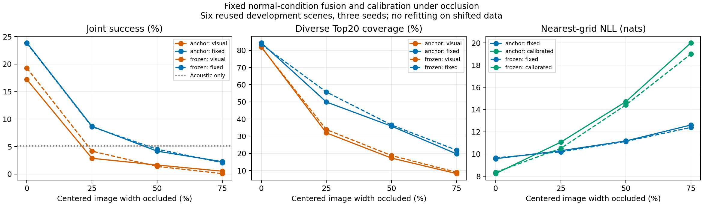

# Strong independent visual/acoustic fusion and RGB degradation

Date: 2026-11-09. Primary Track B. Status: completed, mixed evidence (fusion gain; brightness did not impair visual accuracy). Evidence: Exploratory, reused development scenes. This is the independent F1 baseline, not the proposed joint interaction model. No Test observations, historical Track A heads, B2 proposals or candidate RIR references are used.

## Hypotheses and competing explanations

Does query acoustic evidence add information once the visual branch is strengthened? A competing explanation is that previous fusion gains only repair a weak visual baseline. Compare independently trained visual/acoustic score fields, standardized fixed .85/.15 fusion, other-five-development-scene NLL calibration, and within-scene cyclic audio replacement. Keep both visual alternatives (frozen structural pretrain and constrained trainable FP) rather than selecting the best after seeing fusion results. Then darken actual RGB intensities by .2 before the fixed foundation encoder; preserve checkpoints, acoustic observations, grid and normal-condition calibration. Synthetic brightness is not a physical night/material/furniture shift.

## Dataset / Evaluation Protocol

The 16 Train/6 Val scene cohort and 64 queries per scene are inherited from the [foundation study](../2026-11-09-foundation-visual/README.md). Evaluation uses 384 queries × three seeds, candidate bank .25 m × 36 yaw bins, exact full-bank scoring. Six scenes are the bootstrap unit; seeds and queries are not independent scenes. The same 384 observations have been reused for method development; upstream training exposure is not independently excluded. Other-five-scene calibration holdout does not create full-pipeline independence.

Each modality uses its own independently trained FP representation and score scale; no interaction is introduced by F1. Acoustic source: `track_b_structure_20261109/supervised_v1/acoustic_{42,43,44}.pt`. Visual sources: foundation `matched_frozen_v1` and `learned_fp_w1000_anchor1000_v1`. Checkpoint hashes are in each run protocol. Both visual alternatives use frozen upstream DINOv2 features from the separately identified DepthAnything checkpoint; no HSSD-trained UnLoc head is loaded. Visual adapter/FP training histories differ between these alternatives, so this comparison does not isolate parameter capacity or pretraining exposure.

Calibration candidates: visual weights [0,.15,.5,.85,1], temperatures [.25,1,4], chosen by nearest-grid NLL on the other five scenes pooled over seeds. Every normal fold selected .85/.25, hence rankings equal fixed .85/.15 fusion. Lower NLL alone does not establish calibrated reliability or ECE quality.

## Normal-condition observations

| Visual training | Visual Joint % | Fixed fusion Joint % | Fine % (V→fusion) | Raw Top20 % (V→fusion) | Diverse Top20 % (V→fusion) | Audio-shuffled fusion Joint % |
|---|---:|---:|---|---|---|---:|
| Constrained trainable FP | 17.188 | 23.872 | .955→2.170 | 64.583→61.892 | 82.031→84.375 | 10.243 |
| Frozen adapter/FP | 19.271 | 23.785 | 1.042→2.170 | 66.840→59.462 | 81.858→83.507 | 8.941 |

Acoustic-only Joint is 5.122% in both comparisons. Fixed fusion minus visual Joint: constrained +6.684 pp [95% scene CI 4.427,8.681], frozen +4.514 pp [1.910,7.465]. Constrained fixed fusion versus audio-shuffled fusion: +13.628 pp [10.851,16.406]. Frozen: +14.844 pp [12.674,16.840]. Aligned audio contributes beyond the stronger visual baseline under this protocol. Shuffle is an input mismatch intervention; it does not identify which acoustic physical mechanism is used.

Counterevidence: raw Top20 coverage decreases in both variants even while Top1 and diverse coverage increase. Fine accuracy stays low. No universal retrieval or precision improvement is established. NLL fixed→calibrated: constrained 9.580→8.241, frozen 9.654→8.362, with unchanged Joint; temperature scaling preserves ranking. Both jobs exited 0 and replayed all 2,304 unimodal query-seed metrics against their archived results.

## Brightness intervention and execution failures

The feature extractor multiplies decoded RGB/BGR intensities by .2 before upstream image normalization and embedding extraction. It does not multiply cached features. All source image hashes are checked, only six Val scenes are read, and acoustic input remains unchanged. Normal-condition calibration is loaded unchanged for shifted evaluation; shifted labels cannot choose the deployed fusion parameters.

The first extraction launch failed at Python parsing before reading inputs (source `1abb0520b7d1eea68a41c2cc4fc1d77ed160c7e3`), retained as `features_lowlight_v1.log`. The second failed at package import because the source argument omitted the nested checkout directory, retained as `features_lowlight_v2.log` and its empty output directory. The corrected third launch uses `/work/external/checkouts/UnLoc/depth_anything_v2`, completes six scenes/384 images, and retains a distinct `features_lowlight_v3` cache. The first summary-script compilation also failed due an unmatched parenthesis; corrected before aggregation, without modifying evaluations. These failures are not scientific negative arms and are not discarded.

## Reproduction and provenance

External output root: `/home/jeongeonlee/track1/experiments/track_b_foundation_20261109`. Code/Docs repository branch: `refactor/hssd-two-branch-fusion`. Docker `avfploc:cu124-clean`, RTX4090, no network, non-root UID, source/data mounts read-only. Large features, weights, raw sweeps and query predictions remain external; only summaries/protocols/hashes are versioned.

Normal evaluation source: `5aecaaa240b3a5bf4a0b0f3245e1dfdd19dc7303`. Brightness evaluator runtime source: `1b20f6b4daac0d0019300c3380e224db41cdef36`. Feature builder source: `ca4b68d908ce133cd6ac0fc3406bd1380fa38ea8` (runtime HEAD `1b20f6b4daac0d0019300c3380e224db41cdef36`). Exact upstream weights and source hashes are copied in the brightness protocol. The 29 Track B tests pass; the more relevant evaluation checks are hash alignment, unimodal metric replay and unchanged calibration selection.

Commands inside the mounted container:

```bash
python -m track_b.scripts.independent_fusion --cache /structure/cache --run /structure/supervised_v1 --visual-run /results/learned_fp_w1000_anchor1000_v1 --visual-cache /results/features_v1 --out /results/independent_fusion_anchor_v1
python -m track_b.scripts.cache_foundation_visual --root /data --cache /cache --source /work/external/checkouts/UnLoc/depth_anything_v2 --checkpoint /data/UnLoc/pretrained/depth_anything_v2_metric_hypersim_vitl.pth --out /results/features_lowlight_v3 --split val --brightness .2
python -m track_b.scripts.independent_fusion --cache /structure/cache --run /structure/supervised_v1 --visual-run /results/learned_fp_w1000_anchor1000_v1 --visual-cache /results/features_v1 --eval-visual-cache /results/features_lowlight_v3 --selection-reference /results/independent_fusion_anchor_v1 --out /results/independent_fusion_anchor_lowlight_v1
```

For the frozen comparison replace the visual run with `matched_frozen_v1` and `anchor` output/reference names with `frozen`. Output directories must be new. New training/ablation is not required to regenerate this report from saved results. This establishes a stronger F1 baseline for subsequent matched interaction comparisons; it does not satisfy H-B2 or complete the full Track B protocol.


## Completed brightness result and interpretation

All four evaluation batches exited 0; the two shifted batches each replayed all 1,152 acoustic-only cases. Normal and shifted selection files are exactly equal. Brightness feature extraction completed six scenes/384 queries; preprocessing inspection confirms fixed ImageNet normalization after division by255, with no per-image brightness renormalization.

| Visual training | Darkened visual Joint % | Darkened fusion Joint % | Fusion Fine % | Fusion raw Top20 % | Fusion diverse Top20 % |
|---|---:|---:|---:|---:|---:|
| Constrained FP | 18.056 | 24.566 | 1.997 | 61.979 | 84.115 |
| Frozen adapter/FP | 19.618 | 24.479 | 1.997 | 60.851 | 82.205 |

Darkened fusion minus darkened visual: constrained +6.510 pp [4.167,8.507], frozen +4.861 pp [2.431,6.771]. Darkened minus normal fusion: constrained +0.694 pp [0.174,1.302], frozen +0.694 pp [-0.347,1.649]. These small scene-bootstrap changes do not establish a general benefit from darkening images. Visual-only performance did not decrease under this intervention (constrained +0.868 pp, frozen +0.347 pp), so this is **not evidence of rescuing a failing visual branch**. Foundation features are resilient to this synthetic global intensity change on these observations, unlike the earlier scratch baseline. The comparison is not capacity/exposure matched across foundation and scratch.

Fine fusion accuracy decreases from 2.170% to 1.997% in both variants. Diverse coverage also decreases slightly; raw coverage and Joint move differently. This negative detail is preserved in `paired_brightness.json` and full summary. All results remain Exploratory. No claim of robustness to physical lighting noise, occlusion, furniture/material changes or unseen datasets is supported.

Aggregator source: `54c0cc3ed99d662418927db68dc03dcc7639c114`; command `python -m track_b.scripts.summarize_foundation_fusion --root <external-root> --out <new-output> --normal-code 5aecaaa240b3a5bf4a0b0f3245e1dfdd19dc7303 --shift-code 1b20f6b4daac0d0019300c3380e224db41cdef36`. External hashes identify retained raw sweeps and predictions. Full-pipeline inference cost is not measured by these evaluation scripts; no cost superiority claim is made.

Next requirement: capacity-matched actual interaction/concat/separable models initialized from this stronger representation, plus a predeclared genuinely degrading visual intervention. The present normal/brightness F1 result must remain a comparator, not be replaced with the earlier weak baseline. Full Track B goal remains ongoing.


## Predeclared occlusion curve follow-up (pending)

Before evaluating any occluded images, fix three severities: full-height centered black strip of 25%, 50%, 75% image width. Width is round(image_width×fraction); start is floor((image_width−strip_width)/2). Preserve original image dimensions, camera calibration, RGB outside the strip and the entire RIR input. No per-condition model fit or calibration. Re-extract upstream features from the modified RGB for all 384 Val queries. Run both constrained-FP and frozen visual baselines with unchanged normal-condition fusion weights/temperatures, report every severity and all primary metrics, and bootstrap scenes. This synthetic missing-visibility intervention is distinct from physical illumination or furniture shift. The strip changes the image while leaving FP target geometry intact; do not infer robustness to physical object appearance from a black-mask result.

Motivation: brightness0.2 did not cause visual failure, so it cannot by itself validate the proposed interaction benefit under impaired vision. This curve tests the missing-visibility boundary; severity must not be chosen retrospectively to favor attention. Train data and the ongoing matched interaction fits remain unchanged. Feature extraction source SHA `94ef80eda7a36f0b6cdd7a139cfca0006e774b4a`. Results are pending; all three caches and any failed launch logs will be retained outside Git.

Occlusion extraction batch completed with exit0: all three levels each have six scenes/384 query features (1,152 total). Feature manifests and protocols are archived. Six baseline evaluation jobs (levels25/50/75 × anchored/frozen visual), unchanged normal calibration, launched sequentially in observation session11021; results remain pending. Runtime SHA `105ae0f95a393a0c9cd22f79784e1bb65759e57e`. Reproduction uses the normal F1 evaluator with `--eval-visual-cache /results/features_occlusion25_v1 --selection-reference /results/independent_fusion_anchor_v1` and a distinct `independent_fusion_anchor_occlusion25_v1` output; repeat all declared levels/variants. `summarize_occlusion_curve` refuses to aggregate before every planned result exists.


## Complete predeclared occlusion curve (supersedes pending status)

All six batches completed, combined launcher exit0. Both visual variants and all three severities are reported; none selected based on outcome. Each batch reproduced the unchanged acoustic-only metrics in1,152 query-seed cases, total6,912 checks. Normal calibration selections remain byte-equivalent in parsed content. Source dependencies consumed by the evaluation match launcher source `105ae0f95a393a0c9cd22f79784e1bb65759e57e`; later checkout HEADs changed during unrelated additions and are not individually recorded. Aggregation source `b5ff944ff758d4552ca347a3f647122c39f64d93`.

| Occlusion width | Anchored V Joint % | Anchored fusion Joint % | Frozen V Joint % | Frozen fusion Joint % | Acoustic Joint % |
|---|---:|---:|---:|---:|---:|
| 0% | 17.188 | 23.872 | 19.271 | 23.785 | 5.122 |
| 25% | 2.865 | 8.681 | 4.167 | 8.594 | 5.122 |
| 50% | 1.649 | 4.167 | 1.389 | 4.514 | 5.122 |
| 75% | 0.521 | 2.257 | 0.087 | 2.083 | 5.122 |

Observation: aligned audio helps relative to visual-only at each severity, but fixed fusion falls below acoustic-only under severe occlusion. At75%, anchored fusion−acoustic = −2.865 pp [95% scene CI −4.080,−1.649]; frozen = −3.038 pp [−4.688,−1.215]. Thus an always-dominant visual weight can cause negative transfer when visibility is lost. This demonstrates a failure boundary for fixed fusion; it does not prove a learned attention/gate solves it. The currently running matched models were not retrained or selected based on this curve.

Coverage also collapses: anchored fusion diverse20 84.375→49.913→35.851→19.705%; raw20 61.892→31.858→20.486→12.153%. A discriminator cannot recover GT absent its selected set. At75% anchored fusion Fine is0.174%, frozen0%; do not frame the residual coarse success as precision.

Normal-trained temperature0.25 worsens shifted nearest-grid NLL despite unchanged rankings: at75%, anchored calibrated−fixed is +7.396 nats [5.894,8.943], frozen +6.607 [5.198,8.104]. This is evidence of failed NLL transfer under this synthetic shift, not a substitute for an ECE analysis. It rejects assuming that a sharper normal-development posterior remains trustworthy under missing visual content.

Interpretation: global dimming and removing central content probe different failure mechanisms. The former did not impair this foundation representation; the latter strongly impairs structural prediction. Black strips are synthetic out-of-distribution image content, not a physical occluder rendering; distinguish lost visual information from the black-mask appearance artifact. Generalization remains limited to six reused development scenes and this camera/representation. Next falsification: apply the exact curve to every matched model, then compare input-aware reliability mechanisms without selecting a favorable severity or injecting GT.



The figure shows three-seed, equal-scene means; paired scene uncertainty is in `occlusion_paired_scene_bootstrap.json` and `occlusion_negative_transfer.json`. The full observations and calibration files stay outside Git; hashes identify them. Reproduce aggregation with `python -m track_b.scripts.summarize_occlusion_curve --root <external-root> --out <new-output>`. Existing normal/brightness results are retained. Decision: retain strong F1 as a necessary baseline, reject any blanket robustness claim for fixed visual-dominant fusion or transferred normal temperature. Overall Track B remains unfinished; see the protocol coverage audit.
