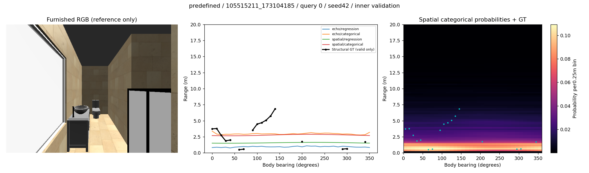
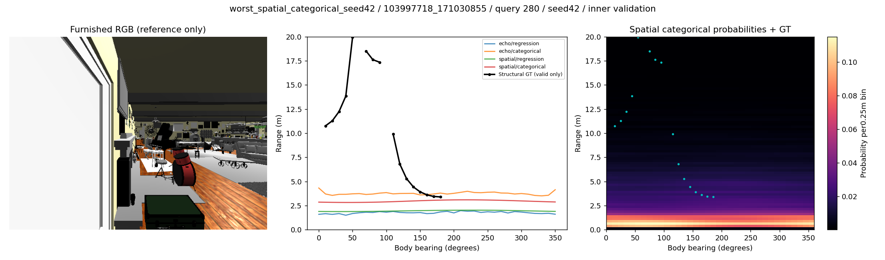

# Initial learned representation results — 18 fits

2026-11-10. **Mixed/negative result: position-dependent range evidence exists, but direction-specific structural shape is not demonstrated.** Overall research remains active. These are inner-validation development results, not independent Test or localization gains.

## Protocol and evidence

95 training scenes/94 source families,17 validation scenes/16 families,64 queries each; seeds42/43/44. All models trained1,500 Adam updates, scene-balanced batch16, lr1e-4, weight decay5e-4, final checkpoint only. 12 primary fits plus6 matched spatial phase-zero fits. Architectural-stage first-hit36-bearing targets, max20m, with invalid/out-of-scope directions masked. Train valid-direction coverage79.96%; errors are conditional on this mask. Existing19-scene development holdout has not been evaluated. Historical source-family/teacher exposure means no pristine claim.

Bootstrap:10,000 paired draws over16 source families, after averaging seeds within scene and variants within family. Intervals are exploratory, uncorrected for multiple comparisons. Seeds and64 observations do not multiply independent scene count.

## Primary results

| Encoder/head | MAE m,95% interval | Scene RMSE m | Across-query direction correlation | Donor−normal MAE m,95% interval |
|---|---:|---:|---:|---:|
| Echo/regression |1.479 [1.261,1.782]|2.202|.285|+.302 [.224,.395]|
| Echo/categorical |1.545 [1.349,1.816]|2.043|.344|+.240 [.189,.302]|
| Spatial/regression |1.492 [1.262,1.812]|2.201|.311|+.255 [.206,.308]|
| Spatial/categorical |1.703 [1.526,1.975]|2.147|.304|+.112 [.087,.137]|

RMSE is computed per scene and averaged by family, not pooled across every ray. Correlation above is computed across observations separately for each direction; it can be explained by scalar range changes and must not be confused with within-observation angular shape agreement.

Train-only directional median has MAE about1.682m on the same family weighting. Model−median MAE: Echo regression−.202m [−.291,−.135], Echo categorical−.137m [−.249,−.060], Spatial regression−.190m [−.260,−.131], Spatial categorical+.021m [−.088,+.108]. Full prior means, histogram NLL, individual seeds and all metrics are preserved in external outputs and [primary summary](representation_summary.json). The categorical mean is used for MAE; that is not a Bayes-optimal absolute-error estimator for an asymmetric distribution, so mean-MAE alone is not a proper distribution-quality comparison.

## Probabilistic outputs

| Encoder | Categorical NLL | CRPS m |90% interval coverage|90% interval width m|
|---|---:|---:|---:|---:|
| Echo |3.241|1.079|.932|7.092|
| Spatial |3.234|1.118|.946|7.472|

NLL uses80 discrete0.25m bins, not continuous density NLL. The distributions permit multiple peaks, but wide intervals and almost direction-independent predictions do not establish useful directional ambiguity modeling. Coverage above90% is accompanied by very broad intervals. No calibration parameters were selected on validation.

## Counterevidence: spatial shape versus scalar distance

The predefined qualitative example and largest Spatial categorical seed42 validation error show almost flat directional profiles. A post-training diagnostic therefore replaced each predicted36-vector by its own scalar mean (no GT needed) and rotated it180°. It did not change weights or touch the held-out evaluation set.

| Encoder/head | Within-query angular correlation | Prediction angular SD m |180° rotation−normal MAE m|
|---|---:|---:|---:|
| Echo/regression |.0068 [−.0140,.0265]|.1286|+.0013 [−.0038,.0057]|
| Echo/categorical |.0015 [−.0112,.0143]|.1371|+.0008 [−.0027,.0048]|
| Spatial/regression |.0028 [−.0147,.0195]|.0552|+.0006 [−.0013,.0023]|
| Spatial/categorical |.0078 [−.0126,.0290]|.0390|+.0007 [−.0006,.0019]|

Scalarization changes MAE by−.0039,−.0024,−.0005,+.0001m respectively; it does not remove a meaningful demonstrated directional gain. **Observation:** different-position audio changes predictions, while rotating their directional arrangement barely matters. **Interpretation:** the models can exploit position-dependent range scale; they have not recovered the desired angular layout. **Causal scope:** donor substitution establishes input dependence under this intervention, not identification of early reflections, physical walls, or furniture invariance. Geometry unidentifiability is one possibility; weak optimization, representation bottlenecks and finite training remain competing explanations. This is not proof that six-channel RIR cannot encode directions.

## Phase ablation and architecture limits

With the same Spatial model, seeds, update count and inputs but12 phase channels zeroed during training and evaluation, regression MAE is1.540m and categorical1.741m; donor penalties are+.183m and+.082m. These descriptive values are consistent with some phase contribution to range prediction; a paired main−ablation contrast is still needed before quantifying that effect. They do not repair the missing directional evidence.

Echo regression/categorical have501,089/503,696 parameters; Spatial101,345/111,536. Within each encoder, head variants share exactly identical encoder initialization and the same training draws/update count. The two encoder architectures are **not** capacity-matched and have different spectral/time frontends: Echo first60ms, Spatial first341ms with ordered frequency/time tokens. A superiority claim attributable solely to spatial architecture is therefore not supported. The regression loss is masked log1p absolute error; categorical loss is interpolated soft-label cross entropy.

12 primary training loops used50.73s total on the installed4090 environment, excluding cache construction, evaluation, input loading and earlier source work. Per-fit time, parameter count, memory, checkpoint hash and warmed batch1 encoder/head latency are in the registry. Latency excludes STFT and localization and is measured on a shared GPU, so it is not end-to-end deployment latency.

## Visuals and failures

The first validation scene/query is fixed before model results. The failure is selected post hoc as maximum masked MAE of Spatial categorical seed42, explicitly a failure analysis selection.

Training input preparation verifies every7,168 RIR waveform hash, sidecar, source-centre equality and body alignment. The initial split failed family-separation assertion; the first GT version retained external architectural structures beyond windows; GPU smoke initially failed a CPU/CUDA metric operation. All failed outputs remain external, with corrected targets and smoke documented in the preflight. These are not silently erased experiments. No fit diverged in the completed18-condition suite.

## Next discriminating work and completion limits

1. Compare the phase ablation with paired family intervals; diagnose whether longer training or explicitly preserving mic/time geometry can fit directional targets on training scenes before claiming generalization.
2. Execute unchanged-Track-B scoring transfer: existing acoustic baseline and capacity/budget controls, geometry encoder frozen/fine-tuned, and joint auxiliary learning. Pretraining benefits and localization gains remain unknown.
3. Validate or generate actual same-pose native furnished/stage-only6-channel pairs. Existing native→extrusion FP pairs alter geometry beyond furniture and cannot establish furniture robustness.
4. Freeze methods before evaluating the19-scene development holdout; separately audit genuinely independent official-Test coverage. Do not substitute historical Test data for pristine validation.

This report records a completed initial representation experiment. It does not terminate the approved research objective. All numerical values are observations under this development protocol, and no furniture-invariance, independent-generalization or localization-improvement conclusion is warranted.
