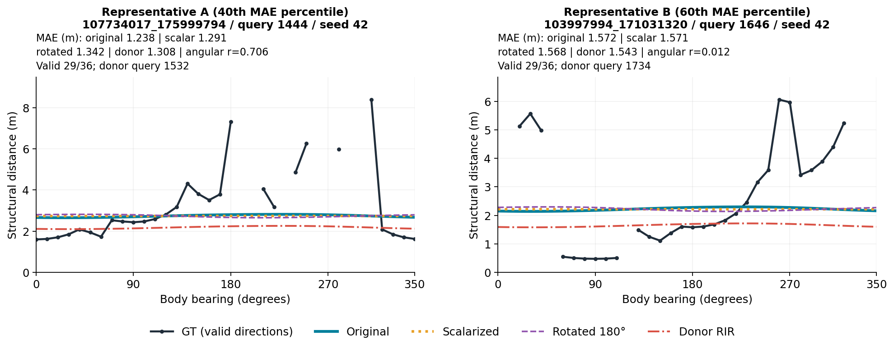
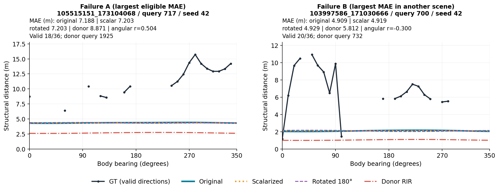
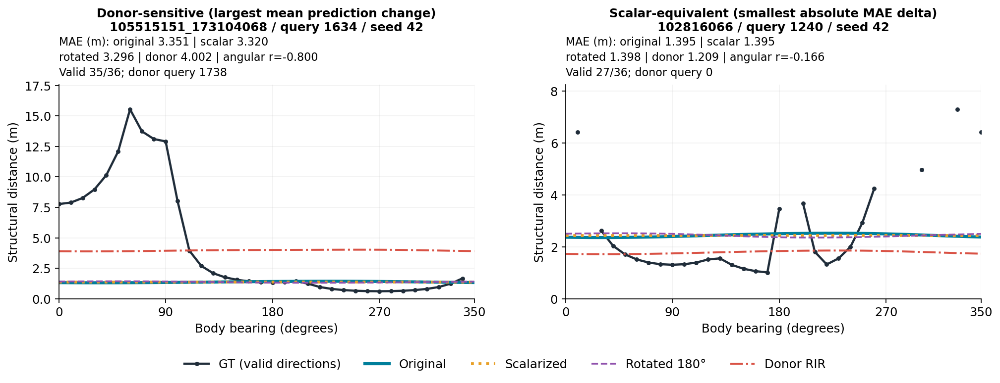
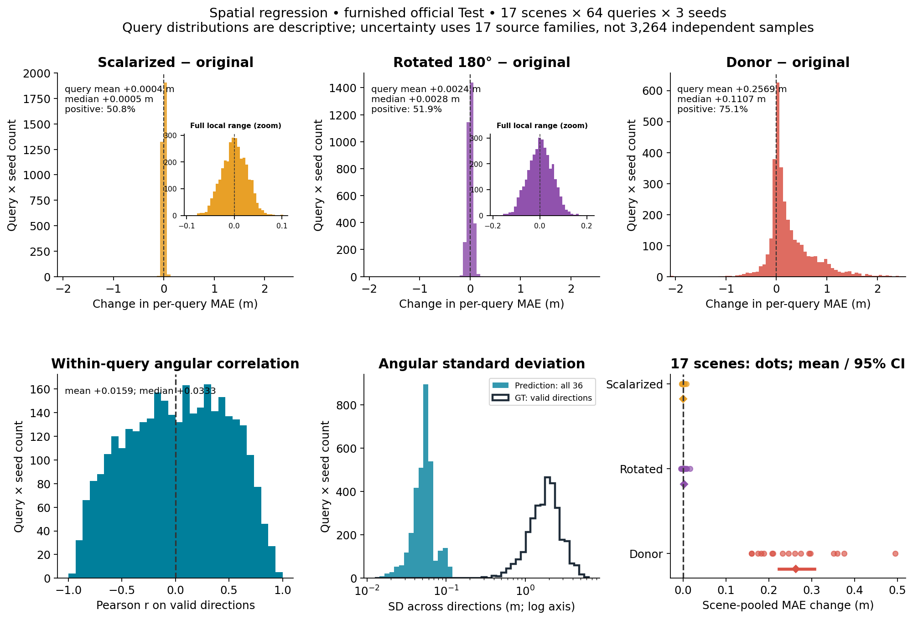
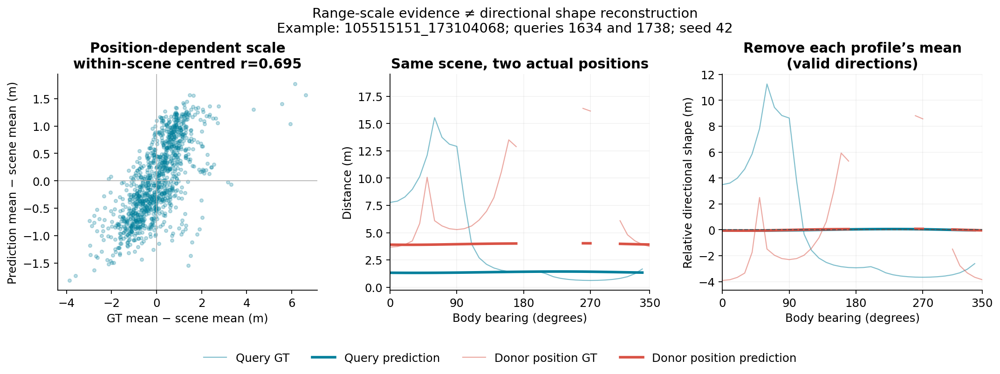
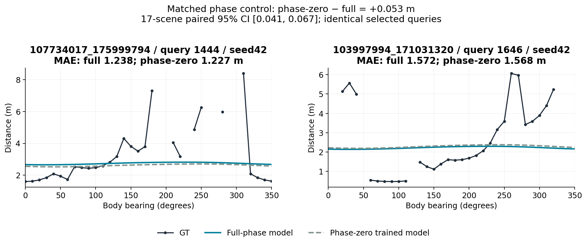

# Track C — Study 31 Visualization Audit

### 1. Purpose

**예측의 거리 수준은 RIR에 따라 달라지지만, 36방향의 굴곡은 거의 복원되지 않는다.** Study 31의 이 음성 결과를 저장된 예측으로 직접 확인한다. 경쟁 설명은 “장면 평균만 학습”, “위치에 따른 거리 수준 학습”, “방향별 구조 복원”이다. 본 문서는 사용자가 지정한 Track C의 사후 해석이며, 원 연구는 Track B에 유지한다. 신규 학습·추론·튜닝은 수행하지 않았다.

### 2. Data / outputs used

- **주 그림:** furnished 공식 Test 17장면 × 64질의 × seed 42/43/44의 Spatial regression, 총 3,264 query–seed 기록(고유 질의 1,088개). 비교표는 Echo/Spatial × regression/categorical 전체를 포함한다. Categorical은 저장된 예측 평균을 사용하므로 분포 전체의 방향 정보에 대한 검정은 아니다.
- **원자료:** 로컬 `/home/jeongeonlee/track1/experiments/acoustic_geometry_20261110/` 아래 `official_evaluation_v1/furnished/representation_v1/{model}_{seed}/{scene}__{normal,same_scene_different_position}.npz`; `mean`, `target`, `mask`, `donor` 사용. Phase 대조는 같은 평가 루트의 `phase_zero_v1/spatial_regression_{seed}/{scene}__normal.npz`. 질의 ID·위치는 `official_targets_v1/{scene}_queries.json`, 장면 목록은 `method_freeze_v1.json`에서 읽었다. 필요한 배열은 모두 존재했다.
- **검산:** 204개 normal/donor 파일 쌍에서 GT·mask·donor index 일치, donor 위치 차이 >0.5m 확인. 저장된 donor 예측과 해당 donor의 normal 예측은 최대 차이 **0m**. 4모델 × 3종 contrast 및 phase contrast의 재계산이 기존 집계와 0.000002m 이내로 일치했다.
- **기존 문서:** 기준 Docs SHA `d52936cab06e96476ad4ead6ce79145c3b417e52`의 [official_results.md](../../track-b/experiments/2026-11-10-acoustic-geometry/official_results.md), [conclusion.md](../../track-b/experiments/2026-11-10-acoustic-geometry/conclusion.md), [results.md](../../track-b/experiments/2026-11-10-acoustic-geometry/results.md), representation/official summary, directional diagnostic, official contrasts를 확인했다. `results.md`는 초기 진행상태를 담은 역사적 기록이므로 최종 상태는 앞의 두 문서를 따른다. 기존 [predefined.png](../../track-b/experiments/2026-11-10-acoustic-geometry/predefined.png)와 [failure.png](../../track-b/experiments/2026-11-10-acoustic-geometry/failure.png)는 inner-validation 그림이며 이번 공식 Test 그림과 섞지 않았다.

**정의:** GT는 유효한 방향의 structural wall distance이며 visible depth나 acoustic path length가 아니다. 모든 MAE와 angular Pearson r은 원래 query의 동일한 mask에서 계산한다(유효 방향 4–36개). Scalarization은 예측 36개 전체의 평균을 반복하고, rotation은 예측만 18칸 순환 이동한다. GT의 빈 구간은 미확인 방향이며 보간하지 않았다. Donor는 같은 장면의 다른 위치 RIR에 대한 저장된 예측을 원래 query의 GT와 비교한다.

### 3. Key visual evidence

**A — 중간 오차 사례에서도 GT 굴곡과 예측 진폭이 다르다.**



두 사례는 seed 42, 유효 방향 ≥18인 질의 중 MAE 40/60백분위에 가장 가까운 서로 다른 장면에서 선택했다. “대표”는 중간 오차를 뜻하며 무작위 표본은 아니다. 왼쪽은 r=0.706으로 높아도 예측 진폭이 매우 작다. 상관계수 하나만으로 거리 형상 복원을 판단할 수 없다. 오른쪽은 donor가 오히려 MAE를 조금 줄이는 반례다.



동일한 유효방향 조건에서 최대 MAE 및 다른 장면의 최대 MAE를 선택했다. 장거리 벽과 급격한 방향 변화가 평평한 예측에 흡수된다. 실패 A는 18/36방향만 유효하므로 미확인 반원의 성능까지 추론하지 않는다. 패널마다 세로축 범위가 다르다.



왼쪽은 donor 교체에 따른 36방향 평균 절대 예측 변화가 최대인 사례(**2.593m**): 곡선의 높이가 바뀌지만 형상은 거의 평평하다. 오른쪽은 중앙 MAE ±0.3m, GT 방향 SD >1m 조건에서 scalar MAE 차이가 최소인 사례(**+0.000145m**). 이 두 사례는 의도적인 결과 기반 선택이며 효과 크기의 대표 추정치가 아니다. 여섯 사례는 중복 질의 없이 선택했다.

**B — 전체 분포에서도 방향 변형의 영향은 작고 donor 영향은 크다.**



위 세 패널은 동일한 전체 x축 범위이며 inset은 작은 차이를 확대한다. Donor는 **75.1%**의 query–seed에서 MAE를 높이고, 17장면 각각의 집계 차이도 양수다. 모든 질의에서 악화되는 것은 아니다. Angular r은 양·음으로 넓게 분포한다. **평균 0.0159, 중앙값 0.0333이 0에 가깝다**는 뜻이지 개별 상관계수 모두가 0 부근에 밀집한다는 뜻은 아니다. 예측 방향 SD 중앙값은 **0.054m**, GT는 **1.836m**다(예측은 전체 36방향, GT는 유효 방향 기준).

Spatial regression의 원래 MAE는 1.567m. 장면 단위 차이와 기존 95% CI는 scalar **+0.00030m [−0.00083, +0.00156]**, rotation **+0.00224m [−0.00002, +0.00475]**, donor **+0.26314m [+0.22328, +0.30724]**다. 이는 정식 equivalence margin 검정을 했다는 뜻은 아니다.

| 모델 / head | Scalar − original (m) | Rotate − original (m) | Donor − original (m) | 평균 angular r |
|---|---:|---:|---:|---:|
| echo / regression | -0.0020 | +0.0065 | +0.3059 | 0.0134 |
| echo / categorical | -0.0022 | +0.0022 | +0.2390 | 0.0070 |
| spatial / regression | +0.0003 | +0.0022 | +0.2631 | 0.0159 |
| spatial / categorical | +0.0003 | +0.0010 | +0.1200 | 0.0244 |

표는 장면 내 유효 ray를 pooling한 뒤 seed/장면을 평균한다. 히스토그램은 질의를 동일 가중하므로 평균이 조금 다르다. CI는 기존 seed 평균 후 **17 source-family paired bootstrap 10,000회**, 다중비교 보정 없는 구간을 재사용했다. 3,264개 기록을 독립 표본으로 취급하지 않았다. Echo regression의 작은 rotation 효과처럼 약한 방향 신호 가능성도 보존한다.

**C — 거리 수준과 방향 형상을 분리해서 본다.**



왼쪽: seed 42의 모든 질의에서 GT/예측의 유효방향 평균을 구한 뒤 각각의 장면 평균을 뺐다. **r=0.695**인 기술적 상관은 단순한 장면 간 크기 차이를 제거해도 위치에 따른 거리 수준의 대응이 남음을 보여준다. 마스크 변화도 영향을 줄 수 있으며 정확한 평균 거리 회귀나 인과를 입증하는 지표는 아니다. 가운데: 실제 query/donor 위치의 GT와 각 위치의 normal 예측. 오른쪽: 각 곡선에서 자신의 유효방향 평균을 제거하자 GT 형상은 남지만 예측은 거의 0선이다. 각 프로파일은 자기 body bearing을 사용하며 월드 좌표 형상을 겹친 그림은 아니다.

**D — phase 대조에서도 방향 복원은 확립되지 않는다.**



동일한 대표 질의에 대한 separately-trained phase-zero 대조다. 전체 장면 집계에서는 full-phase가 **0.053m** 유리하다(phase-zero − full 95% CI **[0.041, 0.067]m**). 그러나 이 두 사례에서는 phase-zero가 오히려 조금 낫고, 양쪽 곡선 모두 평평하다. 집계상 이득과 개별 반례를 함께 보여준다. 동일 checkpoint의 inference-only phase 제거 실험으로 해석하지 않는다.

### 4. Interpretation

| 구분 | 직접 관찰 | 허용되는 해석 / 한계 |
|---|---|---|
| Input dependence | 같은 장면의 다른 위치 RIR로 예측과 MAE가 달라진다. | 모델이 유용한 입력 의존성을 학습했다는 증거. 이것만으로 방향 복원은 성립하지 않는다. |
| Range-scale sensitivity | 위치별 예측 높이가 바뀌며, 장면 평균 제거 후 GT 거리 수준과도 대응한다. | 위치 의존적인 coarse range-scale evidence를 지지한다. 정확한 공간 형상·좌표 추정은 아니다. |
| Directional-shape reconstruction | 작은 예측 SD, 양·음으로 상쇄되는 r, 매우 작은 scalar/rotation 집계 효과. | **테스트한 모델·설정에서 유용한 36-ray 방향 구조 복원은 확립되지 않았다.** |

거의 상수인 곡선은 평균으로 바꾸거나 회전해도 거의 변하지 않는다. 반면 donor 교체는 상수에 가까운 거리 수준 자체를 움직일 수 있다. 따라서 donor 악화와 scalar/rotation의 작은 영향은 모순되지 않는다. 높은 r의 사례도 존재하지만 진폭·절대오차·전체 대조를 함께 보면 지속적인 방향 복원의 근거는 부족하다.

실패 원인은 확정하지 않았다. 목표/마스크, 손실·최적화, architecture, 채널·방향 정렬, acoustic 식별 가능성 등이 경쟁 설명으로 남는다. **“RIR에 방향 정보가 없다”, furniture invariance, localization 개선을 주장하지 않는다.** Furnished 결과 중심의 이번 audit는 stage-only나 transfer를 재평가하지 않았다. 공식 Test의 과거 visual/upstream 노출 가능성과 이번 사후 사례 선택 때문에 증거 수준은 **Exploratory**다. 새 모델을 이 그림에 맞춰 선택하면 해당 Test는 개발 자료로 재사용된다는 점도 기록한다.

### 5. Bottom line

- **What can we directly see?** RIR 교체는 거리 수준을 움직이고 평균적으로 오차를 높인다. 예측의 방향 진폭은 GT보다 훨씬 작아 scalarization과 180° 회전이 전체 MAE를 거의 바꾸지 않는다.
- **What remains uncertain?** 방향 실패의 원인, 다른 설정에서 회복 가능한 정보, 확률분포 전체의 방향성 및 미확인 ray의 성능은 이 audit로 결론내릴 수 없다.
- **What does this imply for the next Track C experiment?** 새 개발 프로토콜에서 scalar baseline과 평균 제거한 directional residual을 분리해 평가하는 것을 권한다. 정렬 검증·rotation 대조·동일 예산 비교를 사전 고정하고, MAE뿐 아니라 방향 진폭과 형상 오차를 함께 성공 기준으로 삼는다. 본 audit에서 후속 학습은 실행하지 않았다.

<details>
<summary>재현·출처·검증 기록</summary>

분석/그림 코드: `55155a7ee03dc21cec0f5b112c4c171ad661db28`, [study31_visualization_audit.py](../../../../scripts/research/study31_visualization_audit.py). 기존 표현 학습 코드: `13f18b028b35d694c8e0adee4d138d46fecf9d00`; 저장 평가 코드: `6907b72`(원 연구 기록 참조). 학습 checkpoint를 이번 작업에서 로드하지 않았다. Python 3.10.12 / NumPy 1.21.5 / Matplotlib 3.5.1; CPU 배열 연산만 수행했다. 추가 분석 난수는 사용하지 않았다.

저장 배열·query metadata·freeze manifest와 참고 Docs의 SHA-256, 선택된 여섯 질의 수치, 4모델 집계는 [audit.json](audit.json)에 있다. 원자료는 외부 로컬 경로에 보존하며 Git에 업로드하지 않는다. 따라서 코드 clone만으로는 재현되지 않고 해당 해시의 입력이 필요하다. 실행 당시 plotting 코드에는 미커밋 수정이 없었으며 무관한 기존 작업 파일 두 개는 변경·사용하지 않았다.

저장소 루트에서 새 출력 경로로 실행한다(기존 폴더 덮어쓰기는 거부):

```bash
python3 scripts/research/study31_visualization_audit.py \
  --study /home/jeongeonlee/track1/experiments/acoustic_geometry_20261110 \
  --docs docs/research/track-b/experiments/2026-11-10-acoustic-geometry \
  --out /tmp/study31-visualization-reproduction \
  --code-sha 55155a7ee03dc21cec0f5b112c4c171ad661db28
```

검증: 배열 대응 및 13개 contrast 재계산 assertions 통과, 여섯 PNG 육안 확인, Markdown 링크 확인. 초기 코드의 syntax compile 실패는 `26a269f`에서 수정했고 데이터 분석 전이었다. 첫 성공 출력 `visualization_audit_v1`은 외부 원자료 루트에 보존했으며, 레이아웃/출처 기록을 개선한 `visualization_audit_v2`가 본 보고서의 최종 그림이다. 이는 추가 실험이나 결과 선택이 아니다.

</details>
